<p align="center">
  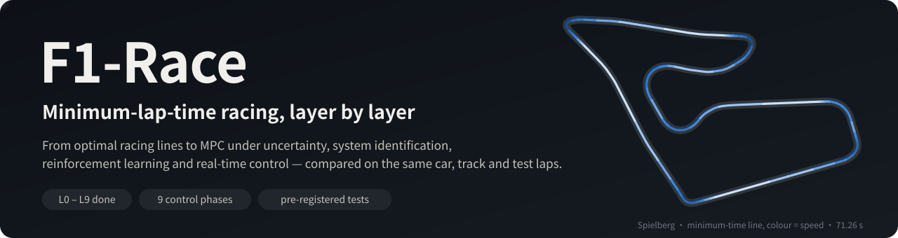
</p>

<p align="center">
  <b>English</b> · <a href="README.zh-CN.md">简体中文</a>
</p>

<p align="center">
  
  
  
  
  
  
  <br>
  
  
  
  
</p>

<p align="center">
  <a href="#-watch-a-lap">🎬 Watch a lap</a> ·
  <a href="#-results-at-a-glance">📊 Results</a> ·
  <a href="#%EF%B8%8F-explore-the-lap-yourself">🕹️ Explore</a> ·
  <a href="#-the-layers">🧱 Layers</a> ·
  <a href="#-control-expansion-phases-ai">🔬 Control expansion</a> ·
  <a href="#-quick-start">🚀 Quick start</a> ·
  <a href="#%EF%B8%8F-repository-layout">🗂️ Layout</a>
</p>

A self-contained study of how to drive a racing car around a track as fast as possible, built up in
**layers**. Each layer adds one source of difficulty – tyre dynamics, a car that differs from the model,
random disturbances, an unknown car, a structural model error, new tracks, a real-time budget – and
compares several solution methods on the same problem, the same car and the same test laps.

> **The guiding question of the whole series:** *in which settings does a learning-based controller beat
> a model-based one, and why?*

---

## 🎬 Watch a lap

<p align="center">
  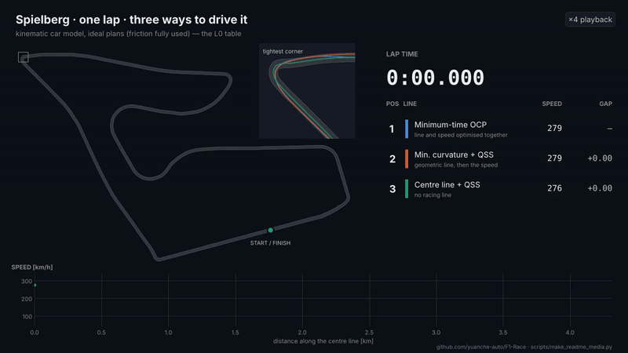
</p>

<p align="center"><sub>
  <b>Ghost race (L0).</b> The three ideal plans of the L0 table driven side by side on Spielberg, with a live
  timing tower, the tightest corner zoomed in and the speed traces below. The racing line alone is worth
  5.75 s; optimising line and speed together another 0.88 s.
  · 🎥 <a href="docs/media/ghost_race.mp4">MP4, 1280×720</a>
</sub></p>

<p align="center">
  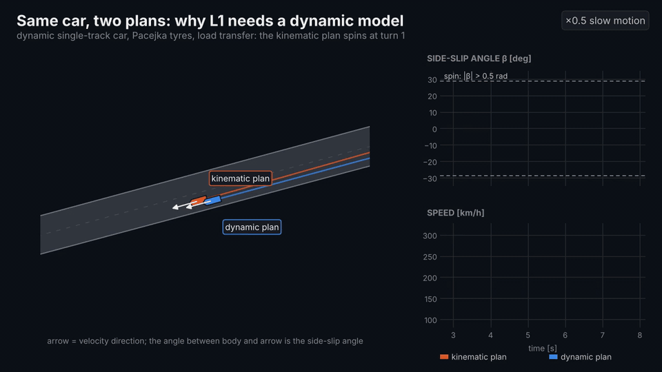
</p>

<p align="center"><sub>
  <b>Why the model matters (L1).</b> The same dynamic car – Pacejka tyres, load transfer – on two plans: the
  kinematic L0 plan (3 % margin) spins at turn 1 as its side-slip angle runs away, while the plan made on the
  dynamic model (5 % margin) completes the lap in 75.57 s. Slow motion, the camera follows the cars.
  · 🎥 <a href="docs/media/spin.mp4">MP4, 1280×720</a>
</sub></p>

<!--
  To get a playable video player here: edit this README on github.com and drag docs/media/ghost_race.mp4
  into the editor; GitHub uploads it and inserts a https://github.com/user-attachments/... link that renders
  as a video (the same for spin.mp4). The GIFs above play everywhere without that step.
-->

## 📊 Results at a glance

<table>
  <tr>
    <td align="center" width="33%">
      <h3>−6.63 s</h3>
      optimised line and speed against driving the centre line<br>
      <sub><b>L0</b> · 71.26 s vs 77.89 s, ideal plans</sub>
    </td>
    <td align="center" width="33%">
      <h3>🌀 spin</h3>
      what the kinematic optimum does on a car with tyre slip – at the first corner<br>
      <sub><b>L1</b> · the dynamic plan with a 5 % margin: 75.57 s</sub>
    </td>
    <td align="center" width="33%">
      <h3>30 / 30</h3>
      laps under random friction, gusts and sensor noise with stochastic MPC<br>
      <sub><b>L3</b> · NMPC with a uniform 5 % reserve: 5 / 30</sub>
    </td>
  </tr>
  <tr>
    <td align="center">
      <h3>25 / 25</h3>
      unknown cars completed after identifying them from one exploration lap<br>
      <sub><b>L4</b> · nominal model: 13 / 25</sub>
    </td>
    <td align="center">
      <h3>51 / 51</h3>
      cars completed by the RL policy selected on validation laps<br>
      <sub><b>L5</b> · nine single training runs: 19 – 50 / 51</sub>
    </td>
    <td align="center">
      <h3>0 → 79 / 105</h3>
      laps within a 50 ms budget on one core: IPOPT against acados real-time iterations<br>
      <sub><b>L9</b> · the same OCP, two implementations</sub>
    </td>
  </tr>
</table>

<picture>
  <source media="(prefers-color-scheme: dark)" srcset="docs/media/results_en_dark.svg">
  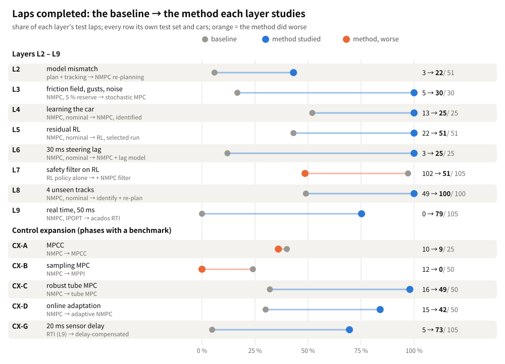
</picture>

<sub>Each row is its own test set (different cars, disturbances or tracks), so rows are not comparable with
each other. Orange marks a method that did worse than its baseline – negative results are reported as such
(L7, CX-A, CX-B). The numbers come from the tables below.</sub>

## 🕹️ Explore the lap yourself

These blocks are rendered by GitHub as **interactive** widgets – pan, zoom, rotate and click. (In viewers
that do not render them, open the files under [`docs/media/`](docs/media).)

### 🗺️ The minimum-time line on the real circuit

Drag and zoom the map; **click** a segment for its speed band, or a marker for the top speed and the
hardest braking, the slowest point, and the four corners where failed test laps leave the track. The line is the L0 minimum-time solution, georeferenced onto the Red Bull
Ring (fitted to the circuit outline with 1.8 m RMS); darker = faster.

<!-- BEGIN map.geojson -->
```geojson
{"type":"FeatureCollection","features":[
{"type":"Feature","properties":{"speed band":"> 270 km/h","stroke":"#0d366b","stroke-width":5,"stroke-opacity":0.95},"geometry":{"type":"LineString","coordinates":[[14.76669,47.22033],[14.76656,47.2203],[14.76644,47.22028],[14.76631,47.22025],[14.76618,47.22023],[14.76606,47.2202],[14.76593,47.22018],[14.7658,47.22016],[14.76567,47.22013],[14.76555,47.22011],[14.76542,47.22008],[14.76529,47.22006],[14.76516,47.22003],[14.76504,47.22001],[14.76491,47.21998],[14.76478,47.21996],[14.76466,47.21993],[14.76453,47.21991],[14.7644,47.21988],[14.76428,47.21986],[14.76415,47.21984],[14.76402,47.21981],[14.76389,47.21979],[14.76377,47.21976],[14.76364,47.21974],[14.76351,47.21971],[14.76338,47.21969],[14.76326,47.21966],[14.76313,47.21964],[14.763,47.21961],[14.76288,47.21959],[14.76275,47.21956],[14.76262,47.21954],[14.76249,47.21952],[14.76237,47.21949],[14.76224,47.21947]]}},
{"type":"Feature","properties":{"speed band":"220–270 km/h","stroke":"#184f95","stroke-width":5,"stroke-opacity":0.95},"geometry":{"type":"LineString","coordinates":[[14.76224,47.21947],[14.76211,47.21944],[14.76198,47.21942],[14.76186,47.2194]]}},
{"type":"Feature","properties":{"speed band":"170–220 km/h","stroke":"#256abf","stroke-width":5,"stroke-opacity":0.95},"geometry":{"type":"LineString","coordinates":[[14.76186,47.2194],[14.76173,47.21937],[14.7616,47.21935]]}},
{"type":"Feature","properties":{"speed band":"120–170 km/h","stroke":"#3987e5","stroke-width":5,"stroke-opacity":0.95},"geometry":{"type":"LineString","coordinates":[[14.7616,47.21935],[14.76147,47.21933],[14.76134,47.21931],[14.76121,47.2193]]}},
{"type":"Feature","properties":{"speed band":"< 120 km/h","stroke":"#86b6ef","stroke-width":5,"stroke-opacity":0.95},"geometry":{"type":"LineString","coordinates":[[14.76121,47.2193],[14.76108,47.2193],[14.76096,47.21933],[14.76084,47.21938],[14.76075,47.21944],[14.76067,47.21951]]}},
{"type":"Feature","properties":{"speed band":"120–170 km/h","stroke":"#3987e5","stroke-width":5,"stroke-opacity":0.95},"geometry":{"type":"LineString","coordinates":[[14.76067,47.21951],[14.7606,47.21959],[14.76054,47.21967],[14.76046,47.21974],[14.76039,47.21982]]}},
{"type":"Feature","properties":{"speed band":"170–220 km/h","stroke":"#256abf","stroke-width":5,"stroke-opacity":0.95},"geometry":{"type":"LineString","coordinates":[[14.76039,47.21982],[14.76032,47.21989],[14.76024,47.21997],[14.76017,47.22004],[14.7601,47.22012],[14.76003,47.22019],[14.75995,47.22027],[14.75988,47.22034]]}},
{"type":"Feature","properties":{"speed band":"220–270 km/h","stroke":"#184f95","stroke-width":5,"stroke-opacity":0.95},"geometry":{"type":"LineString","coordinates":[[14.75988,47.22034],[14.75981,47.22042],[14.75973,47.22049],[14.75966,47.22057],[14.75959,47.22064],[14.75951,47.22072],[14.75944,47.22079],[14.75937,47.22087],[14.7593,47.22094],[14.75922,47.22102],[14.75915,47.22109],[14.75908,47.22117],[14.759,47.22124],[14.75893,47.22132],[14.75886,47.22139],[14.75878,47.22146]]}},
{"type":"Feature","properties":{"speed band":"> 270 km/h","stroke":"#0d366b","stroke-width":5,"stroke-opacity":0.95},"geometry":{"type":"LineString","coordinates":[[14.75878,47.22146],[14.75871,47.22154],[14.75864,47.22162],[14.75858,47.2217],[14.75851,47.22178],[14.75845,47.22185],[14.75839,47.22193],[14.75832,47.22201],[14.75826,47.22209],[14.7582,47.22217],[14.75814,47.22225],[14.75808,47.22233],[14.75802,47.22241],[14.75796,47.22249],[14.7579,47.22257],[14.75784,47.22265],[14.75778,47.22273],[14.75772,47.22281],[14.75766,47.22289],[14.7576,47.22297],[14.75754,47.22305],[14.75748,47.22313],[14.75742,47.22321],[14.75736,47.22329],[14.7573,47.22337],[14.75724,47.22345],[14.75717,47.22353],[14.75711,47.22361],[14.75705,47.22369],[14.75699,47.22377],[14.75693,47.22385],[14.75687,47.22393],[14.75681,47.22401],[14.75674,47.22408],[14.75667,47.22416],[14.75659,47.22423],[14.75652,47.22431],[14.75644,47.22438],[14.75637,47.22446],[14.75629,47.22453],[14.7562,47.2246],[14.75612,47.22466],[14.75603,47.22473],[14.75594,47.2248],[14.75584,47.22486],[14.75575,47.22492],[14.75566,47.22499],[14.75557,47.22505],[14.75548,47.22512],[14.75538,47.22518],[14.75529,47.22525],[14.7552,47.22531],[14.75511,47.22538],[14.75501,47.22544],[14.75492,47.2255]]}},
{"type":"Feature","properties":{"speed band":"220–270 km/h","stroke":"#184f95","stroke-width":5,"stroke-opacity":0.95},"geometry":{"type":"LineString","coordinates":[[14.75492,47.2255],[14.75483,47.22557],[14.75473,47.22563],[14.75464,47.22569]]}},
{"type":"Feature","properties":{"speed band":"170–220 km/h","stroke":"#256abf","stroke-width":5,"stroke-opacity":0.95},"geometry":{"type":"LineString","coordinates":[[14.75464,47.22569],[14.75455,47.22576],[14.75445,47.22582]]}},
{"type":"Feature","properties":{"speed band":"120–170 km/h","stroke":"#3987e5","stroke-width":5,"stroke-opacity":0.95},"geometry":{"type":"LineString","coordinates":[[14.75445,47.22582],[14.75436,47.22588],[14.75427,47.22595],[14.75418,47.22602]]}},
{"type":"Feature","properties":{"speed band":"< 120 km/h","stroke":"#86b6ef","stroke-width":5,"stroke-opacity":0.95},"geometry":{"type":"LineString","coordinates":[[14.75418,47.22602],[14.75412,47.2261],[14.75407,47.22618],[14.7541,47.22627],[14.75419,47.22633],[14.75432,47.22636],[14.75444,47.22638],[14.75458,47.22639]]}},
{"type":"Feature","properties":{"speed band":"120–170 km/h","stroke":"#3987e5","stroke-width":5,"stroke-opacity":0.95},"geometry":{"type":"LineString","coordinates":[[14.75458,47.22639],[14.75471,47.2264],[14.75484,47.22641],[14.75497,47.22641],[14.7551,47.2264]]}},
{"type":"Feature","properties":{"speed band":"170–220 km/h","stroke":"#256abf","stroke-width":5,"stroke-opacity":0.95},"geometry":{"type":"LineString","coordinates":[[14.7551,47.2264],[14.75524,47.2264],[14.75537,47.22639],[14.7555,47.22639],[14.75563,47.22638],[14.75576,47.22638],[14.7559,47.22638],[14.75603,47.22637]]}},
{"type":"Feature","properties":{"speed band":"220–270 km/h","stroke":"#184f95","stroke-width":5,"stroke-opacity":0.95},"geometry":{"type":"LineString","coordinates":[[14.75603,47.22637],[14.75616,47.22637],[14.75629,47.22636],[14.75642,47.22636],[14.75656,47.22636],[14.75669,47.22635],[14.75682,47.22634],[14.75695,47.22633],[14.75708,47.22632],[14.75722,47.22631],[14.75735,47.2263],[14.75748,47.22629],[14.75761,47.22627],[14.75774,47.22626],[14.75787,47.22624],[14.758,47.22623]]}},
{"type":"Feature","properties":{"speed band":"> 270 km/h","stroke":"#0d366b","stroke-width":5,"stroke-opacity":0.95},"geometry":{"type":"LineString","coordinates":[[14.758,47.22623],[14.75813,47.22622],[14.75826,47.2262],[14.75839,47.22619],[14.75852,47.22617],[14.75865,47.22616],[14.75878,47.22614],[14.75891,47.22613],[14.75904,47.22611],[14.75917,47.2261],[14.7593,47.22608],[14.75944,47.22607],[14.75957,47.22606],[14.7597,47.22604],[14.75983,47.22603],[14.75996,47.22601],[14.76009,47.226],[14.76022,47.22598],[14.76035,47.22597],[14.76048,47.22596],[14.76061,47.22594],[14.76074,47.22593],[14.76087,47.22591],[14.761,47.2259],[14.76113,47.22589],[14.76126,47.22588],[14.7614,47.22586],[14.76153,47.22585],[14.76166,47.22584],[14.76179,47.22584],[14.76192,47.22583],[14.76205,47.22582],[14.76219,47.22582],[14.76232,47.22582],[14.76245,47.22581],[14.76258,47.22581],[14.76272,47.2258],[14.76285,47.2258],[14.76298,47.2258],[14.76311,47.22579],[14.76324,47.22579]]}},
{"type":"Feature","properties":{"speed band":"220–270 km/h","stroke":"#184f95","stroke-width":5,"stroke-opacity":0.95},"geometry":{"type":"LineString","coordinates":[[14.76324,47.22579],[14.76338,47.22578],[14.76351,47.22578],[14.76364,47.22578]]}},
{"type":"Feature","properties":{"speed band":"170–220 km/h","stroke":"#256abf","stroke-width":5,"stroke-opacity":0.95},"geometry":{"type":"LineString","coordinates":[[14.76364,47.22578],[14.76377,47.22577],[14.7639,47.22577]]}},
{"type":"Feature","properties":{"speed band":"120–170 km/h","stroke":"#3987e5","stroke-width":5,"stroke-opacity":0.95},"geometry":{"type":"LineString","coordinates":[[14.7639,47.22577],[14.76404,47.22576],[14.76417,47.22575],[14.7643,47.22573]]}},
{"type":"Feature","properties":{"speed band":"< 120 km/h","stroke":"#86b6ef","stroke-width":5,"stroke-opacity":0.95},"geometry":{"type":"LineString","coordinates":[[14.7643,47.22573],[14.76442,47.2257],[14.76453,47.22565],[14.76461,47.22558],[14.76464,47.22549],[14.76464,47.2254],[14.7646,47.22532],[14.76455,47.22523]]}},
{"type":"Feature","properties":{"speed band":"120–170 km/h","stroke":"#3987e5","stroke-width":5,"stroke-opacity":0.95},"geometry":{"type":"LineString","coordinates":[[14.76455,47.22523],[14.76448,47.22516],[14.76441,47.22508],[14.76433,47.22501],[14.76424,47.22494]]}},
{"type":"Feature","properties":{"speed band":"170–220 km/h","stroke":"#256abf","stroke-width":5,"stroke-opacity":0.95},"geometry":{"type":"LineString","coordinates":[[14.76424,47.22494],[14.76414,47.22488],[14.76403,47.22483],[14.76392,47.22478],[14.76381,47.22474],[14.7637,47.22469],[14.76358,47.22464],[14.76347,47.2246]]}},
{"type":"Feature","properties":{"speed band":"220–270 km/h","stroke":"#184f95","stroke-width":5,"stroke-opacity":0.95},"geometry":{"type":"LineString","coordinates":[[14.76347,47.2246],[14.76335,47.22456],[14.76323,47.22452],[14.76311,47.22448],[14.76298,47.22446],[14.76285,47.22444],[14.76272,47.22442],[14.76259,47.22441],[14.76246,47.2244],[14.76233,47.22438],[14.7622,47.22438],[14.76206,47.22438],[14.76193,47.22439],[14.7618,47.2244],[14.76167,47.22441],[14.76154,47.22442]]}},
{"type":"Feature","properties":{"speed band":"> 270 km/h","stroke":"#0d366b","stroke-width":5,"stroke-opacity":0.95},"geometry":{"type":"LineString","coordinates":[[14.76154,47.22442],[14.76141,47.22443],[14.76128,47.22444],[14.76115,47.22446],[14.76102,47.22447],[14.76089,47.22449],[14.76076,47.22451],[14.76063,47.22453],[14.7605,47.22455],[14.76037,47.22456],[14.76024,47.22458]]}},
{"type":"Feature","properties":{"speed band":"220–270 km/h","stroke":"#184f95","stroke-width":5,"stroke-opacity":0.95},"geometry":{"type":"LineString","coordinates":[[14.76024,47.22458],[14.76011,47.2246],[14.75998,47.22461],[14.75984,47.22461]]}},
{"type":"Feature","properties":{"speed band":"170–220 km/h","stroke":"#256abf","stroke-width":5,"stroke-opacity":0.95},"geometry":{"type":"LineString","coordinates":[[14.75984,47.22461],[14.75971,47.22461],[14.75958,47.2246],[14.75945,47.22458],[14.75932,47.22455],[14.7592,47.22452]]}},
{"type":"Feature","properties":{"speed band":"120–170 km/h","stroke":"#3987e5","stroke-width":5,"stroke-opacity":0.95},"geometry":{"type":"LineString","coordinates":[[14.7592,47.22452],[14.75909,47.22447],[14.75898,47.22442],[14.75889,47.22436],[14.75881,47.22429],[14.75874,47.22421],[14.75869,47.22413],[14.75866,47.22404],[14.75864,47.22395],[14.75863,47.22386],[14.75864,47.22377]]}},
{"type":"Feature","properties":{"speed band":"170–220 km/h","stroke":"#256abf","stroke-width":5,"stroke-opacity":0.95},"geometry":{"type":"LineString","coordinates":[[14.75864,47.22377],[14.75867,47.22368],[14.7587,47.2236],[14.75874,47.22351],[14.7588,47.22343],[14.75886,47.22335],[14.75893,47.22327],[14.759,47.2232]]}},
{"type":"Feature","properties":{"speed band":"220–270 km/h","stroke":"#184f95","stroke-width":5,"stroke-opacity":0.95},"geometry":{"type":"LineString","coordinates":[[14.759,47.2232],[14.75906,47.22312],[14.75913,47.22304],[14.75919,47.22296],[14.75926,47.22288],[14.75932,47.2228],[14.75939,47.22273],[14.75946,47.22265],[14.75952,47.22257]]}},
{"type":"Feature","properties":{"speed band":"170–220 km/h","stroke":"#256abf","stroke-width":5,"stroke-opacity":0.95},"geometry":{"type":"LineString","coordinates":[[14.75952,47.22257],[14.75959,47.2225],[14.75967,47.22242],[14.75976,47.22236],[14.75986,47.2223],[14.75996,47.22224]]}},
{"type":"Feature","properties":{"speed band":"120–170 km/h","stroke":"#3987e5","stroke-width":5,"stroke-opacity":0.95},"geometry":{"type":"LineString","coordinates":[[14.75996,47.22224],[14.76008,47.2222],[14.7602,47.22216],[14.76032,47.22214],[14.76046,47.22212],[14.76059,47.22212],[14.76072,47.22213],[14.76085,47.22215],[14.76097,47.22218],[14.76109,47.22221]]}},
{"type":"Feature","properties":{"speed band":"170–220 km/h","stroke":"#256abf","stroke-width":5,"stroke-opacity":0.95},"geometry":{"type":"LineString","coordinates":[[14.76109,47.22221],[14.76121,47.22226],[14.76132,47.22231],[14.76142,47.22237],[14.76151,47.22243],[14.76159,47.2225],[14.76168,47.22257],[14.76176,47.22264]]}},
{"type":"Feature","properties":{"speed band":"220–270 km/h","stroke":"#184f95","stroke-width":5,"stroke-opacity":0.95},"geometry":{"type":"LineString","coordinates":[[14.76176,47.22264],[14.76186,47.2227],[14.76196,47.22276],[14.76207,47.22281],[14.76218,47.22286],[14.7623,47.2229],[14.76241,47.22294],[14.76253,47.22298],[14.76266,47.22301],[14.76279,47.22303],[14.76292,47.22305],[14.76305,47.22306],[14.76318,47.22307],[14.76331,47.22308],[14.76344,47.22309],[14.76357,47.22309],[14.76371,47.2231]]}},
{"type":"Feature","properties":{"speed band":"> 270 km/h","stroke":"#0d366b","stroke-width":5,"stroke-opacity":0.95},"geometry":{"type":"LineString","coordinates":[[14.76371,47.2231],[14.76384,47.2231],[14.76397,47.22311],[14.7641,47.22311],[14.76423,47.22311],[14.76437,47.22312],[14.7645,47.22312],[14.76463,47.22312],[14.76476,47.22313],[14.7649,47.22313],[14.76503,47.22314],[14.76516,47.22314],[14.76529,47.22314],[14.76542,47.22314],[14.76556,47.22315],[14.76569,47.22315],[14.76582,47.22316],[14.76595,47.22316],[14.76608,47.22316],[14.76622,47.22317],[14.76635,47.22317],[14.76648,47.22317],[14.76661,47.22318],[14.76674,47.22318],[14.76688,47.22318],[14.76701,47.22319],[14.76714,47.22319],[14.76727,47.22319],[14.76741,47.2232],[14.76754,47.2232],[14.76767,47.2232],[14.7678,47.22321],[14.76794,47.22321],[14.76807,47.22322],[14.7682,47.22322],[14.76833,47.22322],[14.76846,47.22322],[14.7686,47.22323],[14.76873,47.22323]]}},
{"type":"Feature","properties":{"speed band":"220–270 km/h","stroke":"#184f95","stroke-width":5,"stroke-opacity":0.95},"geometry":{"type":"LineString","coordinates":[[14.76873,47.22323],[14.76886,47.22323],[14.76899,47.22323]]}},
{"type":"Feature","properties":{"speed band":"170–220 km/h","stroke":"#256abf","stroke-width":5,"stroke-opacity":0.95},"geometry":{"type":"LineString","coordinates":[[14.76899,47.22323],[14.76912,47.22322],[14.76925,47.22321],[14.76938,47.22318],[14.76951,47.22315],[14.76962,47.22311],[14.76974,47.22307],[14.76984,47.22301],[14.76994,47.22295],[14.77002,47.22288],[14.77009,47.2228],[14.77016,47.22273],[14.77021,47.22264],[14.77025,47.22256],[14.77029,47.22247],[14.77033,47.22239],[14.77037,47.2223]]}},
{"type":"Feature","properties":{"speed band":"220–270 km/h","stroke":"#184f95","stroke-width":5,"stroke-opacity":0.95},"geometry":{"type":"LineString","coordinates":[[14.77037,47.2223],[14.7704,47.22221],[14.77044,47.22213],[14.77048,47.22204]]}},
{"type":"Feature","properties":{"speed band":"170–220 km/h","stroke":"#256abf","stroke-width":5,"stroke-opacity":0.95},"geometry":{"type":"LineString","coordinates":[[14.77048,47.22204],[14.77052,47.22196],[14.77055,47.22187],[14.77059,47.22178]]}},
{"type":"Feature","properties":{"speed band":"120–170 km/h","stroke":"#3987e5","stroke-width":5,"stroke-opacity":0.95},"geometry":{"type":"LineString","coordinates":[[14.77059,47.22178],[14.77062,47.2217],[14.77064,47.22161],[14.77065,47.22152],[14.77063,47.22143],[14.77058,47.22134],[14.77052,47.22127],[14.77043,47.2212],[14.77034,47.22113],[14.77024,47.22108],[14.77012,47.22103],[14.77001,47.22099]]}},
{"type":"Feature","properties":{"speed band":"170–220 km/h","stroke":"#256abf","stroke-width":5,"stroke-opacity":0.95},"geometry":{"type":"LineString","coordinates":[[14.77001,47.22099],[14.76989,47.22095],[14.76976,47.22092],[14.76964,47.2209],[14.76951,47.22087],[14.76938,47.22085],[14.76925,47.22082],[14.76913,47.2208]]}},
{"type":"Feature","properties":{"speed band":"220–270 km/h","stroke":"#184f95","stroke-width":5,"stroke-opacity":0.95},"geometry":{"type":"LineString","coordinates":[[14.76913,47.2208],[14.769,47.22077],[14.76887,47.22075],[14.76874,47.22072],[14.76862,47.2207],[14.76849,47.22068],[14.76836,47.22065],[14.76824,47.22063],[14.76811,47.2206],[14.76798,47.22058],[14.76785,47.22055],[14.76773,47.22053],[14.7676,47.2205],[14.76747,47.22048],[14.76734,47.22045],[14.76722,47.22043]]}},
{"type":"Feature","properties":{"speed band":"> 270 km/h","stroke":"#0d366b","stroke-width":5,"stroke-opacity":0.95},"geometry":{"type":"LineString","coordinates":[[14.76722,47.22043],[14.76709,47.2204],[14.76696,47.22038],[14.76684,47.22036],[14.76671,47.22033],[14.76669,47.22033]]}},
{"type":"Feature","properties":{"title":"Start / finish","description":"Minimum-time lap 71.26 s (L0, kinematic model, ideal)","marker-color":"#0b0b0b","marker-symbol":"racetrack","marker-size":"medium"},"geometry":{"type":"Point","coordinates":[14.76669,47.22033]}},
{"type":"Feature","properties":{"title":"Top speed, then the hardest braking","description":"320 km/h, then braking at up to 5.5 g of deceleration (downforce adds grip at speed)","marker-color":"#2a78d6","marker-symbol":"triangle","marker-size":"medium"},"geometry":{"type":"Point","coordinates":[14.75518,47.22533]}},
{"type":"Feature","properties":{"title":"Slowest point: the tightest corner","description":"54 km/h at the apex","marker-color":"#eb6834","marker-symbol":"circle","marker-size":"medium"},"geometry":{"type":"Point","coordinates":[14.75408,47.22625]}},
{"type":"Feature","properties":{"title":"Failure hot spot: Turn 1 (≈ 460 m)","description":"One of the few corners where failed test laps leave the track; in the control-expansion benchmark the same corners for every controller","marker-color":"#e34948","marker-symbol":"danger","marker-size":"medium"},"geometry":{"type":"Point","coordinates":[14.76086,47.21937]}},
{"type":"Feature","properties":{"title":"Failure hot spot: ≈ 2.2 km","description":"One of the few corners where failed test laps leave the track; in the control-expansion benchmark the same corners for every controller","marker-color":"#e34948","marker-symbol":"danger","marker-size":"medium"},"geometry":{"type":"Point","coordinates":[14.76455,47.22563]}},
{"type":"Feature","properties":{"title":"Failure hot spot: ≈ 2.7 km","description":"One of the few corners where failed test laps leave the track; in the control-expansion benchmark the same corners for every controller","marker-color":"#e34948","marker-symbol":"danger","marker-size":"medium"},"geometry":{"type":"Point","coordinates":[14.75884,47.22432]}},
{"type":"Feature","properties":{"title":"Failure hot spot: ≈ 3.83 km","description":"One of the few corners where failed test laps leave the track; in the control-expansion benchmark the same corners for every controller","marker-color":"#e34948","marker-symbol":"danger","marker-size":"medium"},"geometry":{"type":"Point","coordinates":[14.77013,47.22276]}}
]}
```
<!-- END map.geojson -->

<details>
<summary><b>🧊 3D speed landscape</b> – click to open an interactive model you can rotate (the wall height is the speed)</summary>

<br>

The minimum-time lap as a wall whose height is the speed (0.6 m per km/h): the straights rise to 320 km/h,
the tightest corner drops to 54 km/h. Drag to rotate, scroll to zoom. A finer model:
[`docs/media/speed_landscape.stl`](docs/media/speed_landscape.stl) (GitHub opens it in the same 3D viewer).

<!-- BEGIN speed_landscape_inline.stl -->
```stl
solid speed_landscape
facet normal -0.274 0.962 0
outer loop
vertex 358 -320.3 0
vertex 46.3 -409 0
vertex 46.3 -409 187.8
endloop
endfacet
facet normal -0.274 0.962 0
outer loop
vertex 358 -320.3 0
vertex 46.3 -409 187.8
vertex 358 -320.3 167.4
endloop
endfacet
facet normal 0.274 -0.962 0
outer loop
vertex 358 -320.3 0
vertex 46.3 -409 187.8
vertex 46.3 -409 0
endloop
endfacet
facet normal 0.274 -0.962 0
outer loop
vertex 358 -320.3 0
vertex 358 -320.3 167.4
vertex 46.3 -409 187.8
endloop
endfacet
facet normal -0.259 0.966 0
outer loop
vertex 46.3 -409 0
vertex -46.4 -433.9 0
vertex -46.4 -433.9 73.8
endloop
endfacet
facet normal -0.259 0.966 0
outer loop
vertex 46.3 -409 0
vertex -46.4 -433.9 73.8
vertex 46.3 -409 187.8
endloop
endfacet
facet normal 0.259 -0.966 0
outer loop
vertex 46.3 -409 0
vertex -46.4 -433.9 73.8
vertex -46.4 -433.9 0
endloop
endfacet
facet normal 0.259 -0.966 0
outer loop
vertex 46.3 -409 0
vertex 46.3 -409 187.8
vertex -46.4 -433.9 73.8
endloop
endfacet
facet normal -0.0355 0.999 0
outer loop
vertex -46.4 -433.9 0
vertex -64.3 -434.5 0
vertex -64.3 -434.5 61.7
endloop
endfacet
facet normal -0.0355 0.999 0
outer loop
vertex -46.4 -433.9 0
vertex -64.3 -434.5 61.7
vertex -46.4 -433.9 73.8
endloop
endfacet
facet normal 0.0355 -0.999 0
outer loop
vertex -46.4 -433.9 0
vertex -64.3 -434.5 61.7
vertex -64.3 -434.5 0
endloop
endfacet
facet normal 0.0355 -0.999 0
outer loop
vertex -46.4 -433.9 0
vertex -46.4 -433.9 73.8
vertex -64.3 -434.5 61.7
endloop
endfacet
facet normal 0.329 0.944 0
outer loop
vertex -64.3 -434.5 0
vertex -79.3 -429.3 0
vertex -79.3 -429.3 59.9
endloop
endfacet
facet normal 0.329 0.944 -0
outer loop
vertex -64.3 -434.5 0
vertex -79.3 -429.3 59.9
vertex -64.3 -434.5 61.7
endloop
endfacet
facet normal -0.329 -0.944 0
outer loop
vertex -64.3 -434.5 0
vertex -79.3 -429.3 59.9
vertex -79.3 -429.3 0
endloop
endfacet
facet normal -0.329 -0.944 0
outer loop
vertex -64.3 -434.5 0
vertex -64.3 -434.5 61.7
vertex -79.3 -429.3 59.9
endloop
endfacet
facet normal 0.666 0.746 0
outer loop
vertex -79.3 -429.3 0
vertex -92.6 -417.4 0
vertex -92.6 -417.4 68.7
endloop
endfacet
facet normal 0.666 0.746 -0
outer loop
vertex -79.3 -429.3 0
vertex -92.6 -417.4 68.7
vertex -79.3 -429.3 59.9
endloop
endfacet
facet normal -0.666 -0.746 0
outer loop
vertex -79.3 -429.3 0
vertex -92.6 -417.4 68.7
vertex -92.6 -417.4 0
endloop
endfacet
facet normal -0.666 -0.746 0
outer loop
vertex -79.3 -429.3 0
vertex -79.3 -429.3 59.9
vertex -92.6 -417.4 68.7
endloop
endfacet
facet normal 0.847 0.532 0
outer loop
vertex -92.6 -417.4 0
vertex -111.8 -386.9 0
vertex -111.8 -386.9 99.2
endloop
endfacet
facet normal 0.847 0.532 -0
outer loop
vertex -92.6 -417.4 0
vertex -111.8 -386.9 99.2
vertex -92.6 -417.4 68.7
endloop
endfacet
facet normal -0.847 -0.532 0
outer loop
vertex -92.6 -417.4 0
vertex -111.8 -386.9 99.2
vertex -111.8 -386.9 0
endloop
endfacet
facet normal -0.847 -0.532 0
outer loop
vertex -92.6 -417.4 0
vertex -92.6 -417.4 68.7
vertex -111.8 -386.9 99.2
endloop
endfacet
facet normal 0.833 0.553 0
outer loop
vertex -111.8 -386.9 0
vertex -132.8 -355.3 0
vertex -132.8 -355.3 118.6
endloop
endfacet
facet normal 0.833 0.553 -0
outer loop
vertex -111.8 -386.9 0
vertex -132.8 -355.3 118.6
vertex -111.8 -386.9 99.2
endloop
endfacet
facet normal -0.833 -0.553 0
outer loop
vertex -111.8 -386.9 0
vertex -132.8 -355.3 118.6
vertex -132.8 -355.3 0
endloop
endfacet
facet normal -0.833 -0.553 0
outer loop
vertex -111.8 -386.9 0
vertex -111.8 -386.9 99.2
vertex -132.8 -355.3 118.6
endloop
endfacet
facet normal 0.833 0.553 0
outer loop
vertex -132.8 -355.3 0
vertex -210.2 -238.6 0
vertex -210.2 -238.6 154.4
endloop
endfacet
facet normal 0.833 0.553 -0
outer loop
vertex -132.8 -355.3 0
vertex -210.2 -238.6 154.4
vertex -132.8 -355.3 118.6
endloop
endfacet
facet normal -0.833 -0.553 0
outer loop
vertex -132.8 -355.3 0
vertex -210.2 -238.6 154.4
vertex -210.2 -238.6 0
endloop
endfacet
facet normal -0.833 -0.553 0
outer loop
vertex -132.8 -355.3 0
vertex -132.8 -355.3 118.6
vertex -210.2 -238.6 154.4
endloop
endfacet
facet normal 0.855 0.519 0
outer loop
vertex -210.2 -238.6 0
vertex -276.6 -129.3 0
vertex -276.6 -129.3 170.5
endloop
endfacet
facet normal 0.855 0.519 -0
outer loop
vertex -210.2 -238.6 0
vertex -276.6 -129.3 170.5
vertex -210.2 -238.6 154.4
endloop
endfacet
facet normal -0.855 -0.519 0
outer loop
vertex -210.2 -238.6 0
vertex -276.6 -129.3 170.5
vertex -276.6 -129.3 0
endloop
endfacet
facet normal -0.855 -0.519 0
outer loop
vertex -210.2 -238.6 0
vertex -210.2 -238.6 154.4
vertex -276.6 -129.3 170.5
endloop
endfacet
facet normal 0.888 0.46 0
outer loop
vertex -276.6 -129.3 0
vertex -393.5 96.2 0
vertex -393.5 96.2 186.4
endloop
endfacet
facet normal 0.888 0.46 -0
outer loop
vertex -276.6 -129.3 0
vertex -393.5 96.2 186.4
vertex -276.6 -129.3 170.5
endloop
endfacet
facet normal -0.888 -0.46 0
outer loop
vertex -276.6 -129.3 0
vertex -393.5 96.2 186.4
vertex -393.5 96.2 0
endloop
endfacet
facet normal -0.888 -0.46 0
outer loop
vertex -276.6 -129.3 0
vertex -276.6 -129.3 170.5
vertex -393.5 96.2 186.4
endloop
endfacet
facet normal 0.815 0.58 0
outer loop
vertex -393.5 96.2 0
vertex -436.3 156.4 0
vertex -436.3 156.4 189
endloop
endfacet
facet normal 0.815 0.58 -0
outer loop
vertex -393.5 96.2 0
vertex -436.3 156.4 189
vertex -393.5 96.2 186.4
endloop
endfacet
facet normal -0.815 -0.58 0
outer loop
vertex -393.5 96.2 0
vertex -436.3 156.4 189
vertex -436.3 156.4 0
endloop
endfacet
facet normal -0.815 -0.58 0
outer loop
vertex -393.5 96.2 0
vertex -393.5 96.2 186.4
vertex -436.3 156.4 189
endloop
endfacet
facet normal 0.723 0.691 0
outer loop
vertex -436.3 156.4 0
vertex -512.3 236 0
vertex -512.3 236 191.9
endloop
endfacet
facet normal 0.723 0.691 -0
outer loop
vertex -436.3 156.4 0
vertex -512.3 236 191.9
vertex -436.3 156.4 189
endloop
endfacet
facet normal -0.723 -0.691 0
outer loop
vertex -436.3 156.4 0
vertex -512.3 236 191.9
vertex -512.3 236 0
endloop
endfacet
facet normal -0.723 -0.691 0
outer loop
vertex -436.3 156.4 0
vertex -436.3 156.4 189
vertex -512.3 236 191.9
endloop
endfacet
facet normal 0.715 0.699 0
outer loop
vertex -512.3 236 0
vertex -586.4 311.7 0
vertex -586.4 311.7 63.8
endloop
endfacet
facet normal 0.715 0.699 -0
outer loop
vertex -512.3 236 0
vertex -586.4 311.7 63.8
vertex -512.3 236 191.9
endloop
endfacet
facet normal -0.715 -0.699 0
outer loop
vertex -512.3 236 0
vertex -586.4 311.7 63.8
vertex -586.4 311.7 0
endloop
endfacet
facet normal -0.715 -0.699 0
outer loop
vertex -512.3 236 0
vertex -512.3 236 191.9
vertex -586.4 311.7 63.8
endloop
endfacet
facet normal 0.883 0.469 0
outer loop
vertex -586.4 311.7 0
vertex -595.7 329.2 0
vertex -595.7 329.2 39.5
endloop
endfacet
facet normal 0.883 0.469 -0
outer loop
vertex -586.4 311.7 0
vertex -595.7 329.2 39.5
vertex -586.4 311.7 63.8
endloop
endfacet
facet normal -0.883 -0.469 0
outer loop
vertex -586.4 311.7 0
vertex -595.7 329.2 39.5
vertex -595.7 329.2 0
endloop
endfacet
facet normal -0.883 -0.469 0
outer loop
vertex -586.4 311.7 0
vertex -586.4 311.7 63.8
vertex -595.7 329.2 39.5
endloop
endfacet
facet normal 0.993 -0.117 0
outer loop
vertex -595.7 329.2 0
vertex -594.3 340.9 0
vertex -594.3 340.9 32.6
endloop
endfacet
facet normal 0.993 -0.117 0
outer loop
vertex -595.7 329.2 0
vertex -594.3 340.9 32.6
vertex -595.7 329.2 39.5
endloop
endfacet
facet normal -0.993 0.117 0
outer loop
vertex -595.7 329.2 0
vertex -594.3 340.9 32.6
vertex -594.3 340.9 0
endloop
endfacet
facet normal -0.993 0.117 0
outer loop
vertex -595.7 329.2 0
vertex -595.7 329.2 39.5
vertex -594.3 340.9 32.6
endloop
endfacet
facet normal 0.477 -0.879 0
outer loop
vertex -594.3 340.9 0
vertex -573.8 352 0
vertex -573.8 352 57.7
endloop
endfacet
facet normal 0.477 -0.879 0
outer loop
vertex -594.3 340.9 0
vertex -573.8 352 57.7
vertex -594.3 340.9 32.6
endloop
endfacet
facet normal -0.477 0.879 0
outer loop
vertex -594.3 340.9 0
vertex -573.8 352 57.7
vertex -573.8 352 0
endloop
endfacet
facet normal -0.477 0.879 0
outer loop
vertex -594.3 340.9 0
vertex -594.3 340.9 32.6
vertex -573.8 352 57.7
endloop
endfacet
facet normal 0.11 -0.994 0
outer loop
vertex -573.8 352 0
vertex -532.2 356.6 0
vertex -532.2 356.6 99
endloop
endfacet
facet normal 0.11 -0.994 0
outer loop
vertex -573.8 352 0
vertex -532.2 356.6 99
vertex -573.8 352 57.7
endloop
endfacet
facet normal -0.11 0.994 0
outer loop
vertex -573.8 352 0
vertex -532.2 356.6 99
vertex -532.2 356.6 0
endloop
endfacet
facet normal -0.11 0.994 0
outer loop
vertex -573.8 352 0
vertex -573.8 352 57.7
vertex -532.2 356.6 99
endloop
endfacet
facet normal -0.0467 -0.999 0
outer loop
vertex -532.2 356.6 0
vertex -482.2 354.3 0
vertex -482.2 354.3 123.2
endloop
endfacet
facet normal -0.0467 -0.999 0
outer loop
vertex -532.2 356.6 0
vertex -482.2 354.3 123.2
vertex -532.2 356.6 99
endloop
endfacet
facet normal 0.0467 0.999 0
outer loop
vertex -532.2 356.6 0
vertex -482.2 354.3 123.2
vertex -482.2 354.3 0
endloop
endfacet
facet normal 0.0467 0.999 -0
outer loop
vertex -532.2 356.6 0
vertex -532.2 356.6 99
vertex -482.2 354.3 123.2
endloop
endfacet
facet normal -0.0469 -0.999 0
outer loop
vertex -482.2 354.3 0
vertex -410.3 350.9 0
vertex -410.3 350.9 143.7
endloop
endfacet
facet normal -0.0469 -0.999 0
outer loop
vertex -482.2 354.3 0
vertex -410.3 350.9 143.7
vertex -482.2 354.3 123.2
endloop
endfacet
facet normal 0.0469 0.999 0
outer loop
vertex -482.2 354.3 0
vertex -410.3 350.9 143.7
vertex -410.3 350.9 0
endloop
endfacet
facet normal 0.0469 0.999 -0
outer loop
vertex -482.2 354.3 0
vertex -482.2 354.3 123.2
vertex -410.3 350.9 143.7
endloop
endfacet
facet normal -0.119 -0.993 0
outer loop
vertex -410.3 350.9 0
vertex -321 340.2 0
vertex -321 340.2 159.6
endloop
endfacet
facet normal -0.119 -0.993 0
outer loop
vertex -410.3 350.9 0
vertex -321 340.2 159.6
vertex -410.3 350.9 143.7
endloop
endfacet
facet normal 0.119 0.993 0
outer loop
vertex -410.3 350.9 0
vertex -321 340.2 159.6
vertex -321 340.2 0
endloop
endfacet
facet normal 0.119 0.993 -0
outer loop
vertex -410.3 350.9 0
vertex -410.3 350.9 143.7
vertex -321 340.2 159.6
endloop
endfacet
facet normal -0.16 -0.987 0
outer loop
vertex -321 340.2 0
vertex -172.9 316.2 0
vertex -172.9 316.2 175.3
endloop
endfacet
facet normal -0.16 -0.987 0
outer loop
vertex -321 340.2 0
vertex -172.9 316.2 175.3
vertex -321 340.2 159.6
endloop
endfacet
facet normal 0.16 0.987 0
outer loop
vertex -321 340.2 0
vertex -172.9 316.2 175.3
vertex -172.9 316.2 0
endloop
endfacet
facet normal 0.16 0.987 -0
outer loop
vertex -321 340.2 0
vertex -321 340.2 159.6
vertex -172.9 316.2 175.3
endloop
endfacet
facet normal -0.149 -0.989 0
outer loop
vertex -172.9 316.2 0
vertex -28.6 294.3 0
vertex -28.6 294.3 184.1
endloop
endfacet
facet normal -0.149 -0.989 0
outer loop
vertex -172.9 316.2 0
vertex -28.6 294.3 184.1
vertex -172.9 316.2 175.3
endloop
endfacet
facet normal 0.149 0.989 0
outer loop
vertex -172.9 316.2 0
vertex -28.6 294.3 184.1
vertex -28.6 294.3 0
endloop
endfacet
facet normal 0.149 0.989 -0
outer loop
vertex -172.9 316.2 0
vertex -172.9 316.2 175.3
vertex -28.6 294.3 184.1
endloop
endfacet
facet normal -0.0546 -0.999 0
outer loop
vertex -28.6 294.3 0
vertex 71.2 288.9 0
vertex 71.2 288.9 188.1
endloop
endfacet
facet normal -0.0546 -0.999 0
outer loop
vertex -28.6 294.3 0
vertex 71.2 288.9 188.1
vertex -28.6 294.3 184.1
endloop
endfacet
facet normal 0.0546 0.999 0
outer loop
vertex -28.6 294.3 0
vertex 71.2 288.9 188.1
vertex 71.2 288.9 0
endloop
endfacet
facet normal 0.0546 0.999 -0
outer loop
vertex -28.6 294.3 0
vertex -28.6 294.3 184.1
vertex 71.2 288.9 188.1
endloop
endfacet
facet normal -0.0529 -0.999 0
outer loop
vertex 71.2 288.9 0
vertex 163.1 284 0
vertex 163.1 284 80.9
endloop
endfacet
facet normal -0.0529 -0.999 0
outer loop
vertex 71.2 288.9 0
vertex 163.1 284 80.9
vertex 71.2 288.9 188.1
endloop
endfacet
facet normal 0.0529 0.999 0
outer loop
vertex 71.2 288.9 0
vertex 163.1 284 80.9
vertex 163.1 284 0
endloop
endfacet
facet normal 0.0529 0.999 -0
outer loop
vertex 71.2 288.9 0
vertex 71.2 288.9 188.1
vertex 163.1 284 80.9
endloop
endfacet
facet normal -0.36 -0.933 0
outer loop
vertex 163.1 284 0
vertex 194.3 272 0
vertex 194.3 272 49.4
endloop
endfacet
facet normal -0.36 -0.933 0
outer loop
vertex 163.1 284 0
vertex 194.3 272 49.4
vertex 163.1 284 80.9
endloop
endfacet
facet normal 0.36 0.933 0
outer loop
vertex 163.1 284 0
vertex 194.3 272 49.4
vertex 194.3 272 0
endloop
endfacet
facet normal 0.36 0.933 -0
outer loop
vertex 163.1 284 0
vertex 163.1 284 80.9
vertex 194.3 272 49.4
endloop
endfacet
facet normal -0.837 -0.547 0
outer loop
vertex 194.3 272 0
vertex 201.9 260.4 0
vertex 201.9 260.4 46.4
endloop
endfacet
facet normal -0.837 -0.547 0
outer loop
vertex 194.3 272 0
vertex 201.9 260.4 46.4
vertex 194.3 272 49.4
endloop
endfacet
facet normal 0.837 0.547 0
outer loop
vertex 194.3 272 0
vertex 201.9 260.4 46.4
vertex 201.9 260.4 0
endloop
endfacet
facet normal 0.837 0.547 -0
outer loop
vertex 194.3 272 0
vertex 194.3 272 49.4
vertex 201.9 260.4 46.4
endloop
endfacet
facet normal -0.999 -0.0457 0
outer loop
vertex 201.9 260.4 0
vertex 202.6 244.6 0
vertex 202.6 244.6 55.4
endloop
endfacet
facet normal -0.999 -0.0457 0
outer loop
vertex 201.9 260.4 0
vertex 202.6 244.6 55.4
vertex 201.9 260.4 46.4
endloop
endfacet
facet normal 0.999 0.0457 0
outer loop
vertex 201.9 260.4 0
vertex 202.6 244.6 55.4
vertex 202.6 244.6 0
endloop
endfacet
facet normal 0.999 0.0457 -0
outer loop
vertex 201.9 260.4 0
vertex 201.9 260.4 46.4
vertex 202.6 244.6 55.4
endloop
endfacet
facet normal -0.881 0.474 0
outer loop
vertex 202.6 244.6 0
vertex 179.2 201 0
vertex 179.2 201 99.2
endloop
endfacet
facet normal -0.881 0.474 0
outer loop
vertex 202.6 244.6 0
vertex 179.2 201 99.2
vertex 202.6 244.6 55.4
endloop
endfacet
facet normal 0.881 -0.474 0
outer loop
vertex 202.6 244.6 0
vertex 179.2 201 99.2
vertex 179.2 201 0
endloop
endfacet
facet normal 0.881 -0.474 0
outer loop
vertex 202.6 244.6 0
vertex 202.6 244.6 55.4
vertex 179.2 201 99.2
endloop
endfacet
facet normal -0.639 0.769 0
outer loop
vertex 179.2 201 0
vertex 150.1 176.8 0
vertex 150.1 176.8 118.7
endloop
endfacet
facet normal -0.639 0.769 0
outer loop
vertex 179.2 201 0
vertex 150.1 176.8 118.7
vertex 179.2 201 99.2
endloop
endfacet
facet normal 0.639 -0.769 0
outer loop
vertex 179.2 201 0
vertex 150.1 176.8 118.7
vertex 150.1 176.8 0
endloop
endfacet
facet normal 0.639 -0.769 0
outer loop
vertex 179.2 201 0
vertex 179.2 201 99.2
vertex 150.1 176.8 118.7
endloop
endfacet
facet normal -0.485 0.874 0
outer loop
vertex 150.1 176.8 0
vertex 90.7 143.8 0
vertex 90.7 143.8 140
endloop
endfacet
facet normal -0.485 0.874 0
outer loop
vertex 150.1 176.8 0
vertex 90.7 143.8 140
vertex 150.1 176.8 118.7
endloop
endfacet
facet normal 0.485 -0.874 0
outer loop
vertex 150.1 176.8 0
vertex 90.7 143.8 140
vertex 90.7 143.8 0
endloop
endfacet
facet normal 0.485 -0.874 0
outer loop
vertex 150.1 176.8 0
vertex 150.1 176.8 118.7
vertex 90.7 143.8 140
endloop
endfacet
facet normal -0.161 0.987 0
outer loop
vertex 90.7 143.8 0
vertex 10.1 130.7 0
vertex 10.1 130.7 156.1
endloop
endfacet
facet normal -0.161 0.987 0
outer loop
vertex 90.7 143.8 0
vertex 10.1 130.7 156.1
vertex 90.7 143.8 140
endloop
endfacet
facet normal 0.161 -0.987 0
outer loop
vertex 90.7 143.8 0
vertex 10.1 130.7 156.1
vertex 10.1 130.7 0
endloop
endfacet
facet normal 0.161 -0.987 0
outer loop
vertex 90.7 143.8 0
vertex 90.7 143.8 140
vertex 10.1 130.7 156.1
endloop
endfacet
facet normal 0.154 0.988 0
outer loop
vertex 10.1 130.7 0
vertex -114.3 150.2 0
vertex -114.3 150.2 171
endloop
endfacet
facet normal 0.154 0.988 -0
outer loop
vertex 10.1 130.7 0
vertex -114.3 150.2 171
vertex 10.1 130.7 156.1
endloop
endfacet
facet normal -0.154 -0.988 0
outer loop
vertex 10.1 130.7 0
vertex -114.3 150.2 171
vertex -114.3 150.2 0
endloop
endfacet
facet normal -0.154 -0.988 0
outer loop
vertex 10.1 130.7 0
vertex 10.1 130.7 156.1
vertex -114.3 150.2 171
endloop
endfacet
facet normal 0.151 0.989 0
outer loop
vertex -114.3 150.2 0
vertex -155.7 156.5 0
vertex -155.7 156.5 130.5
endloop
endfacet
facet normal 0.151 0.989 -0
outer loop
vertex -114.3 150.2 0
vertex -155.7 156.5 130.5
vertex -114.3 150.2 171
endloop
endfacet
facet normal -0.151 -0.989 0
outer loop
vertex -114.3 150.2 0
vertex -155.7 156.5 130.5
vertex -155.7 156.5 0
endloop
endfacet
facet normal -0.151 -0.989 0
outer loop
vertex -114.3 150.2 0
vertex -114.3 150.2 171
vertex -155.7 156.5 130.5
endloop
endfacet
facet normal -0.155 0.988 0
outer loop
vertex -155.7 156.5 0
vertex -200.9 149.4 0
vertex -200.9 149.4 102.7
endloop
endfacet
facet normal -0.155 0.988 0
outer loop
vertex -155.7 156.5 0
vertex -200.9 149.4 102.7
vertex -155.7 156.5 130.5
endloop
endfacet
facet normal 0.155 -0.988 0
outer loop
vertex -155.7 156.5 0
vertex -200.9 149.4 102.7
vertex -200.9 149.4 0
endloop
endfacet
facet normal 0.155 -0.988 0
outer loop
vertex -155.7 156.5 0
vertex -155.7 156.5 130.5
vertex -200.9 149.4 102.7
endloop
endfacet
facet normal -0.53 0.848 0
outer loop
vertex -200.9 149.4 0
vertex -227.8 132.5 0
vertex -227.8 132.5 91.4
endloop
endfacet
facet normal -0.53 0.848 0
outer loop
vertex -200.9 149.4 0
vertex -227.8 132.5 91.4
vertex -200.9 149.4 102.7
endloop
endfacet
facet normal 0.53 -0.848 0
outer loop
vertex -200.9 149.4 0
vertex -227.8 132.5 91.4
vertex -227.8 132.5 0
endloop
endfacet
facet normal 0.53 -0.848 0
outer loop
vertex -200.9 149.4 0
vertex -200.9 149.4 102.7
vertex -227.8 132.5 91.4
endloop
endfacet
facet normal -0.819 0.573 0
outer loop
vertex -227.8 132.5 0
vertex -244.9 108.1 0
vertex -244.9 108.1 89.3
endloop
endfacet
facet normal -0.819 0.573 0
outer loop
vertex -227.8 132.5 0
vertex -244.9 108.1 89.3
vertex -227.8 132.5 91.4
endloop
endfacet
facet normal 0.819 -0.573 0
outer loop
vertex -227.8 132.5 0
vertex -244.9 108.1 89.3
vertex -244.9 108.1 0
endloop
endfacet
facet normal 0.819 -0.573 0
outer loop
vertex -227.8 132.5 0
vertex -227.8 132.5 91.4
vertex -244.9 108.1 89.3
endloop
endfacet
facet normal -0.977 0.213 0
outer loop
vertex -244.9 108.1 0
vertex -251.2 79 0
vertex -251.2 79 96.9
endloop
endfacet
facet normal -0.977 0.213 0
outer loop
vertex -244.9 108.1 0
vertex -251.2 79 96.9
vertex -244.9 108.1 89.3
endloop
endfacet
facet normal 0.977 -0.213 0
outer loop
vertex -244.9 108.1 0
vertex -251.2 79 96.9
vertex -251.2 79 0
endloop
endfacet
facet normal 0.977 -0.213 0
outer loop
vertex -244.9 108.1 0
vertex -244.9 108.1 89.3
vertex -251.2 79 96.9
endloop
endfacet
facet normal -0.99 -0.139 0
outer loop
vertex -251.2 79 0
vertex -246.3 43.5 0
vertex -246.3 43.5 114.6
endloop
endfacet
facet normal -0.99 -0.139 0
outer loop
vertex -251.2 79 0
vertex -246.3 43.5 114.6
vertex -251.2 79 96.9
endloop
endfacet
facet normal 0.99 0.139 0
outer loop
vertex -251.2 79 0
vertex -246.3 43.5 114.6
vertex -246.3 43.5 0
endloop
endfacet
facet normal 0.99 0.139 -0
outer loop
vertex -251.2 79 0
vertex -251.2 79 96.9
vertex -246.3 43.5 114.6
endloop
endfacet
facet normal -0.879 -0.476 0
outer loop
vertex -246.3 43.5 0
vertex -192.1 -56.6 0
vertex -192.1 -56.6 148
endloop
endfacet
facet normal -0.879 -0.476 0
outer loop
vertex -246.3 43.5 0
vertex -192.1 -56.6 148
vertex -246.3 43.5 114.6
endloop
endfacet
facet normal 0.879 0.476 0
outer loop
vertex -246.3 43.5 0
vertex -192.1 -56.6 148
vertex -192.1 -56.6 0
endloop
endfacet
facet normal 0.879 0.476 -0
outer loop
vertex -246.3 43.5 0
vertex -246.3 43.5 114.6
vertex -192.1 -56.6 148
endloop
endfacet
facet normal -0.866 -0.5 0
outer loop
vertex -192.1 -56.6 0
vertex -181.1 -75.6 0
vertex -181.1 -75.6 125.5
endloop
endfacet
facet normal -0.866 -0.5 0
outer loop
vertex -192.1 -56.6 0
vertex -181.1 -75.6 125.5
vertex -192.1 -56.6 148
endloop
endfacet
facet normal 0.866 0.5 0
outer loop
vertex -192.1 -56.6 0
vertex -181.1 -75.6 125.5
vertex -181.1 -75.6 0
endloop
endfacet
facet normal 0.866 0.5 -0
outer loop
vertex -192.1 -56.6 0
vertex -192.1 -56.6 148
vertex -181.1 -75.6 125.5
endloop
endfacet
facet normal -0.76 -0.65 0
outer loop
vertex -181.1 -75.6 0
vertex -160.4 -99.9 0
vertex -160.4 -99.9 106.9
endloop
endfacet
facet normal -0.76 -0.65 0
outer loop
vertex -181.1 -75.6 0
vertex -160.4 -99.9 106.9
vertex -181.1 -75.6 125.5
endloop
endfacet
facet normal 0.76 0.65 0
outer loop
vertex -181.1 -75.6 0
vertex -160.4 -99.9 106.9
vertex -160.4 -99.9 0
endloop
endfacet
facet normal 0.76 0.65 -0
outer loop
vertex -181.1 -75.6 0
vertex -181.1 -75.6 125.5
vertex -160.4 -99.9 106.9
endloop
endfacet
facet normal -0.531 -0.847 0
outer loop
vertex -160.4 -99.9 0
vertex -136.7 -114.7 0
vertex -136.7 -114.7 96.9
endloop
endfacet
facet normal -0.531 -0.847 0
outer loop
vertex -160.4 -99.9 0
vertex -136.7 -114.7 96.9
vertex -160.4 -99.9 106.9
endloop
endfacet
facet normal 0.531 0.847 0
outer loop
vertex -160.4 -99.9 0
vertex -136.7 -114.7 96.9
vertex -136.7 -114.7 0
endloop
endfacet
facet normal 0.531 0.847 -0
outer loop
vertex -160.4 -99.9 0
vertex -160.4 -99.9 106.9
vertex -136.7 -114.7 96.9
endloop
endfacet
facet normal -0.233 -0.972 0
outer loop
vertex -136.7 -114.7 0
vertex -111.6 -120.7 0
vertex -111.6 -120.7 93.6
endloop
endfacet
facet normal -0.233 -0.972 0
outer loop
vertex -136.7 -114.7 0
vertex -111.6 -120.7 93.6
vertex -136.7 -114.7 96.9
endloop
endfacet
facet normal 0.233 0.972 0
outer loop
vertex -136.7 -114.7 0
vertex -111.6 -120.7 93.6
vertex -111.6 -120.7 0
endloop
endfacet
facet normal 0.233 0.972 -0
outer loop
vertex -136.7 -114.7 0
vertex -136.7 -114.7 96.9
vertex -111.6 -120.7 93.6
endloop
endfacet
facet normal 0.106 -0.994 0
outer loop
vertex -111.6 -120.7 0
vertex -83.9 -117.8 0
vertex -83.9 -117.8 97.1
endloop
endfacet
facet normal 0.106 -0.994 0
outer loop
vertex -111.6 -120.7 0
vertex -83.9 -117.8 97.1
vertex -111.6 -120.7 93.6
endloop
endfacet
facet normal -0.106 0.994 0
outer loop
vertex -111.6 -120.7 0
vertex -83.9 -117.8 97.1
vertex -83.9 -117.8 0
endloop
endfacet
facet normal -0.106 0.994 0
outer loop
vertex -111.6 -120.7 0
vertex -111.6 -120.7 93.6
vertex -83.9 -117.8 97.1
endloop
endfacet
facet normal 0.41 -0.912 0
outer loop
vertex -83.9 -117.8 0
vertex -58.4 -106.3 0
vertex -58.4 -106.3 109
endloop
endfacet
facet normal 0.41 -0.912 0
outer loop
vertex -83.9 -117.8 0
vertex -58.4 -106.3 109
vertex -83.9 -117.8 97.1
endloop
endfacet
facet normal -0.41 0.912 0
outer loop
vertex -83.9 -117.8 0
vertex -58.4 -106.3 109
vertex -58.4 -106.3 0
endloop
endfacet
facet normal -0.41 0.912 0
outer loop
vertex -83.9 -117.8 0
vertex -83.9 -117.8 97.1
vertex -58.4 -106.3 109
endloop
endfacet
facet normal 0.703 -0.711 0
outer loop
vertex -58.4 -106.3 0
vertex -6.1 -54.6 0
vertex -6.1 -54.6 136.1
endloop
endfacet
facet normal 0.703 -0.711 0
outer loop
vertex -58.4 -106.3 0
vertex -6.1 -54.6 136.1
vertex -58.4 -106.3 109
endloop
endfacet
facet normal -0.703 0.711 0
outer loop
vertex -58.4 -106.3 0
vertex -6.1 -54.6 136.1
vertex -6.1 -54.6 0
endloop
endfacet
facet normal -0.703 0.711 0
outer loop
vertex -58.4 -106.3 0
vertex -58.4 -106.3 109
vertex -6.1 -54.6 136.1
endloop
endfacet
facet normal 0.534 -0.846 0
outer loop
vertex -6.1 -54.6 0
vertex 34.4 -29 0
vertex 34.4 -29 147.3
endloop
endfacet
facet normal 0.534 -0.846 0
outer loop
vertex -6.1 -54.6 0
vertex 34.4 -29 147.3
vertex -6.1 -54.6 136.1
endloop
endfacet
facet normal -0.534 0.846 0
outer loop
vertex -6.1 -54.6 0
vertex 34.4 -29 147.3
vertex 34.4 -29 0
endloop
endfacet
facet normal -0.534 0.846 0
outer loop
vertex -6.1 -54.6 0
vertex -6.1 -54.6 136.1
vertex 34.4 -29 147.3
endloop
endfacet
facet normal 0.311 -0.951 0
outer loop
vertex 34.4 -29 0
vertex 68.5 -17.9 0
vertex 68.5 -17.9 153.9
endloop
endfacet
facet normal 0.311 -0.951 0
outer loop
vertex 34.4 -29 0
vertex 68.5 -17.9 153.9
vertex 34.4 -29 147.3
endloop
endfacet
facet normal -0.311 0.951 0
outer loop
vertex 34.4 -29 0
vertex 68.5 -17.9 153.9
vertex 68.5 -17.9 0
endloop
endfacet
facet normal -0.311 0.951 0
outer loop
vertex 34.4 -29 0
vertex 34.4 -29 147.3
vertex 68.5 -17.9 153.9
endloop
endfacet
facet normal 0.0961 -0.995 0
outer loop
vertex 68.5 -17.9 0
vertex 128.2 -12.1 0
vertex 128.2 -12.1 162.7
endloop
endfacet
facet normal 0.0961 -0.995 0
outer loop
vertex 68.5 -17.9 0
vertex 128.2 -12.1 162.7
vertex 68.5 -17.9 153.9
endloop
endfacet
facet normal -0.0961 0.995 0
outer loop
vertex 68.5 -17.9 0
vertex 128.2 -12.1 162.7
vertex 128.2 -12.1 0
endloop
endfacet
facet normal -0.0961 0.995 0
outer loop
vertex 68.5 -17.9 0
vertex 68.5 -17.9 153.9
vertex 128.2 -12.1 162.7
endloop
endfacet
facet normal 0.0397 -0.999 0
outer loop
vertex 128.2 -12.1 0
vertex 481.9 2 0
vertex 481.9 2 187.3
endloop
endfacet
facet normal 0.0397 -0.999 0
outer loop
vertex 128.2 -12.1 0
vertex 481.9 2 187.3
vertex 128.2 -12.1 162.7
endloop
endfacet
facet normal -0.0397 0.999 0
outer loop
vertex 128.2 -12.1 0
vertex 481.9 2 187.3
vertex 481.9 2 0
endloop
endfacet
facet normal -0.0397 0.999 0
outer loop
vertex 128.2 -12.1 0
vertex 128.2 -12.1 162.7
vertex 481.9 2 187.3
endloop
endfacet
facet normal 0.0198 -1 0
outer loop
vertex 481.9 2 0
vertex 531.9 2.9 0
vertex 531.9 2.9 131.5
endloop
endfacet
facet normal 0.0198 -1 0
outer loop
vertex 481.9 2 0
vertex 531.9 2.9 131.5
vertex 481.9 2 187.3
endloop
endfacet
facet normal -0.0198 1 0
outer loop
vertex 481.9 2 0
vertex 531.9 2.9 131.5
vertex 531.9 2.9 0
endloop
endfacet
facet normal -0.0198 1 0
outer loop
vertex 481.9 2 0
vertex 481.9 2 187.3
vertex 531.9 2.9 131.5
endloop
endfacet
facet normal -0.165 -0.986 0
outer loop
vertex 531.9 2.9 0
vertex 559.4 -1.6 0
vertex 559.4 -1.6 118
endloop
endfacet
facet normal -0.165 -0.986 0
outer loop
vertex 531.9 2.9 0
vertex 559.4 -1.6 118
vertex 531.9 2.9 131.5
endloop
endfacet
facet normal 0.165 0.986 0
outer loop
vertex 531.9 2.9 0
vertex 559.4 -1.6 118
vertex 559.4 -1.6 0
endloop
endfacet
facet normal 0.165 0.986 -0
outer loop
vertex 531.9 2.9 0
vertex 531.9 2.9 131.5
vertex 559.4 -1.6 118
endloop
endfacet
facet normal -0.416 -0.909 0
outer loop
vertex 559.4 -1.6 0
vertex 584.8 -13.3 0
vertex 584.8 -13.3 111.2
endloop
endfacet
facet normal -0.416 -0.909 0
outer loop
vertex 559.4 -1.6 0
vertex 584.8 -13.3 111.2
vertex 559.4 -1.6 118
endloop
endfacet
facet normal 0.416 0.909 0
outer loop
vertex 559.4 -1.6 0
vertex 584.8 -13.3 111.2
vertex 584.8 -13.3 0
endloop
endfacet
facet normal 0.416 0.909 -0
outer loop
vertex 559.4 -1.6 0
vertex 559.4 -1.6 118
vertex 584.8 -13.3 111.2
endloop
endfacet
facet normal -0.724 -0.689 0
outer loop
vertex 584.8 -13.3 0
vertex 616.2 -46.3 0
vertex 616.2 -46.3 113.8
endloop
endfacet
facet normal -0.724 -0.689 0
outer loop
vertex 584.8 -13.3 0
vertex 616.2 -46.3 113.8
vertex 584.8 -13.3 111.2
endloop
endfacet
facet normal 0.724 0.689 0
outer loop
vertex 584.8 -13.3 0
vertex 616.2 -46.3 113.8
vertex 616.2 -46.3 0
endloop
endfacet
facet normal 0.724 0.689 -0
outer loop
vertex 584.8 -13.3 0
vertex 584.8 -13.3 111.2
vertex 616.2 -46.3 113.8
endloop
endfacet
facet normal -0.946 -0.323 0
outer loop
vertex 616.2 -46.3 0
vertex 642 -121.8 0
vertex 642 -121.8 139.7
endloop
endfacet
facet normal -0.946 -0.323 0
outer loop
vertex 616.2 -46.3 0
vertex 642 -121.8 139.7
vertex 616.2 -46.3 113.8
endloop
endfacet
facet normal 0.946 0.323 0
outer loop
vertex 616.2 -46.3 0
vertex 642 -121.8 139.7
vertex 642 -121.8 0
endloop
endfacet
facet normal 0.946 0.323 -0
outer loop
vertex 616.2 -46.3 0
vertex 616.2 -46.3 113.8
vertex 642 -121.8 139.7
endloop
endfacet
facet normal -0.964 -0.264 0
outer loop
vertex 642 -121.8 0
vertex 656.3 -173.8 0
vertex 656.3 -173.8 81.3
endloop
endfacet
facet normal -0.964 -0.264 0
outer loop
vertex 642 -121.8 0
vertex 656.3 -173.8 81.3
vertex 642 -121.8 139.7
endloop
endfacet
facet normal 0.964 0.264 0
outer loop
vertex 642 -121.8 0
vertex 656.3 -173.8 81.3
vertex 656.3 -173.8 0
endloop
endfacet
facet normal 0.964 0.264 -0
outer loop
vertex 642 -121.8 0
vertex 642 -121.8 139.7
vertex 656.3 -173.8 81.3
endloop
endfacet
facet normal -1 0.0226 0
outer loop
vertex 656.3 -173.8 0
vertex 655.8 -195.7 0
vertex 655.8 -195.7 73
endloop
endfacet
facet normal -1 0.0226 0
outer loop
vertex 656.3 -173.8 0
vertex 655.8 -195.7 73
vertex 656.3 -173.8 81.3
endloop
endfacet
facet normal 1 -0.0226 0
outer loop
vertex 656.3 -173.8 0
vertex 655.8 -195.7 73
vertex 655.8 -195.7 0
endloop
endfacet
facet normal 1 -0.0226 0
outer loop
vertex 656.3 -173.8 0
vertex 656.3 -173.8 81.3
vertex 655.8 -195.7 73
endloop
endfacet
facet normal -0.924 0.382 0
outer loop
vertex 655.8 -195.7 0
vertex 648.2 -214.1 0
vertex 648.2 -214.1 74.6
endloop
endfacet
facet normal -0.924 0.382 0
outer loop
vertex 655.8 -195.7 0
vertex 648.2 -214.1 74.6
vertex 655.8 -195.7 73
endloop
endfacet
facet normal 0.924 -0.382 0
outer loop
vertex 655.8 -195.7 0
vertex 648.2 -214.1 74.6
vertex 648.2 -214.1 0
endloop
endfacet
facet normal 0.924 -0.382 0
outer loop
vertex 655.8 -195.7 0
vertex 655.8 -195.7 73
vertex 648.2 -214.1 74.6
endloop
endfacet
facet normal -0.669 0.744 0
outer loop
vertex 648.2 -214.1 0
vertex 615.8 -243.3 0
vertex 615.8 -243.3 102.7
endloop
endfacet
facet normal -0.669 0.744 0
outer loop
vertex 648.2 -214.1 0
vertex 615.8 -243.3 102.7
vertex 648.2 -214.1 74.6
endloop
endfacet
facet normal 0.669 -0.744 0
outer loop
vertex 648.2 -214.1 0
vertex 615.8 -243.3 102.7
vertex 615.8 -243.3 0
endloop
endfacet
facet normal 0.669 -0.744 0
outer loop
vertex 648.2 -214.1 0
vertex 648.2 -214.1 74.6
vertex 615.8 -243.3 102.7
endloop
endfacet
facet normal -0.343 0.939 0
outer loop
vertex 615.8 -243.3 0
vertex 570.8 -259.7 0
vertex 570.8 -259.7 124.6
endloop
endfacet
facet normal -0.343 0.939 0
outer loop
vertex 615.8 -243.3 0
vertex 570.8 -259.7 124.6
vertex 615.8 -243.3 102.7
endloop
endfacet
facet normal 0.343 -0.939 0
outer loop
vertex 615.8 -243.3 0
vertex 570.8 -259.7 124.6
vertex 570.8 -259.7 0
endloop
endfacet
facet normal 0.343 -0.939 0
outer loop
vertex 615.8 -243.3 0
vertex 615.8 -243.3 102.7
vertex 570.8 -259.7 124.6
endloop
endfacet
facet normal -0.274 0.962 0
outer loop
vertex 570.8 -259.7 0
vertex 480.4 -285.4 0
vertex 480.4 -285.4 149
endloop
endfacet
facet normal -0.274 0.962 0
outer loop
vertex 570.8 -259.7 0
vertex 480.4 -285.4 149
vertex 570.8 -259.7 124.6
endloop
endfacet
facet normal 0.274 -0.962 0
outer loop
vertex 570.8 -259.7 0
vertex 480.4 -285.4 149
vertex 480.4 -285.4 0
endloop
endfacet
facet normal 0.274 -0.962 0
outer loop
vertex 570.8 -259.7 0
vertex 570.8 -259.7 124.6
vertex 480.4 -285.4 149
endloop
endfacet
facet normal -0.274 0.962 0
outer loop
vertex 480.4 -285.4 0
vertex 358 -320.3 0
vertex 358 -320.3 167.4
endloop
endfacet
facet normal -0.274 0.962 0
outer loop
vertex 480.4 -285.4 0
vertex 358 -320.3 167.4
vertex 480.4 -285.4 149
endloop
endfacet
facet normal 0.274 -0.962 0
outer loop
vertex 480.4 -285.4 0
vertex 358 -320.3 167.4
vertex 358 -320.3 0
endloop
endfacet
facet normal 0.274 -0.962 0
outer loop
vertex 480.4 -285.4 0
vertex 480.4 -285.4 149
vertex 358 -320.3 167.4
endloop
endfacet
endsolid speed_landscape
```
<!-- END speed_landscape_inline.stl -->

</details>

### 🧭 How the layers build on each other

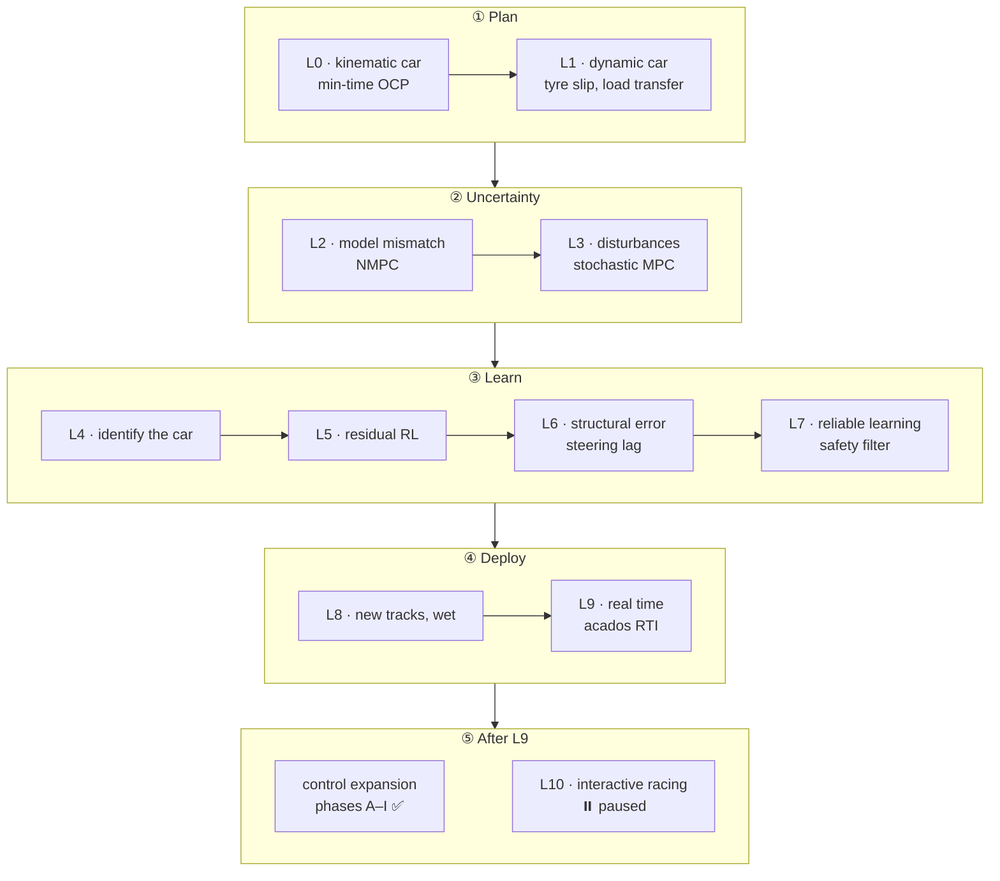

## 🧱 The layers

| Layer | Setting | Methods compared | Status |
|---|---|---|---|
| **L0** | deterministic kinematic model | minimum-curvature line + quasi-steady speed profile; minimum-time optimal control; closed-loop verification | ✅ [report](docs/L0.md) |
| **L1** | dynamic single-track model with tyre slip (magic formula) and load transfer | minimum-time optimal control on the dynamic model; feed-forward/feedback tracking; what the kinematic model misses | ✅ [report](docs/L1.md) |
| **L2** | closed loop with model mismatch | offline plan + tracking vs NMPC, constraint tightening, Monte Carlo and one-at-a-time sensitivity | ✅ [report](docs/L2.md) |
| **L3** | stochastic disturbances (friction varying along the track, gusts, sensor noise) | NMPC with uniform reserves vs stochastic MPC with back-offs calibrated from measured prediction errors (four calibrations); ablations | ✅ [report](docs/L3.md) |
| **L4** | learning the car | identify the parameters from an exploration lap (least squares on the logged dynamics), re-plan, drive with the identified model; noise sensitivity | ✅ [report](docs/L4.md) |
| **L5** | reinforcement learning | residual soft actor-critic on top of the L1 tracker with an observation history, trained on randomised cars and disturbances; nine training runs, checkpoints selected on full validation laps; compared on the L2 and L3 test sets | ✅ [report](docs/L5.md) |
| **L6** | structural model error (steering actuator lag) | the fixed baselines of L1–L5; parameter identification vs identification of the lag; correct-structure NMPC; learned residual dynamics with uncertainty; EKF under sensor noise | ✅ [report](docs/L6.md) · [roadmap L6–L10](docs/ROADMAP_L6-L10.md) |
| **L7** | reliable learning | diagnosis of the L5 runs' blind spots; an NMPC safety filter with calibrated risk estimates on top of the learned policies; training that restarts episodes before failure positions | ✅ [report](docs/L7.md) |
| **L8** | generalisation: new tracks and wet friction, one at a time | the fixed baselines and the trained policies on four unseen tracks and on wet Spielberg; identification + re-planning; short fine-tuning | ✅ [report](docs/L8.md) |
| **L9** | real time: every controller on one core within the 50 ms control period | the offline implementations (IPOPT) against acados real-time iterations of the same OCP; delay compensation; sensor delay; distilled policies | ✅ [report](docs/L9.md) |
| **L10** | interactive racing (exploratory) | one opponent of fixed behaviour first | ⏸️ paused – its protocol is kept; the [control expansion](docs/CONTROL_EXPANSION_ROADMAP.md) came first |

Every layer from L5 on was planned in a pre-registered protocol (`docs/L*_protocol.md`, amendments listed at
its end) before any test lap ran. Click a layer below for its results.

<details open>
<summary><b>L0 · deterministic kinematic model</b> – Spielberg, generic open-wheel car with downforce</summary>

<br>

| Plan | Lap time (ideal, friction fully used) | Lap time with 3 % friction margin | Closed loop (simulator) |
|---|---|---|---|
| centre line + speed profile | 77.89 s | – | – |
| minimum-curvature line + speed profile | 72.14 s | 72.89 s | 72.90 s |
| minimum-time optimal control | **71.26 s** | 72.07 s | **72.10 s** |

OCP on a 2 m grid (grid limit ≈ 71.0 s), speed profiles at 0.5 m; the closed loop stays within 99.5 % of the
friction ellipse for control steps from 5 to 40 ms. See the grid and step studies in [docs/L0.md](docs/L0.md).

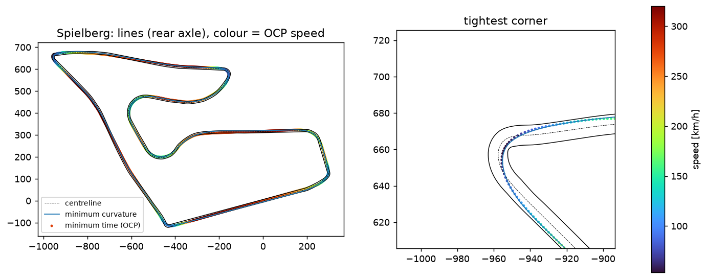

<table>
  <tr>
    <td width="50%">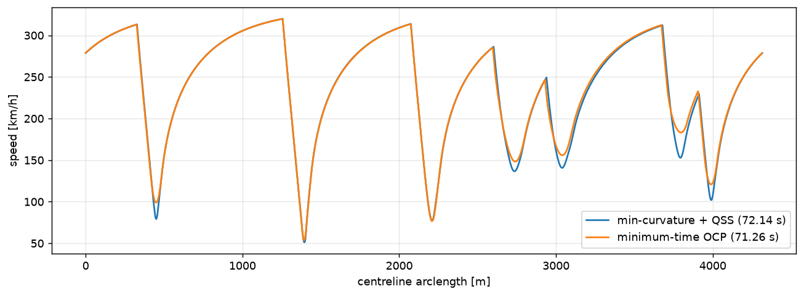</td>
    <td width="50%">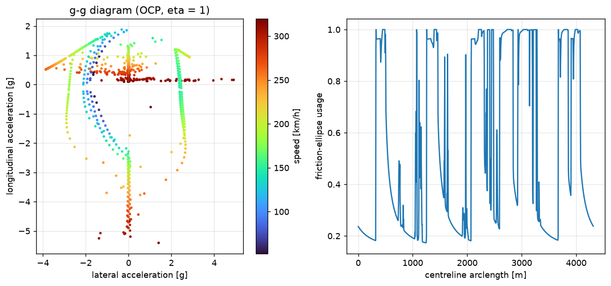</td>
  </tr>
</table>

Details, model equations and discussion: [docs/L0.md](docs/L0.md).

</details>

<details>
<summary><b>L1 · dynamic single-track model</b> – what the kinematic model hides</summary>

<br>

| Plan / run | Lap time |
|---|---|
| kinematic optimum (L0) | 71.26 s |
| dynamic optimum (ideal) | **73.91 s** (+2.6 s: rear-wheel drive, per-axle friction, slip) |
| dynamic plan with 5 % margin, driven by feed-forward/feedback tracking | **75.57 s** |
| kinematic plan driven on the dynamic car | spins at the first corner |

The tracker completes the lap only in a narrow window of plan margins and gains; see [docs/L1.md](docs/L1.md).

<table>
  <tr>
    <td width="50%">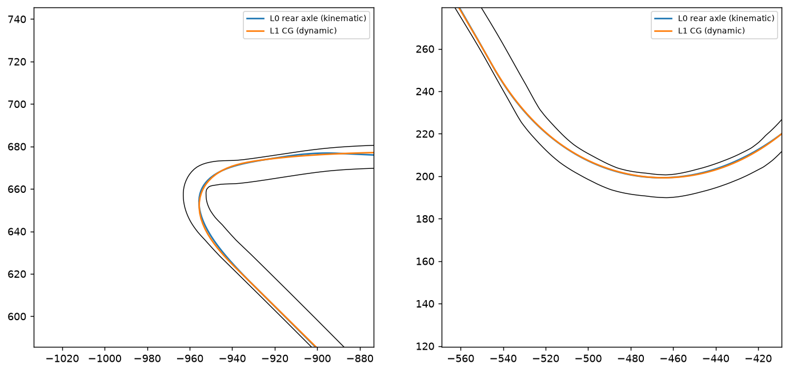</td>
    <td width="50%">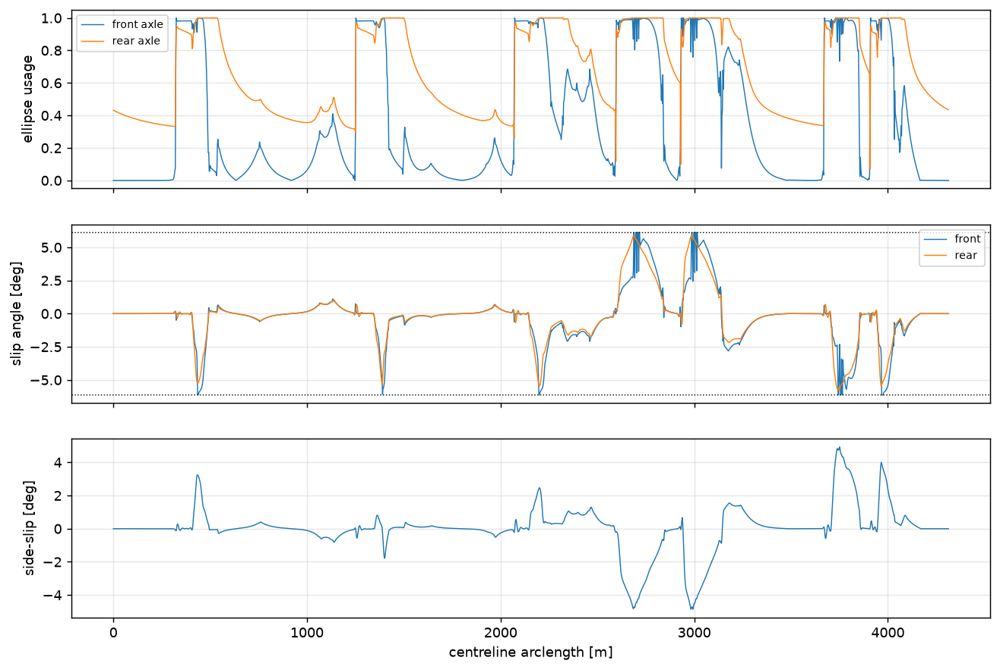</td>
  </tr>
</table>

</details>

<details>
<summary><b>L2 · model mismatch</b> – the plant's parameters differ from the controllers' model (51 cars)</summary>

<br>

| Controller | Laps completed on 51 cars (95 % interval) | Nominal car |
|---|---|---|
| offline plan (5 % reserve) + tracking | 3 / 51 (1–16 %) | 75.57 s |
| NMPC re-planning every 50 ms (5 % reserve) | **22 / 51** (29–58 %) | 76.07 s |
| the same NMPC with hard friction / slip constraints | 15 / 51 (17–44 %) | 75.88 s |
| NMPC with a 12 % reserve | 27 / 51 (38–67 %) | 78.91 s |

Re-planning completes 19 cars the tracker cannot (and none the other way round). Hard constraints on the
measured slip angles make the MPC problem infeasible and cost 7 cars. A larger reserve helps little: the
remaining failures are cars that turn differently from the model (softer tyres, different aero balance),
mostly without reaching the friction limit; see [docs/L2.md](docs/L2.md).

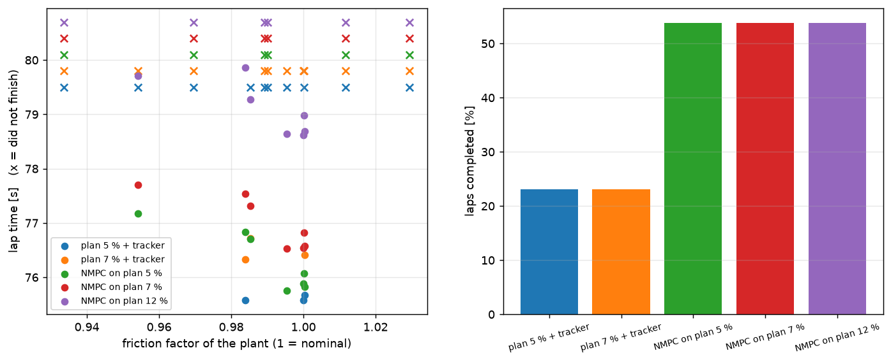

</details>

<details>
<summary><b>L3 · stochastic disturbances</b> – random friction field, gusts and sensor noise (30 laps each)</summary>

<br>

| Controller | Laps completed (95 % interval) | Mean lap |
|---|---|---|
| offline plan + tracking | 0 / 30 (0–12 %) | – |
| NMPC, uniform 5 % friction reserve | 5 / 30 (6–35 %) | 77.45 s |
| NMPC, uniform 11 % and 0.8 m track reserve | 16 / 30 (34–72 %) | 81.43 s |
| **stochastic MPC, ε = 0.05** | **29 / 30** (83–100 %) | 78.26 s |
| **stochastic MPC, ε = 0.01** | **30 / 30** (88–100 %) | 79.20 s |

Back-offs calibrated from the measured prediction errors, growing along the horizon and covering friction
and track limits, make the MPC both safer and faster than any uniform reserve; with three other calibrations
it completes 28–30 of 30, while the same average tightening applied uniformly along the horizon completes
10 of 30. See [docs/L3.md](docs/L3.md).

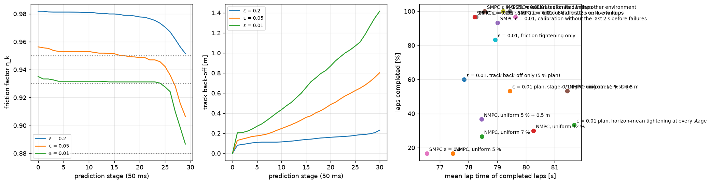

</details>

<details>
<summary><b>L4 · learning the car</b> – the L2 cars, identified from one exploration lap (25 cars)</summary>

<br>

| Controller | Laps completed on 25 cars (95 % interval) | Mean lap |
|---|---|---|
| NMPC, nominal model | 13 / 25 (31–72 %) | 76.35 s |
| exploration lap (NMPC, 12 % reserve) | 16 / 25 (43–82 %) | 79.21 s |
| **NMPC, identified model, re-planned** | **25 / 25** (86–100 %) | 76.87 s |
| NMPC, true model, re-planned | 25 / 25 (86–100 %) | 76.89 s |

The parameters are identified almost exactly from the exploration lap, even when that lap ends off track;
with them the controller is as good as one that knows the car (12 to 0 against the nominal model,
p = 0.0005). With realistic sensor noise the naive estimate is biased but still completes 22 of 25. See
[docs/L4.md](docs/L4.md).

<p align="center">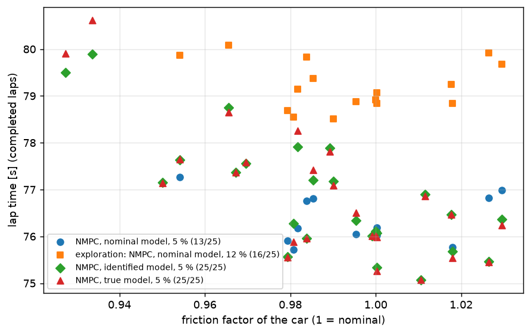</p>

</details>

<details>
<summary><b>L5 · residual reinforcement learning</b> – the same test sets as L2 and L3</summary>

<br>

| Controller | L2: 51 cars | L3: 30 disturbed laps |
|---|---|---|
| tracker alone; with a fixed 15 % slow-down | 3 / 51; 16 / 51 | 0 / 30; 14 / 30 |
| NMPC, nominal model (L2) / SMPC ε = 0.01 (L3) | 22 / 51, 76.3 s | 30 / 30, 79.2 s |
| NMPC slowed down by a uniform reserve | 29 / 51, 84.0 s | 17 / 30, 85.7 s |
| RL, final checkpoints of nine training runs | 19–50 / 51 (median runs 30–46) | 14–30 / 30 (median runs 27–29) |
| **RL, checkpoint selected on validation laps** | **51 / 51**, 81.2 s | **30 / 30**, 81.2 s |

A learned policy can be more robust than the model-based controller without a model of the actual car, but
a single training run is not enough: almost every run beats the nominal NMPC, only about one in three beats an
NMPC slowed to its pace, and most runs have a blind spot, one corner where they fail on almost every car,
invisible in training. With several runs and a validation on full laps each design yielded a good policy; it
is still slower than the model-based controllers that identify the car (L4, in a favourable setting) or
calibrate their reserves (L3). See [docs/L5.md](docs/L5.md).

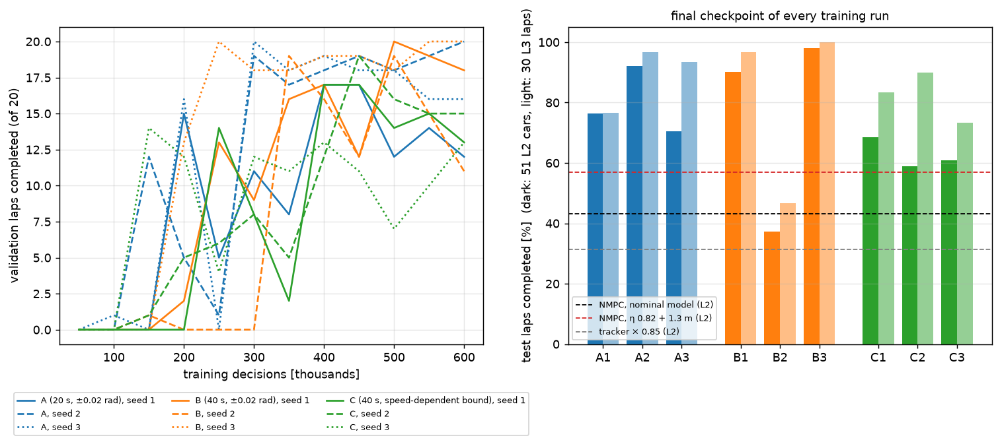

</details>

<details>
<summary><b>L6 · a steering actuator lag the models do not have</b> – the 25 cars of L4</summary>

<br>

Laps completed of 25, with the controllers seeing their own commanded angle:

| Controller | τ = 10 ms | τ = 30 ms | τ = 60 ms |
|---|---|---|---|
| NMPC, nominal model | 12 | 3 | 0 |
| SMPC (L3, calibration unchanged) | 22 | 22 | 9 |
| NMPC, parameters identified (L4) | 22 | 0 | 0 |
| **NMPC + lag model, τ and parameters identified** | **25** | **25** | **24** |
| NMPC + lag model, true car (reference) | 25 | 24 | 23 |
| residual RL (L5, unchanged) | 25 | 24 | 23 |

Parameter errors and the structural error fail separately and both have to be fixed: identifying parameters
in the wrong structure fails from 30 ms on, while identifying the lag together with the parameters matches
the correct-structure reference (lap times 76.8–77.4 s; the RL policy is as reliable, ~4 s per lap slower). A
learned residual model was not calibrated well enough to carry a safety layer (no-go for L7). See
[docs/L6.md](docs/L6.md).

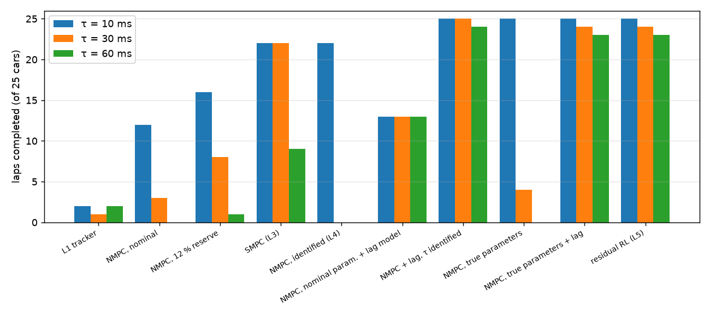

</details>

<details>
<summary><b>L7 · reliable learning</b> – blind spots, a safety filter, training from failures</summary>

<br>

* **Diagnosis of the nine L5 runs:** the blind spots are a few hard corners, and which one a run fails at
  depends on the run; the failing cars mostly have less grip. Whether the cause is too little experience or
  an observation that cannot reveal the grip in time is not separable from these data.
* **Safety layer (H-B, not supported – the opposite):** an NMPC safety filter with a risk estimate that
  passed its acceptance test lowered the completions of all nine final L5 checkpoints on the test laps (exact
  signed-rank p = 0.0039; the selected policy 102 → 51 of 105); by a 3-s criterion 88–99 % of its sampled
  interventions were not needed (an upper bound). More than half of the filtered failures followed runs of
  failed solves. The result is for this filter (no solver retries); it is not a statement about safety
  filters in general.
* **Training from failures (H-C, not supported – the opposite):** restarting 30 % of the episodes before
  recent failure positions gave a median seed that completes fewer test laps than plain training (50 vs 80
  of 105, 4 : 34, p = 6·10⁻⁷); at the level of seeds the two groups do not differ significantly (p = 0.69),
  the curriculum's seeds are far more spread. Checkpoints selected on validation laps reached 104 and 105 of
  105 (a secondary result).

See [docs/L7.md](docs/L7.md) and the protocol [docs/L7_protocol.md](docs/L7_protocol.md).

</details>

<details>
<summary><b>L8 · generalisation</b> – four unseen tracks; wet Spielberg</summary>

<br>

| Controller | new tracks, 25 cars × 4 | wet, friction × 0.85 / × 0.75 (25 cars each) |
|---|---|---|
| L1 tracker | 4 / 100 | 0 / 0 |
| NMPC, nominal | 49 / 100 | 0 / 0 |
| SMPC (Spielberg calibration) | 81 / 100 | 0 / 0 |
| **NMPC + lag model, identified, re-planned** | **100 / 100** | **25 / 25** |
| residual RL (L5 selected) | 0 / 100 | 8 / 0 |

Both primary tests hold (new tracks 100 : 0, p = 1.6·10⁻³⁰; wet 42 : 0, p = 4.5·10⁻¹³) – for these two
controllers, one of which drives an exploration lap and re-plans. None of the 22 trained policies transfers:
at most 2 of 100 laps on the new tracks. With the L3 disturbances on the new tracks the SMPC is the most
reliable (33 / 40). Short fine-tuning on a target (~5 min per seed) helps some seeds on some tracks, none on
Austin, and makes the wet worse. Test tracks drawn by seed (Zandvoort, São Paulo, Austin, Nürburgring;
Norisring replaced by the rule when its plans failed). See [docs/L8.md](docs/L8.md).

</details>

<details>
<summary><b>L9 · real time</b> – one core, 50 ms control period, T1new + T2new</summary>

<br>

| Controller (lag model, τ and parameters identified) | offline | real time |
|---|---|---|
| NMPC with IPOPT (as in L2–L8) | 88 / 105 | **0 / 105** |
| the same with a fixed 100 ms delay compensation | – | 0 / 105 |
| **the same OCP in acados, real-time iterations** | 74 / 105 | **79 / 105** |

Both primary tests hold: the time limit costs the IPOPT implementation every lap (88 : 0, p = 6.5·10⁻²⁷;
every IPOPT controller fails within the first 237 m, with every solve late), and real-time iterations keep
the controller on the track (79 : 0, p = 3.3·10⁻²⁴; feedback ~2.4 ms per step) – though below the converged
IPOPT offline. A 20 ms sensor delay takes this RTI controller from 79 to 0 laps. The RL policies, at ~0.3 ms
per decision, lose little to the time limit: the selected one 99 → 98 of 105; the nine L5 final checkpoints
change by −15 to +2 laps (the largest change B_s2 53 → 38). This compares two implementations of one
controller on this machine (WSL, acados v0.6.0) and under this rule. See [docs/L9.md](docs/L9.md).

</details>

> **Not yet done:** the protocols of L7–L9 ask for the primary results to be re-run in a second Python
> environment; that is deferred (see [STATUS.md](STATUS.md)).

## 🔬 Control expansion (phases A–I)

After L9 the project widened the control methods of L1–L9 instead of adding a layer: nine phases, each with
its own literature review, protocol, tuning and test cars ([roadmap](docs/CONTROL_EXPANSION_ROADMAP.md),
[all results](docs/CONTROL_EXPANSION_BENCHMARK.md), [status](docs/CONTROL_EXPANSION_STATUS.md)).

| Phase | Method | Outcome | Key numbers |
|---|---|---|---|
| **A** | dynamic MPCC (contouring control) | ⚪ neither primary test holds | 9 / 25 vs NMPC 10 / 25; −0.31 s on the 8 cars both complete (p = 0.11) |
| **B** | MPPI, sampling-based MPC | 🔴 NMPC better | 0 / 50 vs 12 / 50 (p = 0.0005) |
| **C** | robust tube MPC | 🟢 both hold | 49 / 50 vs 16 / 50 (p = 2.3·10⁻¹⁰); +1.61 s per lap where both complete |
| **D** | adaptive MPC, online identification | 🟢 both hold | 42 / 50 vs 15 / 50; grip falling during the lap: 34 / 50 vs 0 / 50 |
| **E** | learning MPC, lap to lap | ⏹️ closed without the benchmark | the development gate failed (a negative development result) |
| **F** | safety filters around the L5 policies, retried solves | 🟢 H-F2 holds | retries add a median +14 laps per checkpoint (p = 0.0078); the shield part closed |
| **G** | delay-compensated RTI under L9's rule | 🟢 H-G1 holds · ⚪ H-G2 not shown | 20 ms sensor delay: 73 / 105 vs 5 / 105; no delay: 72 vs 72 |
| **H** | ATV-QP learning MPC | ⏹️ closed without the benchmark | the development gate failed |
| **I** | learning-MPC follow-ups, reproduction check | ⏹️ closed without a benchmark | the LMPC line was closed after the check |

## 🚀 Quick start

```bash
python -m venv .venv && .venv/Scripts/activate      # or: source .venv/bin/activate
pip install -e .[dev]                                # or first: pip install -r requirements-lock.txt
python scripts/fetch_tracks.py Spielberg             # downloads the track (see "Data")
python scripts/run_l0.py                             # ~65 s; writes results/L0 and docs/figures/L0
python scripts/l0_studies.py                         # ~4 min; grid / step studies
python scripts/run_l1.py                             # ~20 min; writes results/L1 and docs/figures/L1
python scripts/l1_studies.py                         # ~40 min; grid / model / tracker studies
python scripts/run_l2.py                             # ~3 h (8 processes); Monte Carlo over 51 cars
python scripts/l2_studies.py                         # ~20 min; one parameter at a time
python scripts/run_l3.py                             # ~8 h (12 processes) incl. calibrate / iterate / failures; 18 controllers x 30 seeds
python scripts/run_l4.py                             # ~3 h (7 processes); identify + re-plan on 25 cars (noise: run_l4.py noise)
pip install -e .[rl] && python scripts/l5_multiseed.py   # L5: 9 training runs, validation, tests (~8 h; selected policies in models/L5)
python scripts/run_l6.py plans && python scripts/run_l6.py round1 --taus 0.06   # L6 (rounds 1-4 and report: see the script)
# L7-L9 run from worktrees pinned to one commit; the steps and commands are in each report:
#   L7: docs/L7.md (scripts/l7_partA.py, run_l7.py, run_l7_partB.py, train_l7.py, run_l7_partC.py; RL extras)
#   L8: docs/L8.md (scripts/fetch_tracks.py <track>, l8_plans.py, run_l8.py, report_l8.py)
#   L9: docs/L9.md (WSL with acados, scripts/l9_wsl/; run_l9.py, report_l9.py)
pytest -m "not slow"                                 # ~2 min (full suite ~12 min, ~30 min if the first L1 guess fails)
```

<details>
<summary><b>🎨 Regenerate the media of this README</b></summary>

<br>

Everything under [`docs/media/`](docs/media) – the animations, the map, the 3D model, the banner and the
results chart – is produced by one script from the project's own code (ffmpeg needed for the GIF / MP4):

```bash
python scripts/make_readme_media.py                 # everything; or e.g. `... ghost map stl`
```

It also refreshes the inline map and 3D blocks of both READMEs.

</details>

## 🗂️ Repository layout

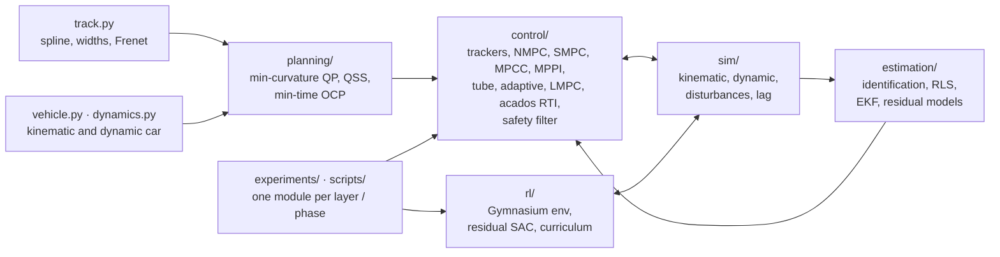

<details>
<summary>File tree</summary>

```
src/f1race/
  track.py          closed track: smoothing spline, widths, Frenet projection
  vehicle.py        vehicle parameters, friction ellipse with downforce, power limit
  dynamics.py       dynamic single-track model (L1): tyres, load transfer, axle ellipses
  path.py           closed paths (racing lines) with curvature and its derivative
  planning/         minimum-curvature QP, QSS speed profile, minimum-time OCP;
                    robust re-planning by continuation (replan.py, before L7)
  control/          path/speed tracking (L0), dynamic tracker (L1), NMPC and experimental
                    receding-horizon min-time MPC (L2); safety-filter mode of the NMPC
                    and a CBF-QP filter (L7, safety_filter.py); the same OCP in acados
                    with real-time iterations (L9, acados_mpc.py); the control expansion's
                    MPCC, MPPI, tube, adaptive and learning MPCs
  sim/              time-domain simulator with constraint monitoring; stochastic
                    disturbances (L3); steering actuator lag (L6, lagged.py)
  estimation/       parameter identification from driving data (L4); identification
                    with the lag, EKF, residual models (L6); RLS and model banks
  rl/               Gymnasium environment for residual RL on the tracker (L5);
                    failure-start curriculum (L7, curriculum.py)
  experiments/      one module per layer and phase (l9_distill.py: the L9 DAgger students)
scripts/            data download and per-layer reproduction scripts; l9_wsl/: the WSL
                    environment of L9 (acados build, versions, run driver);
                    make_readme_media.py: the media of this README
tests/              pytest suite
docs/               per-layer write-ups and figures, protocols, review workflow;
                    media/: animations, map, 3D model, banner and charts of this README
```

</details>

## 🔁 Development process

Every layer is developed on its own branch and merged only after an independent review
([docs/workflow.md](docs/workflow.md), [STATUS.md](STATUS.md)):


## 📦 Data

Track centre lines and widths come from the [TUM FTM racetrack-database](https://github.com/TUMFTM/racetrack-database)
(LGPL-3.0). They are **not** redistributed here: `scripts/fetch_tracks.py` downloads them from a pinned
upstream commit and checks SHA-256 sums. L0–L7 and L9 use Spielberg; L8 also uses the validation tracks Monza
and Sakhir and the test tracks Zandvoort, SaoPaulo, Austin and Nuerburgring
(`python scripts/fetch_tracks.py <name>`). Results (`results/`) are not committed either.

The README media in `docs/media/` contain only computed results (the L0 lines, down-sampled), not the track
data. The map's geographic anchor was fitted once to the Red Bull Ring outline of
[bacinger/f1-circuits](https://github.com/bacinger/f1-circuits) (MIT); that outline is not included.

## 📄 License

MIT for the code in this repository (see [LICENSE](LICENSE)). The track data keeps its upstream license.

<p align="right"><a href="#top">⬆ back to top</a></p>
