<p align="center">
  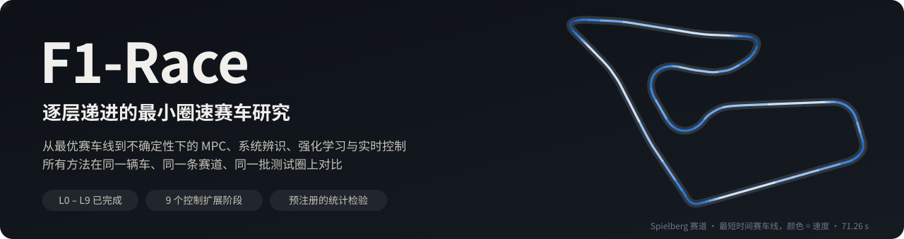
</p>

<p align="center">
  <a href="README.md">English</a> · <b>简体中文</b>
</p>

<p align="center">
  
  
  
  
  
  
  <br>
  
  
  
  
</p>

<p align="center">
  <a href="#-看一圈">🎬 看一圈</a> ·
  <a href="#-结果一览">📊 结果</a> ·
  <a href="#%EF%B8%8F-亲手探索这一圈">🕹️ 互动</a> ·
  <a href="#-研究层">🧱 研究层</a> ·
  <a href="#-控制方法扩展阶段-ai">🔬 控制扩展</a> ·
  <a href="#-快速开始">🚀 快速开始</a> ·
  <a href="#%EF%B8%8F-仓库结构">🗂️ 结构</a>
</p>

这是一个自成体系的研究项目：如何让一辆赛车以尽可能快的速度跑完一圈。项目按**层（layer）**逐步搭建，
每一层只引入一种新的难点——轮胎动力学、与模型不符的车辆、随机扰动、未知的车辆、结构性模型误差、
新赛道、实时计算预算——并在同一个问题、同一辆车、同一批测试圈上对比多种求解方法。

> **贯穿整个系列的核心问题：** *在哪些情形下，基于学习的控制器能胜过基于模型的控制器？为什么？*

---

## 🎬 看一圈

<p align="center">
  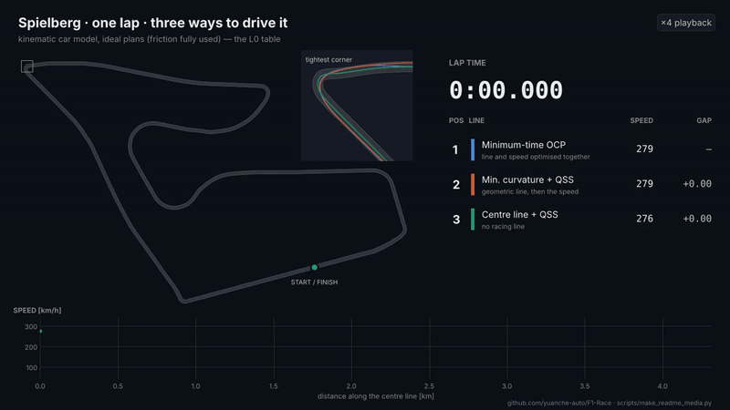
</p>

<p align="center"><sub>
  <b>幽灵对决（L0）。</b>L0 表格中的三种理想规划在 Spielberg 赛道上同场竞速：实时计时塔、最急弯道放大视图、
  下方的速度曲线。仅赛车线本身就值 5.75 s；同时优化路线与速度再快 0.88 s。
  · 🎥 <a href="docs/media/ghost_race.mp4">MP4 高清版（1280×720）</a>
</sub></p>

<!--
  如需在此处显示可播放的视频：在 github.com 上编辑本 README，把 docs/media/ghost_race.mp4 拖入编辑器，
  GitHub 会上传并插入一个 https://github.com/user-attachments/... 链接，渲染为视频播放器。
  上面的 GIF 无需这一步即可在任何地方播放。
-->

## 📊 结果一览

<table>
  <tr>
    <td align="center" width="33%">
      <h3>−6.63 s</h3>
      同时优化路线与速度，对比沿中心线行驶<br>
      <sub><b>L0</b> · 71.26 s vs 77.89 s，理想规划</sub>
    </td>
    <td align="center" width="33%">
      <h3>🌀 打滑</h3>
      运动学模型下的最优解，放到有轮胎滑移的车上，第一个弯就失控<br>
      <sub><b>L1</b> · 带 5% 裕度的动力学规划：75.57 s</sub>
    </td>
    <td align="center" width="33%">
      <h3>30 / 30</h3>
      随机摩擦、阵风与传感器噪声下，随机 MPC 完成的圈数<br>
      <sub><b>L3</b> · 统一 5% 裕度的 NMPC：5 / 30</sub>
    </td>
  </tr>
  <tr>
    <td align="center">
      <h3>25 / 25</h3>
      仅用一圈探索圈辨识未知车辆后，全部完赛<br>
      <sub><b>L4</b> · 名义模型：13 / 25</sub>
    </td>
    <td align="center">
      <h3>51 / 51</h3>
      在验证圈上选出的强化学习策略完成的车辆数<br>
      <sub><b>L5</b> · 九次单独训练：19 – 50 / 51</sub>
    </td>
    <td align="center">
      <h3>0 → 79 / 105</h3>
      单核、50 ms 预算内：IPOPT 对比 acados 实时迭代<br>
      <sub><b>L9</b> · 同一个 OCP，两种实现</sub>
    </td>
  </tr>
</table>

<picture>
  <source media="(prefers-color-scheme: dark)" srcset="docs/media/results_zh_dark.svg">
  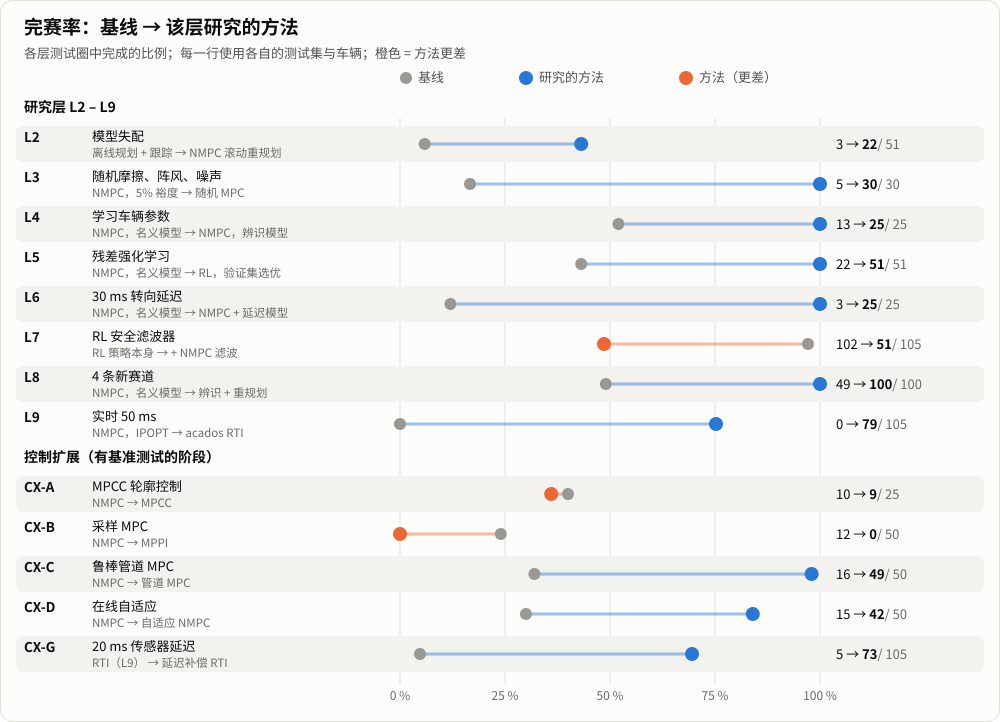
</picture>

<sub>每一行都有各自的测试集（不同的车辆、扰动或赛道），因此行与行之间不可直接比较。橙色表示方法比基线更差——
负面结果同样如实报告（L7、CX-A、CX-B）。数字均来自下方表格。</sub>

## 🕹️ 亲手探索这一圈

以下内容块会被 GitHub 渲染为**可交互**组件——可以拖动、缩放、旋转和点击。（若当前查看器不支持渲染，
请直接打开 [`docs/media/`](docs/media) 下的文件。）

### 🗺️ 真实赛道上的最短时间赛车线

拖动、缩放地图；**点击**线段查看速度区间，点击标记查看最高速度与最大制动、最低速度点，以及测试圈冲出赛道的四个失败高发弯。这条线是 L0 的
最短时间解，已地理配准到真实的红牛环赛道（与赛道轮廓拟合，RMS 误差 1.8 m）；颜色越深 = 越快。

<!-- BEGIN map.geojson -->
```geojson
{"type":"FeatureCollection","features":[
{"type":"Feature","properties":{"速度区间":"> 270 km/h","stroke":"#0d366b","stroke-width":5,"stroke-opacity":0.95},"geometry":{"type":"LineString","coordinates":[[14.76669,47.22033],[14.76656,47.2203],[14.76644,47.22028],[14.76631,47.22025],[14.76618,47.22023],[14.76606,47.2202],[14.76593,47.22018],[14.7658,47.22016],[14.76567,47.22013],[14.76555,47.22011],[14.76542,47.22008],[14.76529,47.22006],[14.76516,47.22003],[14.76504,47.22001],[14.76491,47.21998],[14.76478,47.21996],[14.76466,47.21993],[14.76453,47.21991],[14.7644,47.21988],[14.76428,47.21986],[14.76415,47.21984],[14.76402,47.21981],[14.76389,47.21979],[14.76377,47.21976],[14.76364,47.21974],[14.76351,47.21971],[14.76338,47.21969],[14.76326,47.21966],[14.76313,47.21964],[14.763,47.21961],[14.76288,47.21959],[14.76275,47.21956],[14.76262,47.21954],[14.76249,47.21952],[14.76237,47.21949],[14.76224,47.21947]]}},
{"type":"Feature","properties":{"速度区间":"220–270 km/h","stroke":"#184f95","stroke-width":5,"stroke-opacity":0.95},"geometry":{"type":"LineString","coordinates":[[14.76224,47.21947],[14.76211,47.21944],[14.76198,47.21942],[14.76186,47.2194]]}},
{"type":"Feature","properties":{"速度区间":"170–220 km/h","stroke":"#256abf","stroke-width":5,"stroke-opacity":0.95},"geometry":{"type":"LineString","coordinates":[[14.76186,47.2194],[14.76173,47.21937],[14.7616,47.21935]]}},
{"type":"Feature","properties":{"速度区间":"120–170 km/h","stroke":"#3987e5","stroke-width":5,"stroke-opacity":0.95},"geometry":{"type":"LineString","coordinates":[[14.7616,47.21935],[14.76147,47.21933],[14.76134,47.21931],[14.76121,47.2193]]}},
{"type":"Feature","properties":{"速度区间":"< 120 km/h","stroke":"#86b6ef","stroke-width":5,"stroke-opacity":0.95},"geometry":{"type":"LineString","coordinates":[[14.76121,47.2193],[14.76108,47.2193],[14.76096,47.21933],[14.76084,47.21938],[14.76075,47.21944],[14.76067,47.21951]]}},
{"type":"Feature","properties":{"速度区间":"120–170 km/h","stroke":"#3987e5","stroke-width":5,"stroke-opacity":0.95},"geometry":{"type":"LineString","coordinates":[[14.76067,47.21951],[14.7606,47.21959],[14.76054,47.21967],[14.76046,47.21974],[14.76039,47.21982]]}},
{"type":"Feature","properties":{"速度区间":"170–220 km/h","stroke":"#256abf","stroke-width":5,"stroke-opacity":0.95},"geometry":{"type":"LineString","coordinates":[[14.76039,47.21982],[14.76032,47.21989],[14.76024,47.21997],[14.76017,47.22004],[14.7601,47.22012],[14.76003,47.22019],[14.75995,47.22027],[14.75988,47.22034]]}},
{"type":"Feature","properties":{"速度区间":"220–270 km/h","stroke":"#184f95","stroke-width":5,"stroke-opacity":0.95},"geometry":{"type":"LineString","coordinates":[[14.75988,47.22034],[14.75981,47.22042],[14.75973,47.22049],[14.75966,47.22057],[14.75959,47.22064],[14.75951,47.22072],[14.75944,47.22079],[14.75937,47.22087],[14.7593,47.22094],[14.75922,47.22102],[14.75915,47.22109],[14.75908,47.22117],[14.759,47.22124],[14.75893,47.22132],[14.75886,47.22139],[14.75878,47.22146]]}},
{"type":"Feature","properties":{"速度区间":"> 270 km/h","stroke":"#0d366b","stroke-width":5,"stroke-opacity":0.95},"geometry":{"type":"LineString","coordinates":[[14.75878,47.22146],[14.75871,47.22154],[14.75864,47.22162],[14.75858,47.2217],[14.75851,47.22178],[14.75845,47.22185],[14.75839,47.22193],[14.75832,47.22201],[14.75826,47.22209],[14.7582,47.22217],[14.75814,47.22225],[14.75808,47.22233],[14.75802,47.22241],[14.75796,47.22249],[14.7579,47.22257],[14.75784,47.22265],[14.75778,47.22273],[14.75772,47.22281],[14.75766,47.22289],[14.7576,47.22297],[14.75754,47.22305],[14.75748,47.22313],[14.75742,47.22321],[14.75736,47.22329],[14.7573,47.22337],[14.75724,47.22345],[14.75717,47.22353],[14.75711,47.22361],[14.75705,47.22369],[14.75699,47.22377],[14.75693,47.22385],[14.75687,47.22393],[14.75681,47.22401],[14.75674,47.22408],[14.75667,47.22416],[14.75659,47.22423],[14.75652,47.22431],[14.75644,47.22438],[14.75637,47.22446],[14.75629,47.22453],[14.7562,47.2246],[14.75612,47.22466],[14.75603,47.22473],[14.75594,47.2248],[14.75584,47.22486],[14.75575,47.22492],[14.75566,47.22499],[14.75557,47.22505],[14.75548,47.22512],[14.75538,47.22518],[14.75529,47.22525],[14.7552,47.22531],[14.75511,47.22538],[14.75501,47.22544],[14.75492,47.2255]]}},
{"type":"Feature","properties":{"速度区间":"220–270 km/h","stroke":"#184f95","stroke-width":5,"stroke-opacity":0.95},"geometry":{"type":"LineString","coordinates":[[14.75492,47.2255],[14.75483,47.22557],[14.75473,47.22563],[14.75464,47.22569]]}},
{"type":"Feature","properties":{"速度区间":"170–220 km/h","stroke":"#256abf","stroke-width":5,"stroke-opacity":0.95},"geometry":{"type":"LineString","coordinates":[[14.75464,47.22569],[14.75455,47.22576],[14.75445,47.22582]]}},
{"type":"Feature","properties":{"速度区间":"120–170 km/h","stroke":"#3987e5","stroke-width":5,"stroke-opacity":0.95},"geometry":{"type":"LineString","coordinates":[[14.75445,47.22582],[14.75436,47.22588],[14.75427,47.22595],[14.75418,47.22602]]}},
{"type":"Feature","properties":{"速度区间":"< 120 km/h","stroke":"#86b6ef","stroke-width":5,"stroke-opacity":0.95},"geometry":{"type":"LineString","coordinates":[[14.75418,47.22602],[14.75412,47.2261],[14.75407,47.22618],[14.7541,47.22627],[14.75419,47.22633],[14.75432,47.22636],[14.75444,47.22638],[14.75458,47.22639]]}},
{"type":"Feature","properties":{"速度区间":"120–170 km/h","stroke":"#3987e5","stroke-width":5,"stroke-opacity":0.95},"geometry":{"type":"LineString","coordinates":[[14.75458,47.22639],[14.75471,47.2264],[14.75484,47.22641],[14.75497,47.22641],[14.7551,47.2264]]}},
{"type":"Feature","properties":{"速度区间":"170–220 km/h","stroke":"#256abf","stroke-width":5,"stroke-opacity":0.95},"geometry":{"type":"LineString","coordinates":[[14.7551,47.2264],[14.75524,47.2264],[14.75537,47.22639],[14.7555,47.22639],[14.75563,47.22638],[14.75576,47.22638],[14.7559,47.22638],[14.75603,47.22637]]}},
{"type":"Feature","properties":{"速度区间":"220–270 km/h","stroke":"#184f95","stroke-width":5,"stroke-opacity":0.95},"geometry":{"type":"LineString","coordinates":[[14.75603,47.22637],[14.75616,47.22637],[14.75629,47.22636],[14.75642,47.22636],[14.75656,47.22636],[14.75669,47.22635],[14.75682,47.22634],[14.75695,47.22633],[14.75708,47.22632],[14.75722,47.22631],[14.75735,47.2263],[14.75748,47.22629],[14.75761,47.22627],[14.75774,47.22626],[14.75787,47.22624],[14.758,47.22623]]}},
{"type":"Feature","properties":{"速度区间":"> 270 km/h","stroke":"#0d366b","stroke-width":5,"stroke-opacity":0.95},"geometry":{"type":"LineString","coordinates":[[14.758,47.22623],[14.75813,47.22622],[14.75826,47.2262],[14.75839,47.22619],[14.75852,47.22617],[14.75865,47.22616],[14.75878,47.22614],[14.75891,47.22613],[14.75904,47.22611],[14.75917,47.2261],[14.7593,47.22608],[14.75944,47.22607],[14.75957,47.22606],[14.7597,47.22604],[14.75983,47.22603],[14.75996,47.22601],[14.76009,47.226],[14.76022,47.22598],[14.76035,47.22597],[14.76048,47.22596],[14.76061,47.22594],[14.76074,47.22593],[14.76087,47.22591],[14.761,47.2259],[14.76113,47.22589],[14.76126,47.22588],[14.7614,47.22586],[14.76153,47.22585],[14.76166,47.22584],[14.76179,47.22584],[14.76192,47.22583],[14.76205,47.22582],[14.76219,47.22582],[14.76232,47.22582],[14.76245,47.22581],[14.76258,47.22581],[14.76272,47.2258],[14.76285,47.2258],[14.76298,47.2258],[14.76311,47.22579],[14.76324,47.22579]]}},
{"type":"Feature","properties":{"速度区间":"220–270 km/h","stroke":"#184f95","stroke-width":5,"stroke-opacity":0.95},"geometry":{"type":"LineString","coordinates":[[14.76324,47.22579],[14.76338,47.22578],[14.76351,47.22578],[14.76364,47.22578]]}},
{"type":"Feature","properties":{"速度区间":"170–220 km/h","stroke":"#256abf","stroke-width":5,"stroke-opacity":0.95},"geometry":{"type":"LineString","coordinates":[[14.76364,47.22578],[14.76377,47.22577],[14.7639,47.22577]]}},
{"type":"Feature","properties":{"速度区间":"120–170 km/h","stroke":"#3987e5","stroke-width":5,"stroke-opacity":0.95},"geometry":{"type":"LineString","coordinates":[[14.7639,47.22577],[14.76404,47.22576],[14.76417,47.22575],[14.7643,47.22573]]}},
{"type":"Feature","properties":{"速度区间":"< 120 km/h","stroke":"#86b6ef","stroke-width":5,"stroke-opacity":0.95},"geometry":{"type":"LineString","coordinates":[[14.7643,47.22573],[14.76442,47.2257],[14.76453,47.22565],[14.76461,47.22558],[14.76464,47.22549],[14.76464,47.2254],[14.7646,47.22532],[14.76455,47.22523]]}},
{"type":"Feature","properties":{"速度区间":"120–170 km/h","stroke":"#3987e5","stroke-width":5,"stroke-opacity":0.95},"geometry":{"type":"LineString","coordinates":[[14.76455,47.22523],[14.76448,47.22516],[14.76441,47.22508],[14.76433,47.22501],[14.76424,47.22494]]}},
{"type":"Feature","properties":{"速度区间":"170–220 km/h","stroke":"#256abf","stroke-width":5,"stroke-opacity":0.95},"geometry":{"type":"LineString","coordinates":[[14.76424,47.22494],[14.76414,47.22488],[14.76403,47.22483],[14.76392,47.22478],[14.76381,47.22474],[14.7637,47.22469],[14.76358,47.22464],[14.76347,47.2246]]}},
{"type":"Feature","properties":{"速度区间":"220–270 km/h","stroke":"#184f95","stroke-width":5,"stroke-opacity":0.95},"geometry":{"type":"LineString","coordinates":[[14.76347,47.2246],[14.76335,47.22456],[14.76323,47.22452],[14.76311,47.22448],[14.76298,47.22446],[14.76285,47.22444],[14.76272,47.22442],[14.76259,47.22441],[14.76246,47.2244],[14.76233,47.22438],[14.7622,47.22438],[14.76206,47.22438],[14.76193,47.22439],[14.7618,47.2244],[14.76167,47.22441],[14.76154,47.22442]]}},
{"type":"Feature","properties":{"速度区间":"> 270 km/h","stroke":"#0d366b","stroke-width":5,"stroke-opacity":0.95},"geometry":{"type":"LineString","coordinates":[[14.76154,47.22442],[14.76141,47.22443],[14.76128,47.22444],[14.76115,47.22446],[14.76102,47.22447],[14.76089,47.22449],[14.76076,47.22451],[14.76063,47.22453],[14.7605,47.22455],[14.76037,47.22456],[14.76024,47.22458]]}},
{"type":"Feature","properties":{"速度区间":"220–270 km/h","stroke":"#184f95","stroke-width":5,"stroke-opacity":0.95},"geometry":{"type":"LineString","coordinates":[[14.76024,47.22458],[14.76011,47.2246],[14.75998,47.22461],[14.75984,47.22461]]}},
{"type":"Feature","properties":{"速度区间":"170–220 km/h","stroke":"#256abf","stroke-width":5,"stroke-opacity":0.95},"geometry":{"type":"LineString","coordinates":[[14.75984,47.22461],[14.75971,47.22461],[14.75958,47.2246],[14.75945,47.22458],[14.75932,47.22455],[14.7592,47.22452]]}},
{"type":"Feature","properties":{"速度区间":"120–170 km/h","stroke":"#3987e5","stroke-width":5,"stroke-opacity":0.95},"geometry":{"type":"LineString","coordinates":[[14.7592,47.22452],[14.75909,47.22447],[14.75898,47.22442],[14.75889,47.22436],[14.75881,47.22429],[14.75874,47.22421],[14.75869,47.22413],[14.75866,47.22404],[14.75864,47.22395],[14.75863,47.22386],[14.75864,47.22377]]}},
{"type":"Feature","properties":{"速度区间":"170–220 km/h","stroke":"#256abf","stroke-width":5,"stroke-opacity":0.95},"geometry":{"type":"LineString","coordinates":[[14.75864,47.22377],[14.75867,47.22368],[14.7587,47.2236],[14.75874,47.22351],[14.7588,47.22343],[14.75886,47.22335],[14.75893,47.22327],[14.759,47.2232]]}},
{"type":"Feature","properties":{"速度区间":"220–270 km/h","stroke":"#184f95","stroke-width":5,"stroke-opacity":0.95},"geometry":{"type":"LineString","coordinates":[[14.759,47.2232],[14.75906,47.22312],[14.75913,47.22304],[14.75919,47.22296],[14.75926,47.22288],[14.75932,47.2228],[14.75939,47.22273],[14.75946,47.22265],[14.75952,47.22257]]}},
{"type":"Feature","properties":{"速度区间":"170–220 km/h","stroke":"#256abf","stroke-width":5,"stroke-opacity":0.95},"geometry":{"type":"LineString","coordinates":[[14.75952,47.22257],[14.75959,47.2225],[14.75967,47.22242],[14.75976,47.22236],[14.75986,47.2223],[14.75996,47.22224]]}},
{"type":"Feature","properties":{"速度区间":"120–170 km/h","stroke":"#3987e5","stroke-width":5,"stroke-opacity":0.95},"geometry":{"type":"LineString","coordinates":[[14.75996,47.22224],[14.76008,47.2222],[14.7602,47.22216],[14.76032,47.22214],[14.76046,47.22212],[14.76059,47.22212],[14.76072,47.22213],[14.76085,47.22215],[14.76097,47.22218],[14.76109,47.22221]]}},
{"type":"Feature","properties":{"速度区间":"170–220 km/h","stroke":"#256abf","stroke-width":5,"stroke-opacity":0.95},"geometry":{"type":"LineString","coordinates":[[14.76109,47.22221],[14.76121,47.22226],[14.76132,47.22231],[14.76142,47.22237],[14.76151,47.22243],[14.76159,47.2225],[14.76168,47.22257],[14.76176,47.22264]]}},
{"type":"Feature","properties":{"速度区间":"220–270 km/h","stroke":"#184f95","stroke-width":5,"stroke-opacity":0.95},"geometry":{"type":"LineString","coordinates":[[14.76176,47.22264],[14.76186,47.2227],[14.76196,47.22276],[14.76207,47.22281],[14.76218,47.22286],[14.7623,47.2229],[14.76241,47.22294],[14.76253,47.22298],[14.76266,47.22301],[14.76279,47.22303],[14.76292,47.22305],[14.76305,47.22306],[14.76318,47.22307],[14.76331,47.22308],[14.76344,47.22309],[14.76357,47.22309],[14.76371,47.2231]]}},
{"type":"Feature","properties":{"速度区间":"> 270 km/h","stroke":"#0d366b","stroke-width":5,"stroke-opacity":0.95},"geometry":{"type":"LineString","coordinates":[[14.76371,47.2231],[14.76384,47.2231],[14.76397,47.22311],[14.7641,47.22311],[14.76423,47.22311],[14.76437,47.22312],[14.7645,47.22312],[14.76463,47.22312],[14.76476,47.22313],[14.7649,47.22313],[14.76503,47.22314],[14.76516,47.22314],[14.76529,47.22314],[14.76542,47.22314],[14.76556,47.22315],[14.76569,47.22315],[14.76582,47.22316],[14.76595,47.22316],[14.76608,47.22316],[14.76622,47.22317],[14.76635,47.22317],[14.76648,47.22317],[14.76661,47.22318],[14.76674,47.22318],[14.76688,47.22318],[14.76701,47.22319],[14.76714,47.22319],[14.76727,47.22319],[14.76741,47.2232],[14.76754,47.2232],[14.76767,47.2232],[14.7678,47.22321],[14.76794,47.22321],[14.76807,47.22322],[14.7682,47.22322],[14.76833,47.22322],[14.76846,47.22322],[14.7686,47.22323],[14.76873,47.22323]]}},
{"type":"Feature","properties":{"速度区间":"220–270 km/h","stroke":"#184f95","stroke-width":5,"stroke-opacity":0.95},"geometry":{"type":"LineString","coordinates":[[14.76873,47.22323],[14.76886,47.22323],[14.76899,47.22323]]}},
{"type":"Feature","properties":{"速度区间":"170–220 km/h","stroke":"#256abf","stroke-width":5,"stroke-opacity":0.95},"geometry":{"type":"LineString","coordinates":[[14.76899,47.22323],[14.76912,47.22322],[14.76925,47.22321],[14.76938,47.22318],[14.76951,47.22315],[14.76962,47.22311],[14.76974,47.22307],[14.76984,47.22301],[14.76994,47.22295],[14.77002,47.22288],[14.77009,47.2228],[14.77016,47.22273],[14.77021,47.22264],[14.77025,47.22256],[14.77029,47.22247],[14.77033,47.22239],[14.77037,47.2223]]}},
{"type":"Feature","properties":{"速度区间":"220–270 km/h","stroke":"#184f95","stroke-width":5,"stroke-opacity":0.95},"geometry":{"type":"LineString","coordinates":[[14.77037,47.2223],[14.7704,47.22221],[14.77044,47.22213],[14.77048,47.22204]]}},
{"type":"Feature","properties":{"速度区间":"170–220 km/h","stroke":"#256abf","stroke-width":5,"stroke-opacity":0.95},"geometry":{"type":"LineString","coordinates":[[14.77048,47.22204],[14.77052,47.22196],[14.77055,47.22187],[14.77059,47.22178]]}},
{"type":"Feature","properties":{"速度区间":"120–170 km/h","stroke":"#3987e5","stroke-width":5,"stroke-opacity":0.95},"geometry":{"type":"LineString","coordinates":[[14.77059,47.22178],[14.77062,47.2217],[14.77064,47.22161],[14.77065,47.22152],[14.77063,47.22143],[14.77058,47.22134],[14.77052,47.22127],[14.77043,47.2212],[14.77034,47.22113],[14.77024,47.22108],[14.77012,47.22103],[14.77001,47.22099]]}},
{"type":"Feature","properties":{"速度区间":"170–220 km/h","stroke":"#256abf","stroke-width":5,"stroke-opacity":0.95},"geometry":{"type":"LineString","coordinates":[[14.77001,47.22099],[14.76989,47.22095],[14.76976,47.22092],[14.76964,47.2209],[14.76951,47.22087],[14.76938,47.22085],[14.76925,47.22082],[14.76913,47.2208]]}},
{"type":"Feature","properties":{"速度区间":"220–270 km/h","stroke":"#184f95","stroke-width":5,"stroke-opacity":0.95},"geometry":{"type":"LineString","coordinates":[[14.76913,47.2208],[14.769,47.22077],[14.76887,47.22075],[14.76874,47.22072],[14.76862,47.2207],[14.76849,47.22068],[14.76836,47.22065],[14.76824,47.22063],[14.76811,47.2206],[14.76798,47.22058],[14.76785,47.22055],[14.76773,47.22053],[14.7676,47.2205],[14.76747,47.22048],[14.76734,47.22045],[14.76722,47.22043]]}},
{"type":"Feature","properties":{"速度区间":"> 270 km/h","stroke":"#0d366b","stroke-width":5,"stroke-opacity":0.95},"geometry":{"type":"LineString","coordinates":[[14.76722,47.22043],[14.76709,47.2204],[14.76696,47.22038],[14.76684,47.22036],[14.76671,47.22033],[14.76669,47.22033]]}},
{"type":"Feature","properties":{"title":"起点 / 终点","description":"最短时间圈 71.26 s（L0，运动学模型，理想）","marker-color":"#0b0b0b","marker-symbol":"racetrack","marker-size":"medium"},"geometry":{"type":"Point","coordinates":[14.76669,47.22033]}},
{"type":"Feature","properties":{"title":"最高速度，随即最大制动","description":"320 km/h，随后以最高 5.5 g 的减速度（高速时下压力增加抓地力）制动","marker-color":"#2a78d6","marker-symbol":"triangle","marker-size":"medium"},"geometry":{"type":"Point","coordinates":[14.75518,47.22533]}},
{"type":"Feature","properties":{"title":"最低速度点：最急的弯","description":"弯心 54 km/h","marker-color":"#eb6834","marker-symbol":"circle","marker-size":"medium"},"geometry":{"type":"Point","coordinates":[14.75408,47.22625]}},
{"type":"Feature","properties":{"title":"失败高发点：1 号弯（≈ 460 m）","description":"测试圈冲出赛道的少数几个弯之一；在控制扩展的基准测试中，所有控制器都在这些弯失败","marker-color":"#e34948","marker-symbol":"danger","marker-size":"medium"},"geometry":{"type":"Point","coordinates":[14.76086,47.21937]}},
{"type":"Feature","properties":{"title":"失败高发点：≈ 2.2 km","description":"测试圈冲出赛道的少数几个弯之一；在控制扩展的基准测试中，所有控制器都在这些弯失败","marker-color":"#e34948","marker-symbol":"danger","marker-size":"medium"},"geometry":{"type":"Point","coordinates":[14.76455,47.22563]}},
{"type":"Feature","properties":{"title":"失败高发点：≈ 2.7 km","description":"测试圈冲出赛道的少数几个弯之一；在控制扩展的基准测试中，所有控制器都在这些弯失败","marker-color":"#e34948","marker-symbol":"danger","marker-size":"medium"},"geometry":{"type":"Point","coordinates":[14.75884,47.22432]}},
{"type":"Feature","properties":{"title":"失败高发点：≈ 3.83 km","description":"测试圈冲出赛道的少数几个弯之一；在控制扩展的基准测试中，所有控制器都在这些弯失败","marker-color":"#e34948","marker-symbol":"danger","marker-size":"medium"},"geometry":{"type":"Point","coordinates":[14.77013,47.22276]}}
]}
```
<!-- END map.geojson -->

<details>
<summary><b>🧊 3D 速度地形</b> —— 点击展开可旋转的交互式模型（墙的高度即速度）</summary>

<br>

最短时间圈被表示为一道墙，墙高即速度（每 km/h 0.6 m）：直道升到 320 km/h，最急弯降到 54 km/h。
拖动旋转，滚轮缩放。更精细的模型：[`docs/media/speed_landscape.stl`](docs/media/speed_landscape.stl)
（GitHub 会用同样的 3D 查看器打开）。

<!-- BEGIN speed_landscape_inline.stl -->
```stl
solid speed_landscape
facet normal -0.274 0.962 0
outer loop
vertex 358 -320.3 0
vertex 46.3 -409 0
vertex 46.3 -409 187.8
endloop
endfacet
facet normal -0.274 0.962 0
outer loop
vertex 358 -320.3 0
vertex 46.3 -409 187.8
vertex 358 -320.3 167.4
endloop
endfacet
facet normal 0.274 -0.962 0
outer loop
vertex 358 -320.3 0
vertex 46.3 -409 187.8
vertex 46.3 -409 0
endloop
endfacet
facet normal 0.274 -0.962 0
outer loop
vertex 358 -320.3 0
vertex 358 -320.3 167.4
vertex 46.3 -409 187.8
endloop
endfacet
facet normal -0.259 0.966 0
outer loop
vertex 46.3 -409 0
vertex -46.4 -433.9 0
vertex -46.4 -433.9 73.8
endloop
endfacet
facet normal -0.259 0.966 0
outer loop
vertex 46.3 -409 0
vertex -46.4 -433.9 73.8
vertex 46.3 -409 187.8
endloop
endfacet
facet normal 0.259 -0.966 0
outer loop
vertex 46.3 -409 0
vertex -46.4 -433.9 73.8
vertex -46.4 -433.9 0
endloop
endfacet
facet normal 0.259 -0.966 0
outer loop
vertex 46.3 -409 0
vertex 46.3 -409 187.8
vertex -46.4 -433.9 73.8
endloop
endfacet
facet normal -0.0355 0.999 0
outer loop
vertex -46.4 -433.9 0
vertex -64.3 -434.5 0
vertex -64.3 -434.5 61.7
endloop
endfacet
facet normal -0.0355 0.999 0
outer loop
vertex -46.4 -433.9 0
vertex -64.3 -434.5 61.7
vertex -46.4 -433.9 73.8
endloop
endfacet
facet normal 0.0355 -0.999 0
outer loop
vertex -46.4 -433.9 0
vertex -64.3 -434.5 61.7
vertex -64.3 -434.5 0
endloop
endfacet
facet normal 0.0355 -0.999 0
outer loop
vertex -46.4 -433.9 0
vertex -46.4 -433.9 73.8
vertex -64.3 -434.5 61.7
endloop
endfacet
facet normal 0.329 0.944 0
outer loop
vertex -64.3 -434.5 0
vertex -79.3 -429.3 0
vertex -79.3 -429.3 59.9
endloop
endfacet
facet normal 0.329 0.944 -0
outer loop
vertex -64.3 -434.5 0
vertex -79.3 -429.3 59.9
vertex -64.3 -434.5 61.7
endloop
endfacet
facet normal -0.329 -0.944 0
outer loop
vertex -64.3 -434.5 0
vertex -79.3 -429.3 59.9
vertex -79.3 -429.3 0
endloop
endfacet
facet normal -0.329 -0.944 0
outer loop
vertex -64.3 -434.5 0
vertex -64.3 -434.5 61.7
vertex -79.3 -429.3 59.9
endloop
endfacet
facet normal 0.666 0.746 0
outer loop
vertex -79.3 -429.3 0
vertex -92.6 -417.4 0
vertex -92.6 -417.4 68.7
endloop
endfacet
facet normal 0.666 0.746 -0
outer loop
vertex -79.3 -429.3 0
vertex -92.6 -417.4 68.7
vertex -79.3 -429.3 59.9
endloop
endfacet
facet normal -0.666 -0.746 0
outer loop
vertex -79.3 -429.3 0
vertex -92.6 -417.4 68.7
vertex -92.6 -417.4 0
endloop
endfacet
facet normal -0.666 -0.746 0
outer loop
vertex -79.3 -429.3 0
vertex -79.3 -429.3 59.9
vertex -92.6 -417.4 68.7
endloop
endfacet
facet normal 0.847 0.532 0
outer loop
vertex -92.6 -417.4 0
vertex -111.8 -386.9 0
vertex -111.8 -386.9 99.2
endloop
endfacet
facet normal 0.847 0.532 -0
outer loop
vertex -92.6 -417.4 0
vertex -111.8 -386.9 99.2
vertex -92.6 -417.4 68.7
endloop
endfacet
facet normal -0.847 -0.532 0
outer loop
vertex -92.6 -417.4 0
vertex -111.8 -386.9 99.2
vertex -111.8 -386.9 0
endloop
endfacet
facet normal -0.847 -0.532 0
outer loop
vertex -92.6 -417.4 0
vertex -92.6 -417.4 68.7
vertex -111.8 -386.9 99.2
endloop
endfacet
facet normal 0.833 0.553 0
outer loop
vertex -111.8 -386.9 0
vertex -132.8 -355.3 0
vertex -132.8 -355.3 118.6
endloop
endfacet
facet normal 0.833 0.553 -0
outer loop
vertex -111.8 -386.9 0
vertex -132.8 -355.3 118.6
vertex -111.8 -386.9 99.2
endloop
endfacet
facet normal -0.833 -0.553 0
outer loop
vertex -111.8 -386.9 0
vertex -132.8 -355.3 118.6
vertex -132.8 -355.3 0
endloop
endfacet
facet normal -0.833 -0.553 0
outer loop
vertex -111.8 -386.9 0
vertex -111.8 -386.9 99.2
vertex -132.8 -355.3 118.6
endloop
endfacet
facet normal 0.833 0.553 0
outer loop
vertex -132.8 -355.3 0
vertex -210.2 -238.6 0
vertex -210.2 -238.6 154.4
endloop
endfacet
facet normal 0.833 0.553 -0
outer loop
vertex -132.8 -355.3 0
vertex -210.2 -238.6 154.4
vertex -132.8 -355.3 118.6
endloop
endfacet
facet normal -0.833 -0.553 0
outer loop
vertex -132.8 -355.3 0
vertex -210.2 -238.6 154.4
vertex -210.2 -238.6 0
endloop
endfacet
facet normal -0.833 -0.553 0
outer loop
vertex -132.8 -355.3 0
vertex -132.8 -355.3 118.6
vertex -210.2 -238.6 154.4
endloop
endfacet
facet normal 0.855 0.519 0
outer loop
vertex -210.2 -238.6 0
vertex -276.6 -129.3 0
vertex -276.6 -129.3 170.5
endloop
endfacet
facet normal 0.855 0.519 -0
outer loop
vertex -210.2 -238.6 0
vertex -276.6 -129.3 170.5
vertex -210.2 -238.6 154.4
endloop
endfacet
facet normal -0.855 -0.519 0
outer loop
vertex -210.2 -238.6 0
vertex -276.6 -129.3 170.5
vertex -276.6 -129.3 0
endloop
endfacet
facet normal -0.855 -0.519 0
outer loop
vertex -210.2 -238.6 0
vertex -210.2 -238.6 154.4
vertex -276.6 -129.3 170.5
endloop
endfacet
facet normal 0.888 0.46 0
outer loop
vertex -276.6 -129.3 0
vertex -393.5 96.2 0
vertex -393.5 96.2 186.4
endloop
endfacet
facet normal 0.888 0.46 -0
outer loop
vertex -276.6 -129.3 0
vertex -393.5 96.2 186.4
vertex -276.6 -129.3 170.5
endloop
endfacet
facet normal -0.888 -0.46 0
outer loop
vertex -276.6 -129.3 0
vertex -393.5 96.2 186.4
vertex -393.5 96.2 0
endloop
endfacet
facet normal -0.888 -0.46 0
outer loop
vertex -276.6 -129.3 0
vertex -276.6 -129.3 170.5
vertex -393.5 96.2 186.4
endloop
endfacet
facet normal 0.815 0.58 0
outer loop
vertex -393.5 96.2 0
vertex -436.3 156.4 0
vertex -436.3 156.4 189
endloop
endfacet
facet normal 0.815 0.58 -0
outer loop
vertex -393.5 96.2 0
vertex -436.3 156.4 189
vertex -393.5 96.2 186.4
endloop
endfacet
facet normal -0.815 -0.58 0
outer loop
vertex -393.5 96.2 0
vertex -436.3 156.4 189
vertex -436.3 156.4 0
endloop
endfacet
facet normal -0.815 -0.58 0
outer loop
vertex -393.5 96.2 0
vertex -393.5 96.2 186.4
vertex -436.3 156.4 189
endloop
endfacet
facet normal 0.723 0.691 0
outer loop
vertex -436.3 156.4 0
vertex -512.3 236 0
vertex -512.3 236 191.9
endloop
endfacet
facet normal 0.723 0.691 -0
outer loop
vertex -436.3 156.4 0
vertex -512.3 236 191.9
vertex -436.3 156.4 189
endloop
endfacet
facet normal -0.723 -0.691 0
outer loop
vertex -436.3 156.4 0
vertex -512.3 236 191.9
vertex -512.3 236 0
endloop
endfacet
facet normal -0.723 -0.691 0
outer loop
vertex -436.3 156.4 0
vertex -436.3 156.4 189
vertex -512.3 236 191.9
endloop
endfacet
facet normal 0.715 0.699 0
outer loop
vertex -512.3 236 0
vertex -586.4 311.7 0
vertex -586.4 311.7 63.8
endloop
endfacet
facet normal 0.715 0.699 -0
outer loop
vertex -512.3 236 0
vertex -586.4 311.7 63.8
vertex -512.3 236 191.9
endloop
endfacet
facet normal -0.715 -0.699 0
outer loop
vertex -512.3 236 0
vertex -586.4 311.7 63.8
vertex -586.4 311.7 0
endloop
endfacet
facet normal -0.715 -0.699 0
outer loop
vertex -512.3 236 0
vertex -512.3 236 191.9
vertex -586.4 311.7 63.8
endloop
endfacet
facet normal 0.883 0.469 0
outer loop
vertex -586.4 311.7 0
vertex -595.7 329.2 0
vertex -595.7 329.2 39.5
endloop
endfacet
facet normal 0.883 0.469 -0
outer loop
vertex -586.4 311.7 0
vertex -595.7 329.2 39.5
vertex -586.4 311.7 63.8
endloop
endfacet
facet normal -0.883 -0.469 0
outer loop
vertex -586.4 311.7 0
vertex -595.7 329.2 39.5
vertex -595.7 329.2 0
endloop
endfacet
facet normal -0.883 -0.469 0
outer loop
vertex -586.4 311.7 0
vertex -586.4 311.7 63.8
vertex -595.7 329.2 39.5
endloop
endfacet
facet normal 0.993 -0.117 0
outer loop
vertex -595.7 329.2 0
vertex -594.3 340.9 0
vertex -594.3 340.9 32.6
endloop
endfacet
facet normal 0.993 -0.117 0
outer loop
vertex -595.7 329.2 0
vertex -594.3 340.9 32.6
vertex -595.7 329.2 39.5
endloop
endfacet
facet normal -0.993 0.117 0
outer loop
vertex -595.7 329.2 0
vertex -594.3 340.9 32.6
vertex -594.3 340.9 0
endloop
endfacet
facet normal -0.993 0.117 0
outer loop
vertex -595.7 329.2 0
vertex -595.7 329.2 39.5
vertex -594.3 340.9 32.6
endloop
endfacet
facet normal 0.477 -0.879 0
outer loop
vertex -594.3 340.9 0
vertex -573.8 352 0
vertex -573.8 352 57.7
endloop
endfacet
facet normal 0.477 -0.879 0
outer loop
vertex -594.3 340.9 0
vertex -573.8 352 57.7
vertex -594.3 340.9 32.6
endloop
endfacet
facet normal -0.477 0.879 0
outer loop
vertex -594.3 340.9 0
vertex -573.8 352 57.7
vertex -573.8 352 0
endloop
endfacet
facet normal -0.477 0.879 0
outer loop
vertex -594.3 340.9 0
vertex -594.3 340.9 32.6
vertex -573.8 352 57.7
endloop
endfacet
facet normal 0.11 -0.994 0
outer loop
vertex -573.8 352 0
vertex -532.2 356.6 0
vertex -532.2 356.6 99
endloop
endfacet
facet normal 0.11 -0.994 0
outer loop
vertex -573.8 352 0
vertex -532.2 356.6 99
vertex -573.8 352 57.7
endloop
endfacet
facet normal -0.11 0.994 0
outer loop
vertex -573.8 352 0
vertex -532.2 356.6 99
vertex -532.2 356.6 0
endloop
endfacet
facet normal -0.11 0.994 0
outer loop
vertex -573.8 352 0
vertex -573.8 352 57.7
vertex -532.2 356.6 99
endloop
endfacet
facet normal -0.0467 -0.999 0
outer loop
vertex -532.2 356.6 0
vertex -482.2 354.3 0
vertex -482.2 354.3 123.2
endloop
endfacet
facet normal -0.0467 -0.999 0
outer loop
vertex -532.2 356.6 0
vertex -482.2 354.3 123.2
vertex -532.2 356.6 99
endloop
endfacet
facet normal 0.0467 0.999 0
outer loop
vertex -532.2 356.6 0
vertex -482.2 354.3 123.2
vertex -482.2 354.3 0
endloop
endfacet
facet normal 0.0467 0.999 -0
outer loop
vertex -532.2 356.6 0
vertex -532.2 356.6 99
vertex -482.2 354.3 123.2
endloop
endfacet
facet normal -0.0469 -0.999 0
outer loop
vertex -482.2 354.3 0
vertex -410.3 350.9 0
vertex -410.3 350.9 143.7
endloop
endfacet
facet normal -0.0469 -0.999 0
outer loop
vertex -482.2 354.3 0
vertex -410.3 350.9 143.7
vertex -482.2 354.3 123.2
endloop
endfacet
facet normal 0.0469 0.999 0
outer loop
vertex -482.2 354.3 0
vertex -410.3 350.9 143.7
vertex -410.3 350.9 0
endloop
endfacet
facet normal 0.0469 0.999 -0
outer loop
vertex -482.2 354.3 0
vertex -482.2 354.3 123.2
vertex -410.3 350.9 143.7
endloop
endfacet
facet normal -0.119 -0.993 0
outer loop
vertex -410.3 350.9 0
vertex -321 340.2 0
vertex -321 340.2 159.6
endloop
endfacet
facet normal -0.119 -0.993 0
outer loop
vertex -410.3 350.9 0
vertex -321 340.2 159.6
vertex -410.3 350.9 143.7
endloop
endfacet
facet normal 0.119 0.993 0
outer loop
vertex -410.3 350.9 0
vertex -321 340.2 159.6
vertex -321 340.2 0
endloop
endfacet
facet normal 0.119 0.993 -0
outer loop
vertex -410.3 350.9 0
vertex -410.3 350.9 143.7
vertex -321 340.2 159.6
endloop
endfacet
facet normal -0.16 -0.987 0
outer loop
vertex -321 340.2 0
vertex -172.9 316.2 0
vertex -172.9 316.2 175.3
endloop
endfacet
facet normal -0.16 -0.987 0
outer loop
vertex -321 340.2 0
vertex -172.9 316.2 175.3
vertex -321 340.2 159.6
endloop
endfacet
facet normal 0.16 0.987 0
outer loop
vertex -321 340.2 0
vertex -172.9 316.2 175.3
vertex -172.9 316.2 0
endloop
endfacet
facet normal 0.16 0.987 -0
outer loop
vertex -321 340.2 0
vertex -321 340.2 159.6
vertex -172.9 316.2 175.3
endloop
endfacet
facet normal -0.149 -0.989 0
outer loop
vertex -172.9 316.2 0
vertex -28.6 294.3 0
vertex -28.6 294.3 184.1
endloop
endfacet
facet normal -0.149 -0.989 0
outer loop
vertex -172.9 316.2 0
vertex -28.6 294.3 184.1
vertex -172.9 316.2 175.3
endloop
endfacet
facet normal 0.149 0.989 0
outer loop
vertex -172.9 316.2 0
vertex -28.6 294.3 184.1
vertex -28.6 294.3 0
endloop
endfacet
facet normal 0.149 0.989 -0
outer loop
vertex -172.9 316.2 0
vertex -172.9 316.2 175.3
vertex -28.6 294.3 184.1
endloop
endfacet
facet normal -0.0546 -0.999 0
outer loop
vertex -28.6 294.3 0
vertex 71.2 288.9 0
vertex 71.2 288.9 188.1
endloop
endfacet
facet normal -0.0546 -0.999 0
outer loop
vertex -28.6 294.3 0
vertex 71.2 288.9 188.1
vertex -28.6 294.3 184.1
endloop
endfacet
facet normal 0.0546 0.999 0
outer loop
vertex -28.6 294.3 0
vertex 71.2 288.9 188.1
vertex 71.2 288.9 0
endloop
endfacet
facet normal 0.0546 0.999 -0
outer loop
vertex -28.6 294.3 0
vertex -28.6 294.3 184.1
vertex 71.2 288.9 188.1
endloop
endfacet
facet normal -0.0529 -0.999 0
outer loop
vertex 71.2 288.9 0
vertex 163.1 284 0
vertex 163.1 284 80.9
endloop
endfacet
facet normal -0.0529 -0.999 0
outer loop
vertex 71.2 288.9 0
vertex 163.1 284 80.9
vertex 71.2 288.9 188.1
endloop
endfacet
facet normal 0.0529 0.999 0
outer loop
vertex 71.2 288.9 0
vertex 163.1 284 80.9
vertex 163.1 284 0
endloop
endfacet
facet normal 0.0529 0.999 -0
outer loop
vertex 71.2 288.9 0
vertex 71.2 288.9 188.1
vertex 163.1 284 80.9
endloop
endfacet
facet normal -0.36 -0.933 0
outer loop
vertex 163.1 284 0
vertex 194.3 272 0
vertex 194.3 272 49.4
endloop
endfacet
facet normal -0.36 -0.933 0
outer loop
vertex 163.1 284 0
vertex 194.3 272 49.4
vertex 163.1 284 80.9
endloop
endfacet
facet normal 0.36 0.933 0
outer loop
vertex 163.1 284 0
vertex 194.3 272 49.4
vertex 194.3 272 0
endloop
endfacet
facet normal 0.36 0.933 -0
outer loop
vertex 163.1 284 0
vertex 163.1 284 80.9
vertex 194.3 272 49.4
endloop
endfacet
facet normal -0.837 -0.547 0
outer loop
vertex 194.3 272 0
vertex 201.9 260.4 0
vertex 201.9 260.4 46.4
endloop
endfacet
facet normal -0.837 -0.547 0
outer loop
vertex 194.3 272 0
vertex 201.9 260.4 46.4
vertex 194.3 272 49.4
endloop
endfacet
facet normal 0.837 0.547 0
outer loop
vertex 194.3 272 0
vertex 201.9 260.4 46.4
vertex 201.9 260.4 0
endloop
endfacet
facet normal 0.837 0.547 -0
outer loop
vertex 194.3 272 0
vertex 194.3 272 49.4
vertex 201.9 260.4 46.4
endloop
endfacet
facet normal -0.999 -0.0457 0
outer loop
vertex 201.9 260.4 0
vertex 202.6 244.6 0
vertex 202.6 244.6 55.4
endloop
endfacet
facet normal -0.999 -0.0457 0
outer loop
vertex 201.9 260.4 0
vertex 202.6 244.6 55.4
vertex 201.9 260.4 46.4
endloop
endfacet
facet normal 0.999 0.0457 0
outer loop
vertex 201.9 260.4 0
vertex 202.6 244.6 55.4
vertex 202.6 244.6 0
endloop
endfacet
facet normal 0.999 0.0457 -0
outer loop
vertex 201.9 260.4 0
vertex 201.9 260.4 46.4
vertex 202.6 244.6 55.4
endloop
endfacet
facet normal -0.881 0.474 0
outer loop
vertex 202.6 244.6 0
vertex 179.2 201 0
vertex 179.2 201 99.2
endloop
endfacet
facet normal -0.881 0.474 0
outer loop
vertex 202.6 244.6 0
vertex 179.2 201 99.2
vertex 202.6 244.6 55.4
endloop
endfacet
facet normal 0.881 -0.474 0
outer loop
vertex 202.6 244.6 0
vertex 179.2 201 99.2
vertex 179.2 201 0
endloop
endfacet
facet normal 0.881 -0.474 0
outer loop
vertex 202.6 244.6 0
vertex 202.6 244.6 55.4
vertex 179.2 201 99.2
endloop
endfacet
facet normal -0.639 0.769 0
outer loop
vertex 179.2 201 0
vertex 150.1 176.8 0
vertex 150.1 176.8 118.7
endloop
endfacet
facet normal -0.639 0.769 0
outer loop
vertex 179.2 201 0
vertex 150.1 176.8 118.7
vertex 179.2 201 99.2
endloop
endfacet
facet normal 0.639 -0.769 0
outer loop
vertex 179.2 201 0
vertex 150.1 176.8 118.7
vertex 150.1 176.8 0
endloop
endfacet
facet normal 0.639 -0.769 0
outer loop
vertex 179.2 201 0
vertex 179.2 201 99.2
vertex 150.1 176.8 118.7
endloop
endfacet
facet normal -0.485 0.874 0
outer loop
vertex 150.1 176.8 0
vertex 90.7 143.8 0
vertex 90.7 143.8 140
endloop
endfacet
facet normal -0.485 0.874 0
outer loop
vertex 150.1 176.8 0
vertex 90.7 143.8 140
vertex 150.1 176.8 118.7
endloop
endfacet
facet normal 0.485 -0.874 0
outer loop
vertex 150.1 176.8 0
vertex 90.7 143.8 140
vertex 90.7 143.8 0
endloop
endfacet
facet normal 0.485 -0.874 0
outer loop
vertex 150.1 176.8 0
vertex 150.1 176.8 118.7
vertex 90.7 143.8 140
endloop
endfacet
facet normal -0.161 0.987 0
outer loop
vertex 90.7 143.8 0
vertex 10.1 130.7 0
vertex 10.1 130.7 156.1
endloop
endfacet
facet normal -0.161 0.987 0
outer loop
vertex 90.7 143.8 0
vertex 10.1 130.7 156.1
vertex 90.7 143.8 140
endloop
endfacet
facet normal 0.161 -0.987 0
outer loop
vertex 90.7 143.8 0
vertex 10.1 130.7 156.1
vertex 10.1 130.7 0
endloop
endfacet
facet normal 0.161 -0.987 0
outer loop
vertex 90.7 143.8 0
vertex 90.7 143.8 140
vertex 10.1 130.7 156.1
endloop
endfacet
facet normal 0.154 0.988 0
outer loop
vertex 10.1 130.7 0
vertex -114.3 150.2 0
vertex -114.3 150.2 171
endloop
endfacet
facet normal 0.154 0.988 -0
outer loop
vertex 10.1 130.7 0
vertex -114.3 150.2 171
vertex 10.1 130.7 156.1
endloop
endfacet
facet normal -0.154 -0.988 0
outer loop
vertex 10.1 130.7 0
vertex -114.3 150.2 171
vertex -114.3 150.2 0
endloop
endfacet
facet normal -0.154 -0.988 0
outer loop
vertex 10.1 130.7 0
vertex 10.1 130.7 156.1
vertex -114.3 150.2 171
endloop
endfacet
facet normal 0.151 0.989 0
outer loop
vertex -114.3 150.2 0
vertex -155.7 156.5 0
vertex -155.7 156.5 130.5
endloop
endfacet
facet normal 0.151 0.989 -0
outer loop
vertex -114.3 150.2 0
vertex -155.7 156.5 130.5
vertex -114.3 150.2 171
endloop
endfacet
facet normal -0.151 -0.989 0
outer loop
vertex -114.3 150.2 0
vertex -155.7 156.5 130.5
vertex -155.7 156.5 0
endloop
endfacet
facet normal -0.151 -0.989 0
outer loop
vertex -114.3 150.2 0
vertex -114.3 150.2 171
vertex -155.7 156.5 130.5
endloop
endfacet
facet normal -0.155 0.988 0
outer loop
vertex -155.7 156.5 0
vertex -200.9 149.4 0
vertex -200.9 149.4 102.7
endloop
endfacet
facet normal -0.155 0.988 0
outer loop
vertex -155.7 156.5 0
vertex -200.9 149.4 102.7
vertex -155.7 156.5 130.5
endloop
endfacet
facet normal 0.155 -0.988 0
outer loop
vertex -155.7 156.5 0
vertex -200.9 149.4 102.7
vertex -200.9 149.4 0
endloop
endfacet
facet normal 0.155 -0.988 0
outer loop
vertex -155.7 156.5 0
vertex -155.7 156.5 130.5
vertex -200.9 149.4 102.7
endloop
endfacet
facet normal -0.53 0.848 0
outer loop
vertex -200.9 149.4 0
vertex -227.8 132.5 0
vertex -227.8 132.5 91.4
endloop
endfacet
facet normal -0.53 0.848 0
outer loop
vertex -200.9 149.4 0
vertex -227.8 132.5 91.4
vertex -200.9 149.4 102.7
endloop
endfacet
facet normal 0.53 -0.848 0
outer loop
vertex -200.9 149.4 0
vertex -227.8 132.5 91.4
vertex -227.8 132.5 0
endloop
endfacet
facet normal 0.53 -0.848 0
outer loop
vertex -200.9 149.4 0
vertex -200.9 149.4 102.7
vertex -227.8 132.5 91.4
endloop
endfacet
facet normal -0.819 0.573 0
outer loop
vertex -227.8 132.5 0
vertex -244.9 108.1 0
vertex -244.9 108.1 89.3
endloop
endfacet
facet normal -0.819 0.573 0
outer loop
vertex -227.8 132.5 0
vertex -244.9 108.1 89.3
vertex -227.8 132.5 91.4
endloop
endfacet
facet normal 0.819 -0.573 0
outer loop
vertex -227.8 132.5 0
vertex -244.9 108.1 89.3
vertex -244.9 108.1 0
endloop
endfacet
facet normal 0.819 -0.573 0
outer loop
vertex -227.8 132.5 0
vertex -227.8 132.5 91.4
vertex -244.9 108.1 89.3
endloop
endfacet
facet normal -0.977 0.213 0
outer loop
vertex -244.9 108.1 0
vertex -251.2 79 0
vertex -251.2 79 96.9
endloop
endfacet
facet normal -0.977 0.213 0
outer loop
vertex -244.9 108.1 0
vertex -251.2 79 96.9
vertex -244.9 108.1 89.3
endloop
endfacet
facet normal 0.977 -0.213 0
outer loop
vertex -244.9 108.1 0
vertex -251.2 79 96.9
vertex -251.2 79 0
endloop
endfacet
facet normal 0.977 -0.213 0
outer loop
vertex -244.9 108.1 0
vertex -244.9 108.1 89.3
vertex -251.2 79 96.9
endloop
endfacet
facet normal -0.99 -0.139 0
outer loop
vertex -251.2 79 0
vertex -246.3 43.5 0
vertex -246.3 43.5 114.6
endloop
endfacet
facet normal -0.99 -0.139 0
outer loop
vertex -251.2 79 0
vertex -246.3 43.5 114.6
vertex -251.2 79 96.9
endloop
endfacet
facet normal 0.99 0.139 0
outer loop
vertex -251.2 79 0
vertex -246.3 43.5 114.6
vertex -246.3 43.5 0
endloop
endfacet
facet normal 0.99 0.139 -0
outer loop
vertex -251.2 79 0
vertex -251.2 79 96.9
vertex -246.3 43.5 114.6
endloop
endfacet
facet normal -0.879 -0.476 0
outer loop
vertex -246.3 43.5 0
vertex -192.1 -56.6 0
vertex -192.1 -56.6 148
endloop
endfacet
facet normal -0.879 -0.476 0
outer loop
vertex -246.3 43.5 0
vertex -192.1 -56.6 148
vertex -246.3 43.5 114.6
endloop
endfacet
facet normal 0.879 0.476 0
outer loop
vertex -246.3 43.5 0
vertex -192.1 -56.6 148
vertex -192.1 -56.6 0
endloop
endfacet
facet normal 0.879 0.476 -0
outer loop
vertex -246.3 43.5 0
vertex -246.3 43.5 114.6
vertex -192.1 -56.6 148
endloop
endfacet
facet normal -0.866 -0.5 0
outer loop
vertex -192.1 -56.6 0
vertex -181.1 -75.6 0
vertex -181.1 -75.6 125.5
endloop
endfacet
facet normal -0.866 -0.5 0
outer loop
vertex -192.1 -56.6 0
vertex -181.1 -75.6 125.5
vertex -192.1 -56.6 148
endloop
endfacet
facet normal 0.866 0.5 0
outer loop
vertex -192.1 -56.6 0
vertex -181.1 -75.6 125.5
vertex -181.1 -75.6 0
endloop
endfacet
facet normal 0.866 0.5 -0
outer loop
vertex -192.1 -56.6 0
vertex -192.1 -56.6 148
vertex -181.1 -75.6 125.5
endloop
endfacet
facet normal -0.76 -0.65 0
outer loop
vertex -181.1 -75.6 0
vertex -160.4 -99.9 0
vertex -160.4 -99.9 106.9
endloop
endfacet
facet normal -0.76 -0.65 0
outer loop
vertex -181.1 -75.6 0
vertex -160.4 -99.9 106.9
vertex -181.1 -75.6 125.5
endloop
endfacet
facet normal 0.76 0.65 0
outer loop
vertex -181.1 -75.6 0
vertex -160.4 -99.9 106.9
vertex -160.4 -99.9 0
endloop
endfacet
facet normal 0.76 0.65 -0
outer loop
vertex -181.1 -75.6 0
vertex -181.1 -75.6 125.5
vertex -160.4 -99.9 106.9
endloop
endfacet
facet normal -0.531 -0.847 0
outer loop
vertex -160.4 -99.9 0
vertex -136.7 -114.7 0
vertex -136.7 -114.7 96.9
endloop
endfacet
facet normal -0.531 -0.847 0
outer loop
vertex -160.4 -99.9 0
vertex -136.7 -114.7 96.9
vertex -160.4 -99.9 106.9
endloop
endfacet
facet normal 0.531 0.847 0
outer loop
vertex -160.4 -99.9 0
vertex -136.7 -114.7 96.9
vertex -136.7 -114.7 0
endloop
endfacet
facet normal 0.531 0.847 -0
outer loop
vertex -160.4 -99.9 0
vertex -160.4 -99.9 106.9
vertex -136.7 -114.7 96.9
endloop
endfacet
facet normal -0.233 -0.972 0
outer loop
vertex -136.7 -114.7 0
vertex -111.6 -120.7 0
vertex -111.6 -120.7 93.6
endloop
endfacet
facet normal -0.233 -0.972 0
outer loop
vertex -136.7 -114.7 0
vertex -111.6 -120.7 93.6
vertex -136.7 -114.7 96.9
endloop
endfacet
facet normal 0.233 0.972 0
outer loop
vertex -136.7 -114.7 0
vertex -111.6 -120.7 93.6
vertex -111.6 -120.7 0
endloop
endfacet
facet normal 0.233 0.972 -0
outer loop
vertex -136.7 -114.7 0
vertex -136.7 -114.7 96.9
vertex -111.6 -120.7 93.6
endloop
endfacet
facet normal 0.106 -0.994 0
outer loop
vertex -111.6 -120.7 0
vertex -83.9 -117.8 0
vertex -83.9 -117.8 97.1
endloop
endfacet
facet normal 0.106 -0.994 0
outer loop
vertex -111.6 -120.7 0
vertex -83.9 -117.8 97.1
vertex -111.6 -120.7 93.6
endloop
endfacet
facet normal -0.106 0.994 0
outer loop
vertex -111.6 -120.7 0
vertex -83.9 -117.8 97.1
vertex -83.9 -117.8 0
endloop
endfacet
facet normal -0.106 0.994 0
outer loop
vertex -111.6 -120.7 0
vertex -111.6 -120.7 93.6
vertex -83.9 -117.8 97.1
endloop
endfacet
facet normal 0.41 -0.912 0
outer loop
vertex -83.9 -117.8 0
vertex -58.4 -106.3 0
vertex -58.4 -106.3 109
endloop
endfacet
facet normal 0.41 -0.912 0
outer loop
vertex -83.9 -117.8 0
vertex -58.4 -106.3 109
vertex -83.9 -117.8 97.1
endloop
endfacet
facet normal -0.41 0.912 0
outer loop
vertex -83.9 -117.8 0
vertex -58.4 -106.3 109
vertex -58.4 -106.3 0
endloop
endfacet
facet normal -0.41 0.912 0
outer loop
vertex -83.9 -117.8 0
vertex -83.9 -117.8 97.1
vertex -58.4 -106.3 109
endloop
endfacet
facet normal 0.703 -0.711 0
outer loop
vertex -58.4 -106.3 0
vertex -6.1 -54.6 0
vertex -6.1 -54.6 136.1
endloop
endfacet
facet normal 0.703 -0.711 0
outer loop
vertex -58.4 -106.3 0
vertex -6.1 -54.6 136.1
vertex -58.4 -106.3 109
endloop
endfacet
facet normal -0.703 0.711 0
outer loop
vertex -58.4 -106.3 0
vertex -6.1 -54.6 136.1
vertex -6.1 -54.6 0
endloop
endfacet
facet normal -0.703 0.711 0
outer loop
vertex -58.4 -106.3 0
vertex -58.4 -106.3 109
vertex -6.1 -54.6 136.1
endloop
endfacet
facet normal 0.534 -0.846 0
outer loop
vertex -6.1 -54.6 0
vertex 34.4 -29 0
vertex 34.4 -29 147.3
endloop
endfacet
facet normal 0.534 -0.846 0
outer loop
vertex -6.1 -54.6 0
vertex 34.4 -29 147.3
vertex -6.1 -54.6 136.1
endloop
endfacet
facet normal -0.534 0.846 0
outer loop
vertex -6.1 -54.6 0
vertex 34.4 -29 147.3
vertex 34.4 -29 0
endloop
endfacet
facet normal -0.534 0.846 0
outer loop
vertex -6.1 -54.6 0
vertex -6.1 -54.6 136.1
vertex 34.4 -29 147.3
endloop
endfacet
facet normal 0.311 -0.951 0
outer loop
vertex 34.4 -29 0
vertex 68.5 -17.9 0
vertex 68.5 -17.9 153.9
endloop
endfacet
facet normal 0.311 -0.951 0
outer loop
vertex 34.4 -29 0
vertex 68.5 -17.9 153.9
vertex 34.4 -29 147.3
endloop
endfacet
facet normal -0.311 0.951 0
outer loop
vertex 34.4 -29 0
vertex 68.5 -17.9 153.9
vertex 68.5 -17.9 0
endloop
endfacet
facet normal -0.311 0.951 0
outer loop
vertex 34.4 -29 0
vertex 34.4 -29 147.3
vertex 68.5 -17.9 153.9
endloop
endfacet
facet normal 0.0961 -0.995 0
outer loop
vertex 68.5 -17.9 0
vertex 128.2 -12.1 0
vertex 128.2 -12.1 162.7
endloop
endfacet
facet normal 0.0961 -0.995 0
outer loop
vertex 68.5 -17.9 0
vertex 128.2 -12.1 162.7
vertex 68.5 -17.9 153.9
endloop
endfacet
facet normal -0.0961 0.995 0
outer loop
vertex 68.5 -17.9 0
vertex 128.2 -12.1 162.7
vertex 128.2 -12.1 0
endloop
endfacet
facet normal -0.0961 0.995 0
outer loop
vertex 68.5 -17.9 0
vertex 68.5 -17.9 153.9
vertex 128.2 -12.1 162.7
endloop
endfacet
facet normal 0.0397 -0.999 0
outer loop
vertex 128.2 -12.1 0
vertex 481.9 2 0
vertex 481.9 2 187.3
endloop
endfacet
facet normal 0.0397 -0.999 0
outer loop
vertex 128.2 -12.1 0
vertex 481.9 2 187.3
vertex 128.2 -12.1 162.7
endloop
endfacet
facet normal -0.0397 0.999 0
outer loop
vertex 128.2 -12.1 0
vertex 481.9 2 187.3
vertex 481.9 2 0
endloop
endfacet
facet normal -0.0397 0.999 0
outer loop
vertex 128.2 -12.1 0
vertex 128.2 -12.1 162.7
vertex 481.9 2 187.3
endloop
endfacet
facet normal 0.0198 -1 0
outer loop
vertex 481.9 2 0
vertex 531.9 2.9 0
vertex 531.9 2.9 131.5
endloop
endfacet
facet normal 0.0198 -1 0
outer loop
vertex 481.9 2 0
vertex 531.9 2.9 131.5
vertex 481.9 2 187.3
endloop
endfacet
facet normal -0.0198 1 0
outer loop
vertex 481.9 2 0
vertex 531.9 2.9 131.5
vertex 531.9 2.9 0
endloop
endfacet
facet normal -0.0198 1 0
outer loop
vertex 481.9 2 0
vertex 481.9 2 187.3
vertex 531.9 2.9 131.5
endloop
endfacet
facet normal -0.165 -0.986 0
outer loop
vertex 531.9 2.9 0
vertex 559.4 -1.6 0
vertex 559.4 -1.6 118
endloop
endfacet
facet normal -0.165 -0.986 0
outer loop
vertex 531.9 2.9 0
vertex 559.4 -1.6 118
vertex 531.9 2.9 131.5
endloop
endfacet
facet normal 0.165 0.986 0
outer loop
vertex 531.9 2.9 0
vertex 559.4 -1.6 118
vertex 559.4 -1.6 0
endloop
endfacet
facet normal 0.165 0.986 -0
outer loop
vertex 531.9 2.9 0
vertex 531.9 2.9 131.5
vertex 559.4 -1.6 118
endloop
endfacet
facet normal -0.416 -0.909 0
outer loop
vertex 559.4 -1.6 0
vertex 584.8 -13.3 0
vertex 584.8 -13.3 111.2
endloop
endfacet
facet normal -0.416 -0.909 0
outer loop
vertex 559.4 -1.6 0
vertex 584.8 -13.3 111.2
vertex 559.4 -1.6 118
endloop
endfacet
facet normal 0.416 0.909 0
outer loop
vertex 559.4 -1.6 0
vertex 584.8 -13.3 111.2
vertex 584.8 -13.3 0
endloop
endfacet
facet normal 0.416 0.909 -0
outer loop
vertex 559.4 -1.6 0
vertex 559.4 -1.6 118
vertex 584.8 -13.3 111.2
endloop
endfacet
facet normal -0.724 -0.689 0
outer loop
vertex 584.8 -13.3 0
vertex 616.2 -46.3 0
vertex 616.2 -46.3 113.8
endloop
endfacet
facet normal -0.724 -0.689 0
outer loop
vertex 584.8 -13.3 0
vertex 616.2 -46.3 113.8
vertex 584.8 -13.3 111.2
endloop
endfacet
facet normal 0.724 0.689 0
outer loop
vertex 584.8 -13.3 0
vertex 616.2 -46.3 113.8
vertex 616.2 -46.3 0
endloop
endfacet
facet normal 0.724 0.689 -0
outer loop
vertex 584.8 -13.3 0
vertex 584.8 -13.3 111.2
vertex 616.2 -46.3 113.8
endloop
endfacet
facet normal -0.946 -0.323 0
outer loop
vertex 616.2 -46.3 0
vertex 642 -121.8 0
vertex 642 -121.8 139.7
endloop
endfacet
facet normal -0.946 -0.323 0
outer loop
vertex 616.2 -46.3 0
vertex 642 -121.8 139.7
vertex 616.2 -46.3 113.8
endloop
endfacet
facet normal 0.946 0.323 0
outer loop
vertex 616.2 -46.3 0
vertex 642 -121.8 139.7
vertex 642 -121.8 0
endloop
endfacet
facet normal 0.946 0.323 -0
outer loop
vertex 616.2 -46.3 0
vertex 616.2 -46.3 113.8
vertex 642 -121.8 139.7
endloop
endfacet
facet normal -0.964 -0.264 0
outer loop
vertex 642 -121.8 0
vertex 656.3 -173.8 0
vertex 656.3 -173.8 81.3
endloop
endfacet
facet normal -0.964 -0.264 0
outer loop
vertex 642 -121.8 0
vertex 656.3 -173.8 81.3
vertex 642 -121.8 139.7
endloop
endfacet
facet normal 0.964 0.264 0
outer loop
vertex 642 -121.8 0
vertex 656.3 -173.8 81.3
vertex 656.3 -173.8 0
endloop
endfacet
facet normal 0.964 0.264 -0
outer loop
vertex 642 -121.8 0
vertex 642 -121.8 139.7
vertex 656.3 -173.8 81.3
endloop
endfacet
facet normal -1 0.0226 0
outer loop
vertex 656.3 -173.8 0
vertex 655.8 -195.7 0
vertex 655.8 -195.7 73
endloop
endfacet
facet normal -1 0.0226 0
outer loop
vertex 656.3 -173.8 0
vertex 655.8 -195.7 73
vertex 656.3 -173.8 81.3
endloop
endfacet
facet normal 1 -0.0226 0
outer loop
vertex 656.3 -173.8 0
vertex 655.8 -195.7 73
vertex 655.8 -195.7 0
endloop
endfacet
facet normal 1 -0.0226 0
outer loop
vertex 656.3 -173.8 0
vertex 656.3 -173.8 81.3
vertex 655.8 -195.7 73
endloop
endfacet
facet normal -0.924 0.382 0
outer loop
vertex 655.8 -195.7 0
vertex 648.2 -214.1 0
vertex 648.2 -214.1 74.6
endloop
endfacet
facet normal -0.924 0.382 0
outer loop
vertex 655.8 -195.7 0
vertex 648.2 -214.1 74.6
vertex 655.8 -195.7 73
endloop
endfacet
facet normal 0.924 -0.382 0
outer loop
vertex 655.8 -195.7 0
vertex 648.2 -214.1 74.6
vertex 648.2 -214.1 0
endloop
endfacet
facet normal 0.924 -0.382 0
outer loop
vertex 655.8 -195.7 0
vertex 655.8 -195.7 73
vertex 648.2 -214.1 74.6
endloop
endfacet
facet normal -0.669 0.744 0
outer loop
vertex 648.2 -214.1 0
vertex 615.8 -243.3 0
vertex 615.8 -243.3 102.7
endloop
endfacet
facet normal -0.669 0.744 0
outer loop
vertex 648.2 -214.1 0
vertex 615.8 -243.3 102.7
vertex 648.2 -214.1 74.6
endloop
endfacet
facet normal 0.669 -0.744 0
outer loop
vertex 648.2 -214.1 0
vertex 615.8 -243.3 102.7
vertex 615.8 -243.3 0
endloop
endfacet
facet normal 0.669 -0.744 0
outer loop
vertex 648.2 -214.1 0
vertex 648.2 -214.1 74.6
vertex 615.8 -243.3 102.7
endloop
endfacet
facet normal -0.343 0.939 0
outer loop
vertex 615.8 -243.3 0
vertex 570.8 -259.7 0
vertex 570.8 -259.7 124.6
endloop
endfacet
facet normal -0.343 0.939 0
outer loop
vertex 615.8 -243.3 0
vertex 570.8 -259.7 124.6
vertex 615.8 -243.3 102.7
endloop
endfacet
facet normal 0.343 -0.939 0
outer loop
vertex 615.8 -243.3 0
vertex 570.8 -259.7 124.6
vertex 570.8 -259.7 0
endloop
endfacet
facet normal 0.343 -0.939 0
outer loop
vertex 615.8 -243.3 0
vertex 615.8 -243.3 102.7
vertex 570.8 -259.7 124.6
endloop
endfacet
facet normal -0.274 0.962 0
outer loop
vertex 570.8 -259.7 0
vertex 480.4 -285.4 0
vertex 480.4 -285.4 149
endloop
endfacet
facet normal -0.274 0.962 0
outer loop
vertex 570.8 -259.7 0
vertex 480.4 -285.4 149
vertex 570.8 -259.7 124.6
endloop
endfacet
facet normal 0.274 -0.962 0
outer loop
vertex 570.8 -259.7 0
vertex 480.4 -285.4 149
vertex 480.4 -285.4 0
endloop
endfacet
facet normal 0.274 -0.962 0
outer loop
vertex 570.8 -259.7 0
vertex 570.8 -259.7 124.6
vertex 480.4 -285.4 149
endloop
endfacet
facet normal -0.274 0.962 0
outer loop
vertex 480.4 -285.4 0
vertex 358 -320.3 0
vertex 358 -320.3 167.4
endloop
endfacet
facet normal -0.274 0.962 0
outer loop
vertex 480.4 -285.4 0
vertex 358 -320.3 167.4
vertex 480.4 -285.4 149
endloop
endfacet
facet normal 0.274 -0.962 0
outer loop
vertex 480.4 -285.4 0
vertex 358 -320.3 167.4
vertex 358 -320.3 0
endloop
endfacet
facet normal 0.274 -0.962 0
outer loop
vertex 480.4 -285.4 0
vertex 480.4 -285.4 149
vertex 358 -320.3 167.4
endloop
endfacet
endsolid speed_landscape
```
<!-- END speed_landscape_inline.stl -->

</details>

### 🧭 各层如何层层递进

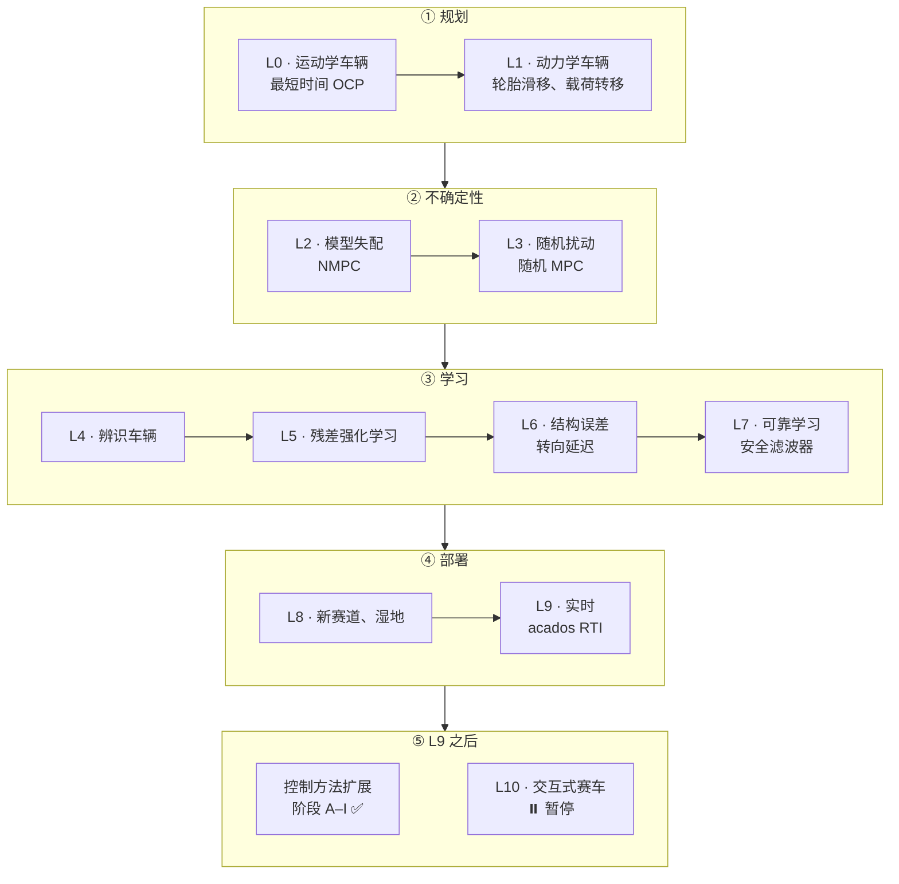

## 🧱 研究层

| 层 | 设定 | 对比的方法 | 状态 |
|---|---|---|---|
| **L0** | 确定性运动学模型 | 最小曲率线 + 准稳态速度曲线；最短时间最优控制；闭环验证 | ✅ [报告](docs/L0.md) |
| **L1** | 带轮胎滑移（魔术公式）与载荷转移的动力学单轨模型 | 动力学模型上的最短时间最优控制；前馈/反馈跟踪；运动学模型遗漏了什么 | ✅ [报告](docs/L1.md) |
| **L2** | 存在模型失配的闭环 | 离线规划 + 跟踪 vs NMPC、约束收紧、蒙特卡洛与单参数敏感性分析 | ✅ [报告](docs/L2.md) |
| **L3** | 随机扰动（沿赛道变化的摩擦、阵风、传感器噪声） | 统一裕度的 NMPC vs 由实测预测误差标定回退量的随机 MPC（四种标定）；消融实验 | ✅ [报告](docs/L3.md) |
| **L4** | 学习车辆 | 从探索圈辨识参数（对记录的动力学做最小二乘）、重新规划、用辨识模型驾驶；噪声敏感性 | ✅ [报告](docs/L4.md) |
| **L5** | 强化学习 | 在 L1 跟踪器之上的残差 SAC，带观测历史，在随机化的车辆与扰动上训练；九次训练，在完整验证圈上选取检查点；在 L2、L3 测试集上对比 | ✅ [报告](docs/L5.md) |
| **L6** | 结构性模型误差（转向执行器延迟） | L1–L5 的固定基线；参数辨识 vs 延迟辨识；结构正确的 NMPC；带不确定性的学习残差动力学；传感器噪声下的 EKF | ✅ [报告](docs/L6.md) · [路线图 L6–L10](docs/ROADMAP_L6-L10.md) |
| **L7** | 可靠学习 | 诊断 L5 各次训练的盲区；在学习策略之上叠加带标定风险估计的 NMPC 安全滤波器；在失败位置前重启回合的训练 | ✅ [报告](docs/L7.md) |
| **L8** | 泛化：新赛道与湿滑路面，逐一考察 | 固定基线与训练好的策略在四条未见过的赛道和湿滑的 Spielberg 上；辨识 + 重规划；短时微调 | ✅ [报告](docs/L8.md) |
| **L9** | 实时：每个控制器在单核上满足 50 ms 控制周期 | 离线实现（IPOPT）vs 同一 OCP 的 acados 实时迭代；延迟补偿；传感器延迟；蒸馏策略 | ✅ [报告](docs/L9.md) |
| **L10** | 交互式赛车（探索性） | 先从一个行为固定的对手开始 | ⏸️ 暂停——其实验方案已保留；先进行了[控制方法扩展](docs/CONTROL_EXPANSION_ROADMAP.md) |

从 L5 开始，每一层都在任何测试圈运行之前写好预注册的实验方案（`docs/L*_protocol.md`，修订记录列在文末）。
点击下方各层查看结果。（各层详细报告为英文。）

<details open>
<summary><b>L0 · 确定性运动学模型</b> —— Spielberg 赛道，带下压力的通用开轮赛车</summary>

<br>

| 规划 | 圈速（理想，摩擦力完全利用） | 圈速（3% 摩擦裕度） | 闭环（仿真器） |
|---|---|---|---|
| 中心线 + 速度曲线 | 77.89 s | – | – |
| 最小曲率线 + 速度曲线 | 72.14 s | 72.89 s | 72.90 s |
| 最短时间最优控制 | **71.26 s** | 72.07 s | **72.10 s** |

OCP 使用 2 m 网格（网格极限 ≈ 71.0 s），速度曲线分辨率 0.5 m；控制步长从 5 ms 到 40 ms，闭环始终保持在
摩擦椭圆的 99.5% 以内。网格与步长研究见 [docs/L0.md](docs/L0.md)。

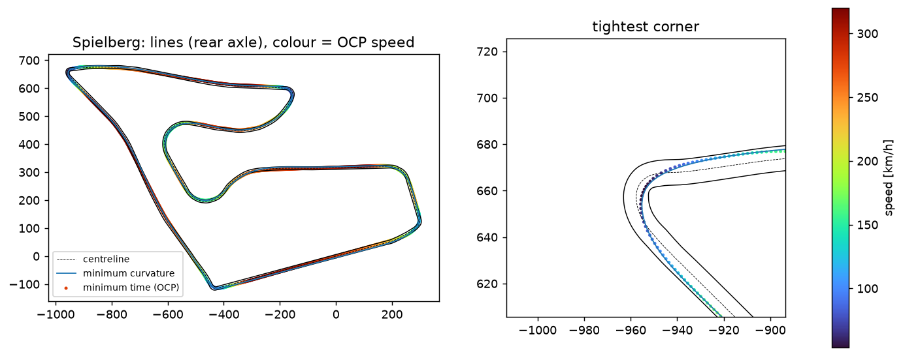

<table>
  <tr>
    <td width="50%">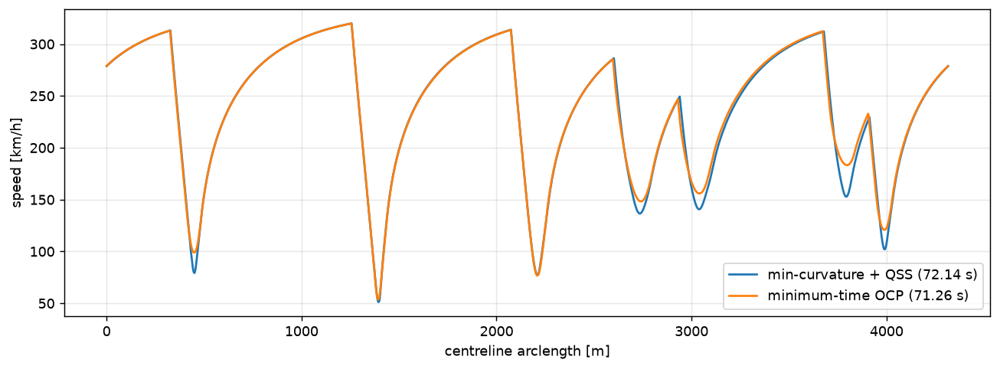</td>
    <td width="50%">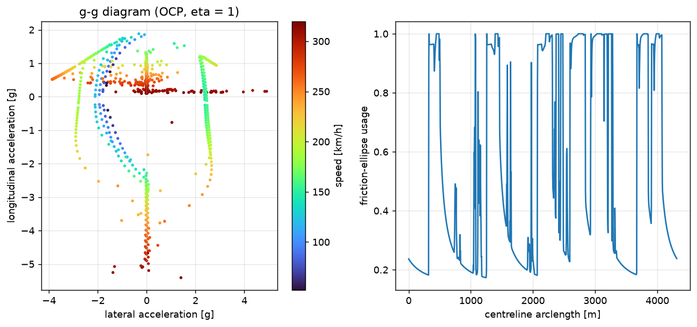</td>
  </tr>
</table>

细节、模型方程与讨论：[docs/L0.md](docs/L0.md)。

</details>

<details>
<summary><b>L1 · 动力学单轨模型</b> —— 运动学模型掩盖了什么</summary>

<br>

| 规划 / 运行 | 圈速 |
|---|---|
| 运动学最优解（L0） | 71.26 s |
| 动力学最优解（理想） | **73.91 s**（+2.6 s：后轮驱动、每轴独立摩擦、滑移） |
| 带 5% 裕度的动力学规划，前馈/反馈跟踪驾驶 | **75.57 s** |
| 运动学规划放到动力学车辆上驾驶 | 在第一个弯打滑失控 |

跟踪器只在很窄的规划裕度与增益范围内能完成一圈；见 [docs/L1.md](docs/L1.md)。

<table>
  <tr>
    <td width="50%">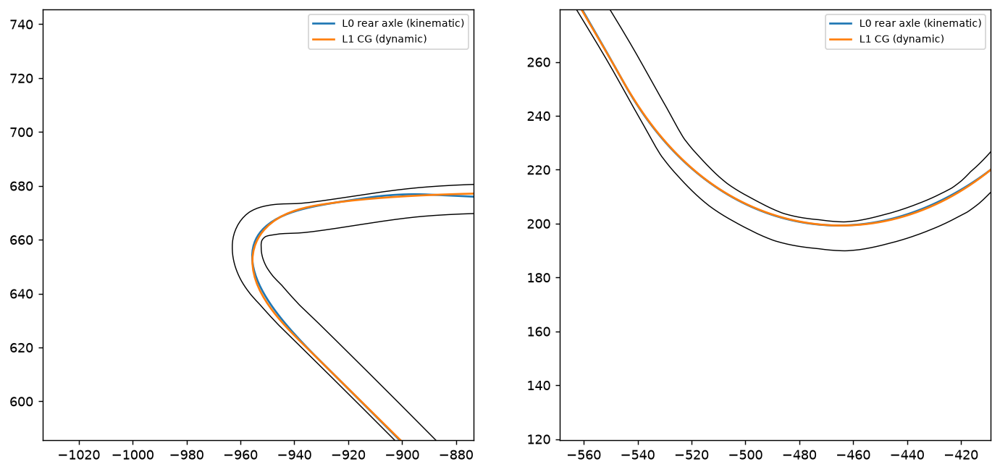</td>
    <td width="50%">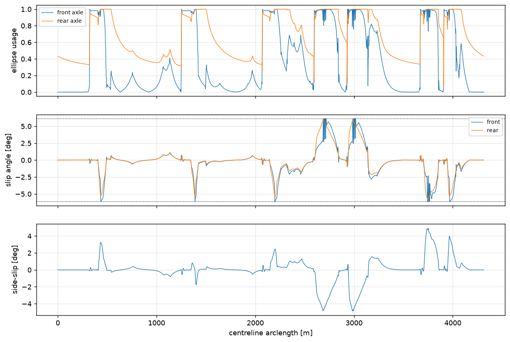</td>
  </tr>
</table>

</details>

<details>
<summary><b>L2 · 模型失配</b> —— 被控车辆的参数与控制器模型不同（51 辆车）</summary>

<br>

| 控制器 | 51 辆车中完成的圈数（95% 区间） | 名义车辆 |
|---|---|---|
| 离线规划（5% 裕度）+ 跟踪 | 3 / 51（1–16%） | 75.57 s |
| 每 50 ms 重规划的 NMPC（5% 裕度） | **22 / 51**（29–58%） | 76.07 s |
| 同一 NMPC，加硬性摩擦 / 滑移约束 | 15 / 51（17–44%） | 75.88 s |
| 12% 裕度的 NMPC | 27 / 51（38–67%） | 78.91 s |

重规划能完成 19 辆跟踪器完成不了的车（反之则一辆没有）。对实测滑移角施加硬约束会让 MPC 问题不可行，
损失 7 辆车。加大裕度帮助不大：剩下的失败车辆转向特性与模型不同（更软的轮胎、不同的气动平衡），
大多在未达到摩擦极限时就已失败；见 [docs/L2.md](docs/L2.md)。

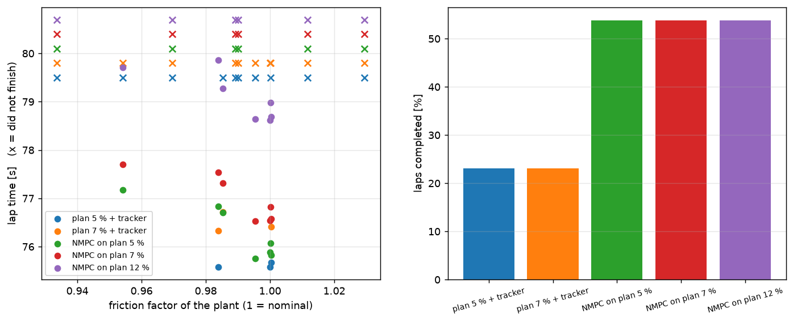

</details>

<details>
<summary><b>L3 · 随机扰动</b> —— 随机摩擦场、阵风与传感器噪声（每种 30 圈）</summary>

<br>

| 控制器 | 完成圈数（95% 区间） | 平均圈速 |
|---|---|---|
| 离线规划 + 跟踪 | 0 / 30（0–12%） | – |
| NMPC，统一 5% 摩擦裕度 | 5 / 30（6–35%） | 77.45 s |
| NMPC，统一 11% 摩擦裕度与 0.8 m 赛道裕度 | 16 / 30（34–72%） | 81.43 s |
| **随机 MPC，ε = 0.05** | **29 / 30**（83–100%） | 78.26 s |
| **随机 MPC，ε = 0.01** | **30 / 30**（88–100%） | 79.20 s |

由实测预测误差标定、沿预测时域递增、同时覆盖摩擦与赛道边界的回退量，让 MPC 比任何统一裕度都更安全、
也更快；另外三种标定方式也能完成 28–30 / 30，而把相同的平均收紧量均匀施加到整个时域只能完成 10 / 30。
见 [docs/L3.md](docs/L3.md)。

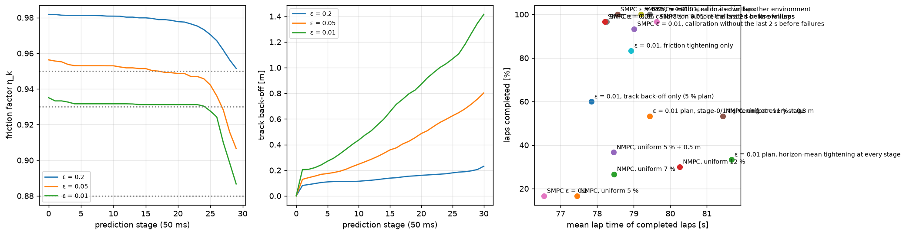

</details>

<details>
<summary><b>L4 · 学习车辆</b> —— L2 的车辆，从一圈探索圈中辨识（25 辆车）</summary>

<br>

| 控制器 | 25 辆车中完成的圈数（95% 区间） | 平均圈速 |
|---|---|---|
| NMPC，名义模型 | 13 / 25（31–72%） | 76.35 s |
| 探索圈（NMPC，12% 裕度） | 16 / 25（43–82%） | 79.21 s |
| **NMPC，辨识模型，重新规划** | **25 / 25**（86–100%） | 76.87 s |
| NMPC，真实模型，重新规划 | 25 / 25（86–100%） | 76.89 s |

即使探索圈以冲出赛道结束，参数也几乎能被精确辨识；用这些参数，控制器表现与已知真实车辆的控制器一样好
（对名义模型 12 比 0，p = 0.0005）。在真实的传感器噪声下，朴素估计有偏差，但仍能完成 22 / 25。见
[docs/L4.md](docs/L4.md)。

<p align="center">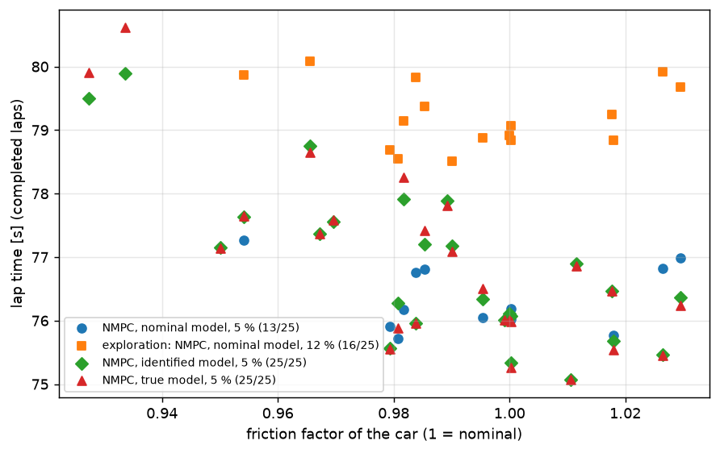</p>

</details>

<details>
<summary><b>L5 · 残差强化学习</b> —— 与 L2、L3 相同的测试集</summary>

<br>

| 控制器 | L2：51 辆车 | L3：30 个扰动圈 |
|---|---|---|
| 仅跟踪器；固定降速 15% | 3 / 51；16 / 51 | 0 / 30；14 / 30 |
| NMPC，名义模型（L2）/ SMPC ε = 0.01（L3） | 22 / 51，76.3 s | 30 / 30，79.2 s |
| 用统一裕度降速的 NMPC | 29 / 51，84.0 s | 17 / 30，85.7 s |
| RL，九次训练的最终检查点 | 19–50 / 51（中位数训练 30–46） | 14–30 / 30（中位数训练 27–29） |
| **RL，在验证圈上选出的检查点** | **51 / 51**，81.2 s | **30 / 30**，81.2 s |

学习得到的策略无需实际车辆的模型，也可能比基于模型的控制器更鲁棒，但单次训练远远不够：几乎每次训练都胜过
名义 NMPC，只有约三分之一胜过降到同样速度的 NMPC，而且大多数训练都有盲区——某个弯几乎在每辆车上都会失败，
训练中却看不出来。通过多次训练并在完整圈上验证，每种设计都得到了好的策略；但它仍比辨识车辆的模型方法
（L4，在有利设定下）或标定裕度的方法（L3）更慢。见 [docs/L5.md](docs/L5.md)。

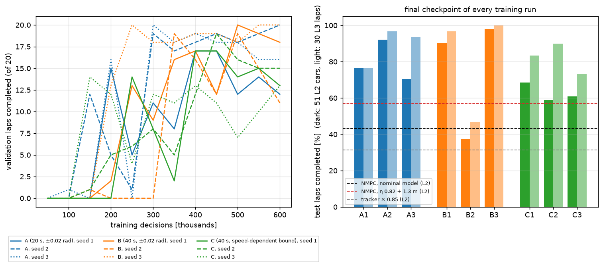

</details>

<details>
<summary><b>L6 · 模型中没有的转向执行器延迟</b> —— L4 的 25 辆车</summary>

<br>

25 辆车中完成的圈数，控制器看到的是自己发出的转向指令：

| 控制器 | τ = 10 ms | τ = 30 ms | τ = 60 ms |
|---|---|---|---|
| NMPC，名义模型 | 12 | 3 | 0 |
| SMPC（L3，标定不变） | 22 | 22 | 9 |
| NMPC，辨识参数（L4） | 22 | 0 | 0 |
| **NMPC + 延迟模型，辨识 τ 与参数** | **25** | **25** | **24** |
| NMPC + 延迟模型，真实车辆（参考） | 25 | 24 | 23 |
| 残差 RL（L5，未改动） | 25 | 24 | 23 |

参数误差和结构误差各自导致失败，两者都必须修正：在错误结构下辨识参数从 30 ms 起就失败，而把延迟和参数一起
辨识则与结构正确的参考相当（圈速 76.8–77.4 s；RL 策略同样可靠，但每圈慢约 4 s）。学习得到的残差模型标定
不足以支撑安全层（对 L7 判定为不可行）。见 [docs/L6.md](docs/L6.md)。

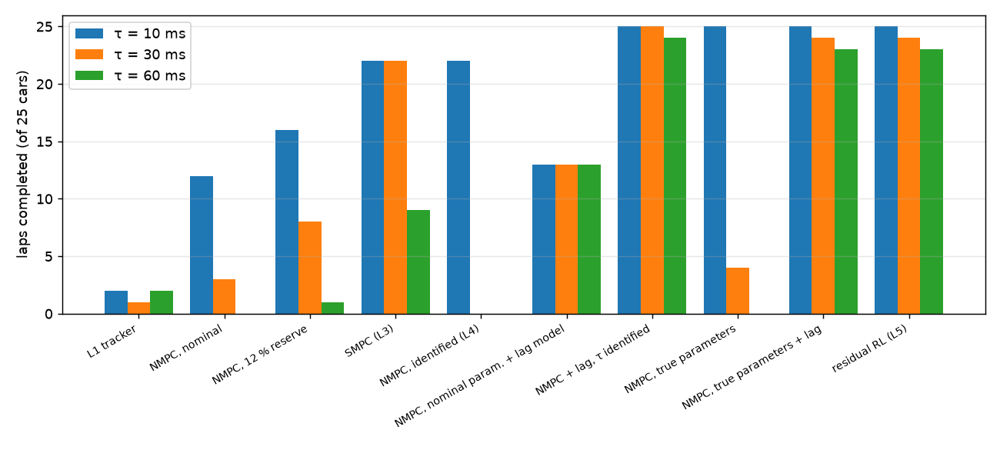

</details>

<details>
<summary><b>L7 · 可靠学习</b> —— 盲区、安全滤波器、从失败中训练</summary>

<br>

* **九次 L5 训练的诊断：** 盲区是少数几个困难弯道，具体在哪个弯失败取决于哪次训练；失败的车辆大多抓地力
  较小。原因究竟是经验不足，还是观测无法及时揭示抓地力，无法从这些数据中区分。
* **安全层（H-B，不成立——结果相反）：** 一个风险估计通过验收测试的 NMPC 安全滤波器，反而降低了全部九个 L5
  最终检查点在测试圈上的完成数（精确符号秩检验 p = 0.0039；选出的策略 102 → 51 / 105）；按 3 秒准则，
  88–99% 的抽样干预是不必要的（上界）。超过一半的滤波后失败发生在一连串求解失败之后。该结论仅针对这个
  滤波器（无求解重试），并非对安全滤波器的一般性结论。
* **从失败中训练（H-C，不成立——结果相反）：** 将 30% 的回合重启在最近的失败位置之前，得到的中位数种子比
  普通训练完成的测试圈更少（50 vs 80 / 105，4 : 34，p = 6·10⁻⁷）；在种子层面两组差异不显著（p = 0.69），
  课程学习的种子分布更分散。在验证圈上选出的检查点达到 104 和 105 / 105（次要结果）。

见 [docs/L7.md](docs/L7.md) 与实验方案 [docs/L7_protocol.md](docs/L7_protocol.md)。

</details>

<details>
<summary><b>L8 · 泛化</b> —— 四条未见过的赛道；湿滑的 Spielberg</summary>

<br>

| 控制器 | 新赛道，25 辆车 × 4 | 湿地，摩擦 × 0.85 / × 0.75（各 25 辆车） |
|---|---|---|
| L1 跟踪器 | 4 / 100 | 0 / 0 |
| NMPC，名义 | 49 / 100 | 0 / 0 |
| SMPC（Spielberg 标定） | 81 / 100 | 0 / 0 |
| **NMPC + 延迟模型，辨识，重规划** | **100 / 100** | **25 / 25** |
| 残差 RL（L5 选出的） | 0 / 100 | 8 / 0 |

两项主要检验均成立（新赛道 100 : 0，p = 1.6·10⁻³⁰；湿地 42 : 0，p = 4.5·10⁻¹³）——仅针对这两个控制器，
其中一个会先跑一圈探索圈再重新规划。22 个训练好的策略没有一个能迁移：在新赛道上最多完成 2 / 100 圈。
在新赛道上叠加 L3 扰动时，SMPC 最可靠（33 / 40）。在目标上短时微调（每个种子约 5 分钟）对部分种子在部分
赛道上有帮助，在 Austin 上没有，在湿地上反而更差。测试赛道按种子抽取（Zandvoort、São Paulo、Austin、
Nürburgring；Norisring 因规划失败按规则被替换）。见 [docs/L8.md](docs/L8.md)。

</details>

<details>
<summary><b>L9 · 实时</b> —— 单核、50 ms 控制周期，T1new + T2new</summary>

<br>

| 控制器（延迟模型，辨识 τ 与参数） | 离线 | 实时 |
|---|---|---|
| IPOPT 求解的 NMPC（与 L2–L8 相同） | 88 / 105 | **0 / 105** |
| 同上，固定 100 ms 延迟补偿 | – | 0 / 105 |
| **同一 OCP 的 acados 实时迭代** | 74 / 105 | **79 / 105** |

两项主要检验均成立：时间限制让 IPOPT 实现丢掉了每一圈（88 : 0，p = 6.5·10⁻²⁷；每个 IPOPT 控制器都在前
237 m 内失败，每次求解都超时），而实时迭代让控制器留在赛道上（79 : 0，p = 3.3·10⁻²⁴；每步反馈约 2.4 ms）
——但低于离线收敛的 IPOPT。20 ms 的传感器延迟会让这个 RTI 控制器从 79 圈降到 0 圈。RL 策略每次决策约
0.3 ms，受时间限制影响很小：选出的策略 99 → 98 / 105；九个 L5 最终检查点变化 −15 到 +2 圈（最大变化
B_s2 53 → 38）。这是在这台机器（WSL，acados v0.6.0）和这一规则下对同一控制器两种实现的比较。见
[docs/L9.md](docs/L9.md)。

</details>

> **尚未完成：** L7–L9 的实验方案要求在第二个 Python 环境中重新运行主要结果；这项工作已推迟
> （见 [STATUS.md](STATUS.md)）。

## 🔬 控制方法扩展（阶段 A–I）

L9 之后，项目没有继续增加新的层，而是横向扩展 L1–L9 的控制方法：共九个阶段，每个阶段都有自己的文献综述、
实验方案、调参车辆与测试车辆（[路线图](docs/CONTROL_EXPANSION_ROADMAP.md)、
[全部结果](docs/CONTROL_EXPANSION_BENCHMARK.md)、[状态](docs/CONTROL_EXPANSION_STATUS.md)）。

| 阶段 | 方法 | 结论 | 关键数字 |
|---|---|---|---|
| **A** | 动力学 MPCC（轮廓控制） | ⚪ 两项主要检验均不成立 | 9 / 25 vs NMPC 10 / 25；两者都完成的 8 辆车上快 0.31 s（p = 0.11） |
| **B** | MPPI，基于采样的 MPC | 🔴 NMPC 更好 | 0 / 50 vs 12 / 50（p = 0.0005） |
| **C** | 鲁棒管道（tube）MPC | 🟢 两项均成立 | 49 / 50 vs 16 / 50（p = 2.3·10⁻¹⁰）；两者都完成时每圈慢 1.61 s |
| **D** | 自适应 MPC，在线辨识 | 🟢 两项均成立 | 42 / 50 vs 15 / 50；圈内抓地力下降时：34 / 50 vs 0 / 50 |
| **E** | 学习型 MPC，逐圈改进 | ⏹️ 未做基准测试即关闭 | 开发阶段门槛未通过（负面的开发结果） |
| **F** | L5 策略外的安全滤波器，带求解重试 | 🟢 H-F2 成立 | 重试使每个检查点的完成圈数中位数 +14（p = 0.0078）；屏蔽器部分已关闭 |
| **G** | L9 规则下的延迟补偿 RTI | 🟢 H-G1 成立 · ⚪ H-G2 未显示差异 | 20 ms 传感器延迟：73 / 105 vs 5 / 105；无延迟：72 vs 72 |
| **H** | ATV-QP 学习型 MPC | ⏹️ 未做基准测试即关闭 | 开发阶段门槛未通过 |
| **I** | 学习型 MPC 后续工作、复现检查 | ⏹️ 未做基准测试即关闭 | 复现检查后 LMPC 方向被关闭 |

## 🚀 快速开始

```bash
python -m venv .venv && .venv/Scripts/activate      # 或：source .venv/bin/activate
pip install -e .[dev]                                # 或先：pip install -r requirements-lock.txt
python scripts/fetch_tracks.py Spielberg             # 下载赛道数据（见"数据"）
python scripts/run_l0.py                             # 约 65 s；写入 results/L0 与 docs/figures/L0
python scripts/l0_studies.py                         # 约 4 分钟；网格 / 步长研究
python scripts/run_l1.py                             # 约 20 分钟；写入 results/L1 与 docs/figures/L1
python scripts/l1_studies.py                         # 约 40 分钟；网格 / 模型 / 跟踪器研究
python scripts/run_l2.py                             # 约 3 小时（8 进程）；51 辆车的蒙特卡洛
python scripts/l2_studies.py                         # 约 20 分钟；单参数敏感性
python scripts/run_l3.py                             # 约 8 小时（12 进程），含标定 / 迭代 / 失败分析；18 个控制器 x 30 个种子
python scripts/run_l4.py                             # 约 3 小时（7 进程）；25 辆车上辨识 + 重规划（噪声：run_l4.py noise）
pip install -e .[rl] && python scripts/l5_multiseed.py   # L5：9 次训练、验证、测试（约 8 小时；选出的策略在 models/L5）
python scripts/run_l6.py plans && python scripts/run_l6.py round1 --taus 0.06   # L6（第 1–4 轮与报告：见脚本）
# L7-L9 在固定到某个提交的 worktree 中运行；步骤与命令见各层报告：
#   L7: docs/L7.md (scripts/l7_partA.py, run_l7.py, run_l7_partB.py, train_l7.py, run_l7_partC.py; RL extras)
#   L8: docs/L8.md (scripts/fetch_tracks.py <track>, l8_plans.py, run_l8.py, report_l8.py)
#   L9: docs/L9.md (WSL with acados, scripts/l9_wsl/; run_l9.py, report_l9.py)
pytest -m "not slow"                                 # 约 2 分钟（完整测试约 12 分钟；若 L1 首个初值失败约 30 分钟）
```

<details>
<summary><b>🎨 重新生成本 README 的媒体素材</b></summary>

<br>

[`docs/media/`](docs/media) 下的所有内容——动画、地图、3D 模型、横幅与结果图——都由同一个脚本基于项目自身的
代码生成（GIF / MP4 需要 ffmpeg）：

```bash
python scripts/make_readme_media.py                 # 全部生成；或例如 `... ghost map stl`
```

它也会同时刷新两份 README 中内嵌的地图与 3D 内容块。

</details>

## 🗂️ 仓库结构

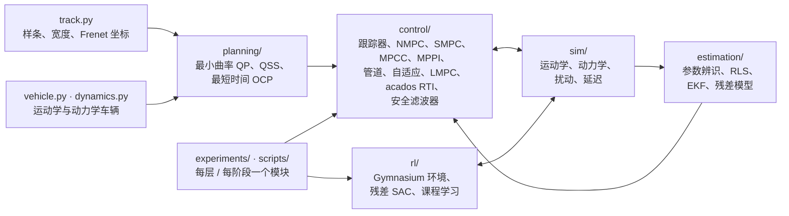

<details>
<summary>文件树</summary>

```
src/f1race/
  track.py          闭合赛道：平滑样条、宽度、Frenet 投影
  vehicle.py        车辆参数、含下压力的摩擦椭圆、功率限制
  dynamics.py       动力学单轨模型（L1）：轮胎、载荷转移、各轴摩擦椭圆
  path.py           闭合路径（赛车线）及其曲率与曲率导数
  planning/         最小曲率 QP、QSS 速度曲线、最短时间 OCP；
                    基于延拓的鲁棒重规划（replan.py，L7 之前）
  control/          路径/速度跟踪（L0）、动力学跟踪器（L1）、NMPC 与实验性的
                    滚动时域最短时间 MPC（L2）；NMPC 的安全滤波模式与 CBF-QP 滤波器
                    （L7，safety_filter.py）；同一 OCP 的 acados 实时迭代实现
                    （L9，acados_mpc.py）；控制扩展中的 MPCC、MPPI、管道、自适应与学习型 MPC
  sim/              带约束监测的时域仿真器；随机扰动（L3）；转向执行器延迟（L6，lagged.py）
  estimation/       从驾驶数据辨识参数（L4）；含延迟的辨识、EKF、残差模型（L6）；RLS 与模型库
  rl/               在跟踪器上做残差 RL 的 Gymnasium 环境（L5）；
                    从失败处开始的课程学习（L7，curriculum.py）
  experiments/      每层、每阶段一个模块（l9_distill.py：L9 的 DAgger 学生策略）
scripts/            数据下载与各层复现脚本；l9_wsl/：L9 的 WSL 环境（acados 构建、版本、运行驱动）；
                    make_readme_media.py：本 README 的媒体素材
tests/              pytest 测试集
docs/               各层报告与图表、实验方案、审查流程；
                    media/：本 README 的动画、地图、3D 模型、横幅与图表
```

</details>

## 🔁 开发流程

每一层都在独立分支上开发，只有通过独立审查后才合并（[docs/workflow.md](docs/workflow.md)、
[STATUS.md](STATUS.md)）：


## 📦 数据

赛道中心线与宽度来自 [TUM FTM racetrack-database](https://github.com/TUMFTM/racetrack-database)（LGPL-3.0）。
本仓库**不**重新分发这些数据：`scripts/fetch_tracks.py` 会从固定的上游提交下载并校验 SHA-256。L0–L7 与 L9
使用 Spielberg；L8 还使用验证赛道 Monza、Sakhir 与测试赛道 Zandvoort、SaoPaulo、Austin、Nuerburgring
（`python scripts/fetch_tracks.py <name>`）。结果目录（`results/`）同样不提交。

`docs/media/` 中的 README 素材只包含计算结果（降采样后的 L0 赛车线），不包含赛道数据。地图的地理锚点曾一次性
拟合到 [bacinger/f1-circuits](https://github.com/bacinger/f1-circuits)（MIT）中的红牛环轮廓；该轮廓本身不包含在
本仓库中。

## 📄 许可证

本仓库代码采用 MIT 许可证（见 [LICENSE](LICENSE)）。赛道数据保留其上游许可证。

<p align="right"><a href="#top">⬆ 返回顶部</a></p>
