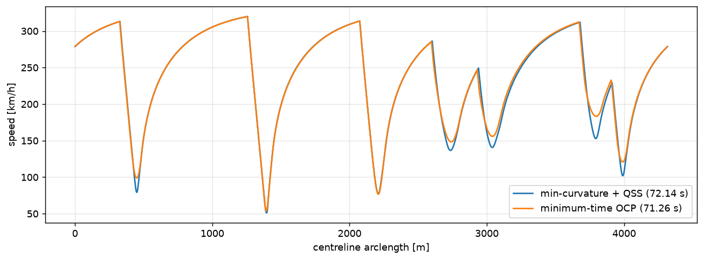
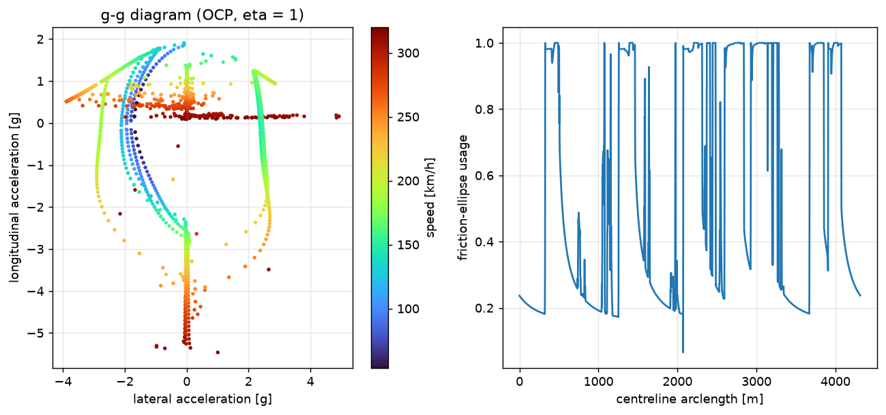
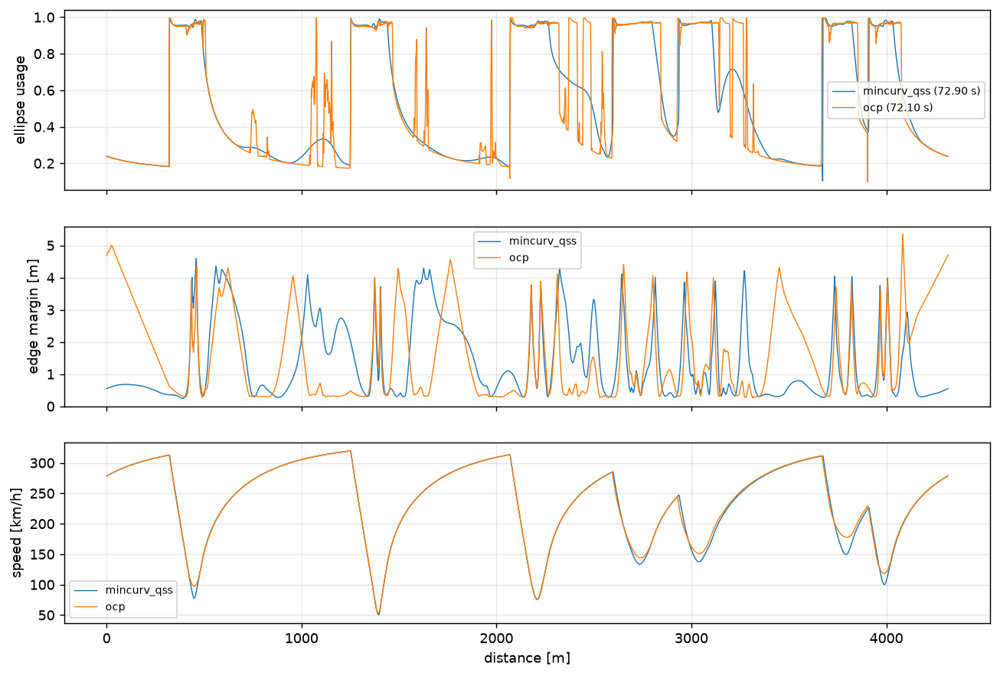

# L0 — deterministic kinematic model

**Question.** For a known, deterministic vehicle model: how much lap time does
each planning method leave on the table, and can a simple feedback controller
actually drive the plan?

## 1. Problem

**Track.** Spielberg (4315.7 m, clockwise) from the TUM racetrack-database. The
centre line is fitted with a periodic smoothing spline (RMS deviation 5 cm) and
re-sampled every metre; the widths to the left/right edge are interpolated
along it (`track.py`).

**Vehicle.** A generic open-wheel racing car (round illustrative numbers, not a
specific car): m = 750 kg, wheelbase L = 3.6 m, half width 1.0 m,
C_dA = 1.1 m², C_lA = 3.5 m², rolling resistance 0.012, μ_x = 1.5, μ_y = 1.6,
P_max = 550 kW, |δ| ≤ 0.4 rad, |δ̇| ≤ 1 rad/s. Top speed 92.5 m/s (333 km/h).

**Model** (kinematic single track, rear-axle reference point, `vehicle.py`):

```
x' = v cos ψ,   y' = v sin ψ,   ψ' = v tan δ / L,   v' = a_x,   δ' = δ̇
m a_x = F_x − ½ρC_dA v² − c_rr F_z,           F_z = m g + ½ρC_lA v²
F_y = m v² tan δ / L
(F_x / μ_x F_z)² + (F_y / μ_y F_z)² ≤ 1,     F_x v ≤ P_max
```

**Track limits.** The car body is represented by the two axle points (rear axle
and front axle, L ahead) widened by the half width: both must stay inside the
edges. Planners add a design margin of 0.3 m. The simulator checks exactly
these two widened points; the body corners ahead of the front axle and behind
the rear axle are not modelled.

Simplifications that later layers remove: no tyre slip or yaw dynamics (L1),
the lateral force is computed at the rear-axle path, one friction ellipse for
the whole car (no axle split, no traction limit of the driven axle).

## 2. Methods

1. **Minimum-curvature line** (`planning/mincurv.py`). Offsets α_i along the
   centre-line normals (every 3 m); minimise the sum of squared periodic second
   differences weighted by 1/Δs⁴ (≈ Σκ²Δs), subject to the lateral bounds of the
   rear axle. The front axle sits on the chord of the path, about ½L²|κ| outside
   it, so the bounds are tightened by that amount (κ of the previous iterate,
   local maximum over 10 m). Box-constrained QP solved with OSQP; weights and
   bounds are updated four times. The points are then fitted with a quintic
   periodic spline (2 cm RMS) so that κ and dκ/ds are continuous.
2. **Quasi-steady-state speed profile** (`planning/qss.py`). On a fixed path the
   steering is δ = atan(Lκ), so the only freedom left is the speed. With
   w = v², the bounds on the tangential acceleration follow from the friction
   ellipse with downforce, the power limit and the resistances; the steering
   rate limit gives v ≤ δ̇_max / |dδ/ds|. Forward (maximum acceleration) and
   backward (maximum braking) passes are repeated until the closed profile is
   periodic. Each segment uses a constant acceleration that is admissible at
   **both** of its ends (the limit is evaluated at the start and at the predicted
   end and the smaller one is used), so the profile is physically feasible at
   every sample (`tests/test_planning.py`). On a constant circle the profile
   converges to the speed where the ellipse leaves exactly enough longitudinal
   force to overcome drag, below the pure lateral limit.
3. **Minimum-time optimal control** (`planning/ocp_kinematic.py`). Frenet
   coordinates of the rear axle along the centre line, arclength as the
   independent variable, states (n, ξ, v, δ), piecewise-constant controls
   (δ̇, F_x), direct multiple shooting with one RK4 step per interval, periodic
   boundary conditions, objective = lap time. Because the force is held over an
   interval, the friction ellipse and the power limit are imposed at both ends
   of each interval. Track limits at the nodes: rear axle n within the bounds,
   front axle approximated in Frenet coordinates as n + L sin ξ (exact for a
   straight centre line) with the same chord allowance ½L²|κ_c| computed from
   the centre-line curvature. IPOPT, started from the minimum-curvature
   solution, converges in 40–65 iterations.
4. **Closed-loop verification** (`sim/kinematic.py`, `control/path_tracking.py`).
   A time-domain RK4 simulator applies the actuator limits and monitors the
   friction ellipse and the track edges; a violation stops the run. Frenet
   projection uses tangents interpolated along each centre-line segment, so the
   progress is continuous (a plain polyline projection jumps by about |n|κΔs at
   every sample on the inside of tight corners). The controller:
   * Lyapunov-based rear-axle path-following law with speed-scheduled gains and
     the plan's own steering as curvature feed-forward;
   * **friction governor**: the commanded steering never asks for more than
     99.5 % of the lateral grip available at the current speed;
   * speed feed-forward a_ref·v/v_ref (the reference is a function of arclength)
     plus feedback k_v = 8 s⁻¹;
   * F_x clipped to what the ellipse leaves (99.5 %) and to the power limit.

   Plans that are executed use 97 % of the friction (η = 0.97).

## 3. Results

Reproduce with `python scripts/run_l0.py` (about 65 s; `results/L0/summary.json`).
Grids: OCP 2 m, QSS on the line re-sampled every 0.5 m, simulator step 20 ms.

| Plan | Ideal (η = 1) | Plan (η = 0.97) | Closed loop | max ellipse usage | min edge margin | max lateral error |
|---|---|---|---|---|---|---|
| centre line + QSS | 77.89 s | – | – | – | – | – |
| minimum curvature + QSS | 72.14 s | 72.89 s | 72.90 s | 0.995 | 0.245 m | 4.0 cm |
| minimum-time OCP | **71.26 s** | 72.07 s | **72.10 s** | 0.995 | 0.262 m | 7.2 cm |



* Using the track width is the biggest single gain (centre line → minimum
  curvature: −5.8 s). Optimising the line for time instead of curvature is
  worth about another second (0.9 s on these grids, 1.1 s for the extrapolated
  limits below): the OCP enters the medium-speed corners differently and
  carries more speed through them (figure above, 2700–4000 m), while the
  slowest hairpin is almost identical.
* Both plans are driven by the feedback controller within 0.04 s of the plan
  (same grid for plan and closed loop).
* The closed loop keeps 0.245–0.26 m from the edges against the 0.3 m design
  margin: the 2 cm smoothing of the line, the tracking error (4–7 cm) and the
  chord approximation for the front axle use part of it.



The g-g diagram shows the effect of downforce: at 300 km/h the car can corner
at more than 4 g, in slow corners at about 2 g.

## 4. Numerical accuracy (`python scripts/l0_studies.py`, ~4 min)

**OCP grid** (η = 1, same initial guess):

| interval length | 8 m | 4 m | 2 m | 1 m | extrapolated |
|---|---|---|---|---|---|
| lap time [s] | 71.746 | 71.433 | 71.262 | 71.157 | ≈ 71.0 |
| IPOPT iterations | 64 | 40 | 50 | 47 | |

The lap time decreases as the grid is refined (successive differences 0.31,
0.17, 0.11 s). The coarse grids are conservative: the force and the steering
rate are held constant over an interval while the friction and power limits
must hold at both of its ends, so on long intervals the held force is set by
the more restrictive end and cannot follow the limit as it changes with speed.
The headline numbers use 2 m (about 0.25 s above the extrapolated limit); plan
and closed loop are compared on the same grid.

**QSS resolution** (minimum-curvature line, η = 1):

| path resolution | 3 m (QP points) | 1 m | 0.5 m | 0.25 m | extrapolated |
|---|---|---|---|---|---|
| lap time [s] | 72.464 | 72.205 | 72.139 | 72.106 | ≈ 72.07 |

The two-end rule of the QSS passes is first-order in the segment length; at
0.5 m the error is about 0.07 s. The OCP-vs-minimum-curvature gap is 0.88 s at
the headline resolutions (2 m / 0.5 m), 0.95 s at the finest ones and about
1.1 s for the extrapolated limits, so the conclusion does not depend on the
grid.

## 5. Robustness to the control step

The plans are executed with the simulator/control step varied (η = 0.97):

| plan, step | closed-loop lap | max usage | steps > 1 | min edge margin | max lateral error |
|---|---|---|---|---|---|
| min. curvature, 5 ms | 72.888 s | 0.9755 | 0 | 0.246 m | 1.1 cm |
| min. curvature, 10 ms | 72.892 s | 0.9924 | 0 | 0.245 m | 2.1 cm |
| min. curvature, 20 ms | 72.903 s | 0.9950 | 0 | 0.245 m | 4.0 cm |
| min. curvature, 40 ms | 72.907 s | 0.9950 | 0 | 0.244 m | 7.8 cm |
| OCP, 5 ms | 72.070 s | 0.9892 | 0 | 0.271 m | 1.7 cm |
| OCP, 10 ms | 72.076 s | 0.9950 | 0 | 0.274 m | 3.5 cm |
| OCP, 20 ms | 72.105 s | 0.9950 | 0 | 0.262 m | 7.2 cm |
| OCP, 40 ms | 72.254 s | 0.9950 | 0 | 0.213 m | 14.2 cm |

Without the friction governor the OCP plan exceeded the ellipse at a 40 ms step
(usage 1.03 even with η = 0.95): with coarse control steps the steering
correction overshoots at the apex, where the plan leaves no lateral slack, and
once the lateral force alone reaches the limit no longitudinal force is left to
correct the speed. Capping the commanded steering by the available grip keeps
the usage at or below 0.995 for every step size; at 40 ms the price is a larger
path error (14 cm) and 0.15 s.



## 6. Lessons that matter for the next layers

* Reference paths must be smooth (continuous κ and dκ/ds) and densely sampled
  for tracking; projecting onto a coarse polyline adds chord errors of
  Δs²κ/8 that the steering feedback amplifies.
* The speed reference is a function of arclength: when the car is faster than
  planned the reference decreases faster in time, so the feed-forward must be
  a_ref·v/v_ref, otherwise speed errors grow in braking zones.
* Near the combined (braking + cornering) limit a small speed excess raises the
  lateral demand, which leaves less braking, which raises the speed excess. A
  stiff speed loop, a planning margin and a grip-aware steering cap break this
  loop.
* A minimum-time plan is at the limit almost everywhere; whatever margin is
  left must be protected by the controller, not by luck in the discretisation.
