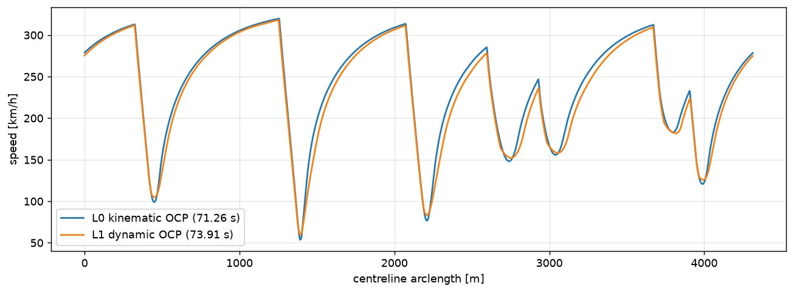
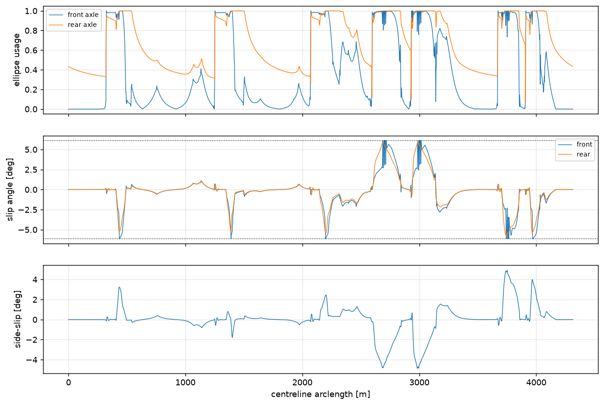
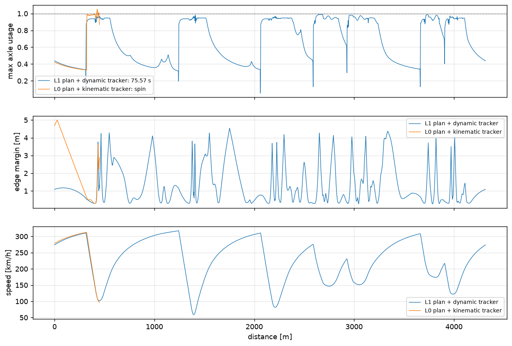

# L1 — dynamic single-track model

**Question.** How much lap time does the kinematic assumption hide, and what does
it take to drive a car that can slide at its limit?

## 1. Model (`dynamics.py`)

Reference point: the centre of gravity. States vx, vy (body-frame velocity),
yaw rate r and steering angle δ; inputs steering rate, drive force on the rear
axle (F_drive ≥ 0) and brake force (F_brake ≤ 0, split 60/40 front/rear).

```
m (v̇x − r vy) = F_xr + F_xf cos δ − F_yf sin δ − ½ρC_dA vx² − c_rr (F_zf + F_zr)
m (v̇y + r vx) = F_yr + F_yf cos δ + F_xf sin δ
I_z ṙ         = l_f (F_yf cos δ + F_xf sin δ) − l_r F_yr
α_f = δ − atan((vy + l_f r)/vx),   α_r = −atan((vy − l_r r)/vx)
F_yi = μ_y F_zi sin(C atan(B α_i))            B = 14, C = 1.6 → peak at α = 6.1°
F_zf = m g l_r/L + 0.45·½ρC_lA v² − m a_x h/L,  F_zr = m g l_f/L + 0.55·½ρC_lA v² + m a_x h/L
(F_xi / μ_x F_zi)² + (F_yi / μ_y F_zi)² ≤ 1   for each axle
```

Same mass, aerodynamics, friction coefficients, power and steering limits as
L0; new: 45 % of the weight on the front axle (l_r = 1.62 m), I_z = 1000 kg m²,
h = 0.30 m. Differences to L0: tyre slip and yaw dynamics, one friction ellipse
per axle with the load transfer between them, drive on the rear axle only,
fixed brake balance.

## 2. Methods

* **Minimum-time OCP** (`planning/ocp_dynamic.py`): curvilinear coordinates of
  the CG along the centre line, six states (n, ξ, vx, vy, r, δ), three inputs,
  2.5 m intervals with two RK4 sub-steps (the lateral tyre dynamics are stiff at
  low speed), friction ellipse of both axles and power at both ends of every
  interval, slip angles on the stable side of the tyre peak, track limits at the
  front and rear axle. IPOPT, each solve capped at 15 min CPU.
* **Continuation over the friction margin** (`experiments/l1.py`): the dynamic
  OCP has several local optima. Started from the kinematic L0 solution, the
  ideal problem converges to 74.61 s; solving a plan with a 3 %
  margin first and warm-starting the ideal problem from it gives
  73.91 s. The pipeline therefore solves η = 0.97 from L0, the ideal from
  that, every margin from the ideal, and the ideal again from the executed plan,
  keeping the best solution for each η.
* **Simulator** (`sim/dynamic.py`): RK4 at 10 ms; forces outside an axle's
  ellipse are scaled back onto it (the tyre slides); a run stops when the body
  leaves the track or the car spins (side-slip > 0.5 rad).
* **Tracker** (`control/dyn_tracking.py`): planned steering plus look-ahead
  feedback δ = δ_ff − k_p (e + x_la sin Δψ) − k_r (r − r_ff) on the course angle
  (heading + side-slip), a front-slip governor (front slip angle within the tyre
  peak), planned force plus speed feedback, and traction control / ABS that keep
  each axle inside 99 % of its ellipse at the current lateral force.

## 3. Results

Reproduce with `python scripts/run_l1.py` (~20 min; `results/L1/summary.json`).

| Plan / run | Lap time | Notes |
|---|---|---|
| L0 kinematic OCP, ideal (η = 1) | 71.26 s | reference (L0, 2 m grid) |
| **L1 dynamic OCP, ideal (η = 1)** | **73.91 s** | 2.5 m grid |
| L1 plans with margin η = 0.97 / 0.95 / 0.93 | 74.89 / 75.60 / 76.35 s | |
| **L1 plan (η = 0.95) + tracker, dynamic car** | **75.57 s** | ellipse usage ≤ 0.99, edge margin ≥ 0.27 m, lateral error ≤ 7 cm, rear slip ≤ 4.3° |
| L0 plan (η = 0.97) + L0 tracker, dynamic car | spins at 450 m | entry of turn 1, axle usage up to 1.05 |



* **The kinematic model overestimates the car by 2.6 s (3.7 %).** The dynamic
  car is slower out of every corner (only the rear axle drives, and its share of
  the grip limits the traction) and slightly slower in the braking zones (one
  ellipse per axle with a fixed brake balance instead of one ellipse for the
  whole car); apex speeds are similar.
* **A kinematic plan cannot be driven on the dynamic car.** The L0 plan with its
  own controller spins at the entry of turn 1: it asks for combined braking and
  turning that the axles, loaded and unloaded by the braking, cannot deliver.
* **The dynamic plan can be driven, but only with more margin.** With 5 % of the
  friction kept in reserve the feed-forward/feedback tracker completes the lap
  within 0.03 s of the plan. With 3 % it never does (section 4): the reserve has
  to absorb yaw transients, not only speed errors as in L0.
* At the limit both axles saturate in every corner; in the fast esses
  (2700–3000 m) the slip angles reach the tyre peak and the side-slip about 5°
  (figure below). The OCP solution chatters node to node where the slip
  constraint is active (piecewise-constant steering rate with constraints at
  both interval ends); the tracker smooths it out.





## 4. Studies (`python scripts/l1_studies.py`, ~40 min)

**OCP grid** (η = 1, warm-started from the ideal plan):

| interval length | 5 m | 2.5 m | 1.25 m | extrapolated |
|---|---|---|---|---|
| lap time [s] | 74.129 | 73.907 | 73.786 | ≈ 73.64 |
| IPOPT iterations | 119 | 93 | 93 | |

As in L0 the coarse grids are conservative; the headline grid (2.5 m) is about
0.27 s above the extrapolated limit. On the same grids the dynamic car is
2.6 s slower than the kinematic one (73.91 vs 71.26 s at 2.5/2 m, 73.64 vs
71.0 s extrapolated).

**Model variants** (ideal lap, warm-started from the L1 ideal plan):

| model | ideal lap |
|---|---|
| L1 model | 73.907 s |
| no longitudinal load transfer (h = 0) | 75.743 s |
| brake balance 50 % front (instead of 60 %) | 73.850 s |
| brake balance 70 % front | 74.415 s |
| half the yaw inertia | 73.849 s |
| L0 kinematic model (reference) | 71.262 s |

Longitudinal load transfer *helps* this car by 1.8 s: under acceleration it
loads the driven rear axle, under braking the front axle that carries 60 % of
the brake force. Halving the yaw inertia gains only 0.06 s, so transient yaw
dynamics are not what costs time; the gap to the kinematic model comes from
the per-axle limits themselves (only the rear axle drives, the brake balance
is fixed). A stiffer-tyre variant is not reported: with three times the
cornering stiffness the lateral dynamics become too stiff for 2.5 m intervals
with two RK4 sub-steps and the optimiser exploits the integration error.

**Robustness of the tracker** (closed loop on the nominal dynamic car, plans
with three margins, eight gain sets; "off track/spin at" gives the distance):

| plan margin η | k_p | x_la | k_r | k_v | result | lap | min edge margin | max lateral error |
|---|---|---|---|---|---|---|---|---|
| 0.97 | (all 8 gain sets) | | | | off track at 2729–2730 m | – | – | 0.24–0.42 m |
| 0.95 | 0.03 | 12 | 0.05 | 8 | off track at 2724 m | – | – | 0.39 m |
| 0.95 | 0.05 | 12 | 0.05 | 4 | off track at 3036 m | – | – | 0.34 m |
| 0.95 | 0.05 | 12 | 0.05 | 8 | **lap** | 75.573 s | 0.220 m | 0.12 m |
| 0.95 | 0.05 | 15 | 0.05 | 8 | **lap** | 75.575 s | 0.258 m | 0.07 m |
| 0.95 | **0.06** | **12** | **0.05** | **8** | **lap** (used) | 75.574 s | 0.267 m | 0.07 m |
| 0.95 | 0.08 | 12 | 0.05 | 8 | **lap** | 75.593 s | 0.234 m | 0.26 m |
| 0.95 | 0.08 | 8 | 0.10 | 8 | **lap** | 75.577 s | 0.175 m | 0.16 m |
| 0.95 | 0.10 | 10 | 0.05 | 8 | off track at 2735 m | – | – | 0.13 m |
| 0.93 | 0.03 | 12 | 0.05 | 8 | **lap** | 76.332 s | 0.069 m | 0.44 m |
| 0.93 | 0.08 | 8 | 0.10 | 8 | **lap** | 76.335 s | 0.170 m | 0.24 m |
| 0.93 | (other 6 gain sets) | | | | spin or off track at 2725–2762 m | – | – | 0.19–0.28 m |

With a 3 % margin no gain set gets through the fast esses (2700–2760 m); with
5 % five of eight do; with 7 % only two. More margin does not make a plan
easier to track here: the 7 % plan is a different local optimum with its own
critical spot in the same section, and every plan is executed open-loop in the
sense that nothing re-plans when the car leaves it. The working window of the
tracker is narrow and has to be found by trial; the speed-loop gain k_v = 8 s⁻¹
and the look-ahead x_la ≥ 12 m are the most important settings.

## 5. Lessons for L2

* **Plan with the model you drive.** A plan from the kinematic model is not
  merely slower to execute on the dynamic car, it is not executable at all.
* **A car that can slide needs a larger reserve** (5 % of the friction instead
  of 3 %): besides speed errors, the reserve has to absorb yaw transients, and
  once the rear tyre passes its peak the car diverges within a fraction of a
  second.
* **The feed-forward/feedback tracker is fragile.** It completes the lap only in
  a narrow window of plan margins and gains (section 4), and nothing re-plans
  when the car leaves the plan. L2 asks how this changes when the controller's
  model is wrong, and whether controllers that re-plan online (MPC) are more
  robust.
* **The dynamic OCP has local optima about 1 % apart**; warm starting across
  friction margins (continuation) finds the better ones.
