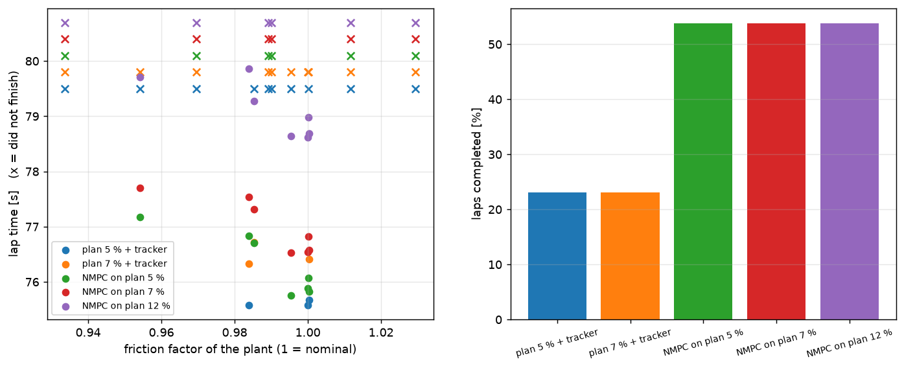

# L2 — closed loop with model mismatch

**Question.** In L1 the controller knew the car exactly. What happens when the
car on the track differs from the model the controllers use, and does a
controller that re-plans online cope better than one that executes an offline
plan?

## 1. Setting

* **Controllers' model:** the nominal L1 dynamic single-track model.
* **Plant:** the same model with perturbed parameters, drawn uniformly with a
  fixed seed (`experiments/l2.py`, 12 samples plus the nominal car):

| parameter | range |
|---|---|
| friction coefficients (both, same factor) | × 0.92 … 1.03 |
| mass | × 1.00 … 1.05 |
| downforce area C_lA | × 0.90 … 1.10 |
| drag area C_dA | × 0.90 … 1.10 |
| yaw inertia | × 0.85 … 1.15 |
| tyre stiffness factor B | × 0.85 … 1.15 |
| front share of the downforce | ± 0.03 |

* Same track, start state, simulator and stopping rules as L1 (off track or
  spin ends the run). One flying lap per controller and plant.

## 2. Controllers

| name | plan | feedback | friction reserve |
|---|---|---|---|
| plan 5 % + tracker | L1 plan, η = 0.95 | L1 tracker (look-ahead steering, speed loop, TC/ABS, front-slip governor) | 5 % in the plan |
| plan 7 % + tracker | L1 plan, η = 0.93 | same | 7 % in the plan |
| NMPC on plan 5 % | L1 plan, η = 0.95 as reference | nonlinear MPC, re-solved every 50 ms | 5 % in plan and MPC |
| NMPC on plan 7 % | L1 plan, η = 0.93 as reference | same | 7 % in plan and MPC |
| NMPC on plan 12 % | plan with η = 0.88 as reference | same | 12 % in plan and MPC |

**NMPC** (`control/nmpc.py`): curvilinear model of the CG (s, n, ξ, vx, vy, r, δ),
30 steps of 50 ms (1.5 s), one RK4 step per MPC step, cost on the deviation from
the reference (n, ξ and speed as functions of s) and on input rates, friction
ellipse of both axles (η), slip angles within the tyre peak, power, steering
limits, and softened track limits for the front and rear axle points. IPOPT with
warm start; if a solve fails, the shifted previous solution is applied. A
low-level traction control / ABS (the L1 `traction_limit`) runs at every 10 ms
simulator step because the MPC input is held for 50 ms while the state moves.

## 3. Results

Reproduce with `python scripts/run_l2.py` (~45 min on 8 processes; needs the
L1 plans from `scripts/run_l1.py`) and `python scripts/l2_studies.py` (~15 min).

**Monte Carlo over 13 plants** (nominal car + 12 perturbed):

| controller | laps completed | mean lap (completed) | nominal car | failures | mean solve |
|---|---|---|---|---|---|
| plan 5 % + tracker | 3/13 | 75.61 s | 75.57 s | off track, spin | – |
| plan 7 % + tracker | 3/13 | 76.49 s | spin @ 2747 m | off track, spin | – |
| NMPC on plan 5 % | 7/13 | 76.32 s | 75.88 s | off track, spin | 297 ms |
| NMPC on plan 7 % | 7/13 | 77.00 s | 76.55 s | off track, spin | 282 ms |
| NMPC on plan 12 % | 7/13 | 79.11 s | 78.62 s | off track, spin | 278 ms |

**Per plant** (lap time, or how and where the run ended):

| friction | mass | C_lA | C_dA | I_z | B | front aero | plan 5 % + tracker | plan 7 % + tracker | NMPC on plan 5 % | NMPC on plan 7 % | NMPC on plan 12 % |
|---|---|---|---|---|---|---|---|---|---|---|---|
| nominal |  |  |  |  |  |  | 75.57 | spin @ 2747 m | 75.88 | 76.55 | 78.62 |
| 0.934 | 1.034 | 1.029 | 1.023 | 0.965 | 1.149 | +0.029 | spin @ 457 m | spin @ 458 m | off track @ 475 m | off track @ 479 m | off track @ 500 m |
| 0.954 | 1.024 | 1.078 | 1.087 | 0.957 | 1.021 | -0.011 | off track @ 2731 m | spin @ 2764 m | 77.17 | 77.70 | 79.71 |
| 0.970 | 1.040 | 0.946 | 0.910 | 0.971 | 0.910 | -0.025 | off track @ 1406 m | spin @ 2752 m | off track @ 470 m | off track @ 470 m | off track @ 468 m |
| 0.984 | 1.015 | 1.034 | 0.940 | 1.133 | 0.960 | -0.024 | 75.58 | 76.33 | 76.84 | 77.54 | 79.87 |
| 0.985 | 1.017 | 0.978 | 1.078 | 0.918 | 1.037 | -0.025 | off track @ 2734 m | 76.71 | 76.71 | 77.31 | 79.28 |
| 0.989 | 1.046 | 0.988 | 1.091 | 1.000 | 0.978 | +0.007 | spin @ 471 m | spin @ 2721 m | off track @ 2753 m | spin @ 2758 m | spin @ 2767 m |
| 0.990 | 1.013 | 0.908 | 0.903 | 1.094 | 1.124 | +0.006 | spin @ 2714 m | spin @ 2715 m | spin @ 2765 m | spin @ 2747 m | off track @ 2731 m |
| 0.995 | 1.033 | 1.038 | 0.978 | 0.891 | 1.066 | +0.002 | off track @ 2727 m | spin @ 2757 m | 75.76 | 76.53 | 78.64 |
| 1.000 | 1.027 | 1.087 | 1.063 | 0.851 | 1.107 | -0.028 | off track @ 3024 m | off track @ 3023 m | 76.08 | 76.82 | 78.98 |
| 1.000 | 1.009 | 1.073 | 1.008 | 0.940 | 0.977 | -0.028 | 75.68 | 76.41 | 75.82 | 76.58 | 78.68 |
| 1.012 | 1.039 | 0.948 | 1.075 | 0.868 | 0.951 | -0.021 | spin @ 2740 m | off track @ 2735 m | off track @ 3834 m | off track @ 3839 m | off track @ 3837 m |
| 1.029 | 1.047 | 0.992 | 1.052 | 0.999 | 1.009 | +0.017 | off track @ 2724 m | off track @ 2725 m | spin @ 2763 m | spin @ 2749 m | off track @ 3039 m |

**One parameter at a time** (each parameter at the ends of its range, the rest
nominal):

| parameter | value | plan 5 % + tracker | NMPC on plan 5 % |
|---|---|---|---|
| friction | × 0.92 | spin at 467 m | off track at 2740 m |
| friction | × 1.03 | spin at 2787 m | 75.72 s |
| mass | × 1.05 | spin at 2728 m | off track at 3835 m |
| downforce C_lA | × 0.9 | spin at 2720 m | spin at 3824 m |
| downforce C_lA | × 1.1 | spin at 2764 m | 75.73 s |
| drag C_dA | × 0.9 | 75.53 s | 75.69 s |
| drag C_dA | × 1.1 | spin at 2772 m | 76.20 s |
| yaw inertia | × 0.85 | off track at 3033 m | 75.88 s |
| yaw inertia | × 1.15 | spin at 3100 m | 75.89 s |
| tyre stiffness B | × 0.85 | spin at 2244 m | off track at 2723 m |
| tyre stiffness B | × 1.15 | off track at 2730 m | 75.72 s |
| front downforce share | − 0.03 | off track at 3041 m | 75.88 s |
| front downforce share | + 0.03 | spin at 2720 m | off track at 497 m |

## 4. Discussion

* **The offline plan with feed-forward/feedback tracking has no tolerance for
  model error.** It completes 3 of 13 random plants and 1 of 13 single-parameter
  changes, and fails even when the car has *more* grip or downforce than the
  model. The feed-forward forces and steering are computed for the nominal car;
  on any other car they are wrong, and the feedback, already working in the
  narrow window found in L1, cannot absorb the difference at the limit.
* **Re-planning online roughly doubles the success rate** (NMPC: 7 of 13 random
  plants, 8 of 13 single-parameter changes) at a cost of about 0.3 s on the
  nominal car (75.88 vs 75.57 s): the MPC re-plans from the measured state every
  50 ms and respects the friction and track constraints of its model.
* **The NMPC fails exactly where the plant has less usable grip than its model
  assumes**: lower friction, more mass, less downforce, softer tyres, or a
  front-heavier aero balance (which unbalances the car towards oversteer). It
  copes with every change that makes the car more capable. A 5 % friction
  reserve in the model does not cover a plant whose effective grip is lower
  than that somewhere on the lap.
* **A little more reserve does not change the picture** (7 % plan: tracker 3/13,
  NMPC 7/13, mostly the same plants fail): margin only helps if it covers the
  actual uncertainty. Even a 12 % reserve, which costs 2.7 s on the
  nominal car (78.62 s), completes the same 7 of 13 cars. The remaining failures
  happen in the same few corners (turn 1 at ≈ 470 m, the fast esses at
  2720–2770 m, ≈ 3040 m, ≈ 3835 m). Half of the six failures at 12 % never
  reach the friction limit (largest axle usage of the run 0.92–0.97, rear slip
  ≤ 4.2°): the car simply drifts off the reference line where the track leaves
  no room; the other half end with the rear tyre past its peak. The mismatch in
  the lateral and yaw response (tyre stiffness, aero balance, mass, inertia) is
  what the reserve does not cover. A fixed
  friction reserve cannot fix a wrong model of how the car turns.
* **Computational cost:** the NMPC needs about 0.3 s per solve in Python/IPOPT
  (re-solved every 50 ms of simulated time), far from real time; a code-generated
  solver (e.g. acados) would be needed on a car.
* **Receding-horizon minimum time (attempted, not in the comparison).**
  Optimising lap time over the next 200 m instead of tracking a reference
  (`control/rh_mpc.py`, exploratory runs with `scripts/try_rh_mpc.py`) did not
  complete a lap in eight configurations on the nominal car (40–80 nodes,
  2.5–5 m intervals, friction reserve 5–7 %, limits at one or both interval
  ends): it left the track at turn 1 (≈ 350–470 m), at the slowest hairpin
  (≈ 1270–1390 m) or, with the finer grids, right after the start; solves took
  0.7–12 s on average with 10–20 % hitting the iteration limit. The spatial
  horizon is needed because a 1.5 s time-domain horizon is too short for the
  braking zones (≈ 150 m at 85 m/s; a time-domain progress-maximising MPC left
  the track at turn 1 for that reason), but it makes the NLP large and hard to
  warm-start. It is kept in the repository as an experimental controller.

## 5. Lessons for L3 and L4

* Re-planning helps, but a controller is only as robust as its model of how the
  car turns: a fixed friction reserve is either too small (failures on cars
  with less grip) or wasted (2.7 s at 12 %), and it does not cure errors in the
  lateral/yaw response at all.
* L3 adds stochastic disturbances (noise, gusts, friction varying along the
  track) and asks how to size the reserve from the uncertainty (chance
  constraints, scenarios). L4 asks whether the car can *learn* its actual grip
  online and recover the time the reserve costs.
