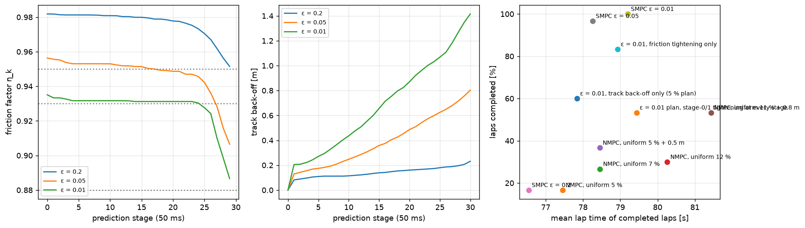

# L3 — stochastic disturbances

**Question.** L2 sized the friction reserve by hand and found it either too
small or wasted. If the car meets random disturbances whose *statistics* are
known, can the reserve be derived from them, and does a reserve shaped by the
uncertainty (chance-constrained MPC) beat a uniform one?

## 1. Setting

The car is the nominal L1 car (no parameter mismatch, unlike L2). On every lap
it meets a new realisation of three disturbances (`sim/stochastic.py`, all
seeded so that every controller meets the same realisations):

| disturbance | model | size |
|---|---|---|
| friction along the track | f(s) = 1 + σ g(s), g a periodic Gaussian process with squared-exponential correlation, scales both axles' friction | σ = 3 %, correlation length 100 m (f between 0.91 and 1.09 over 200 samples) |
| lateral gusts | Ornstein–Uhlenbeck force at the CG, plus the yaw moment of the force acting 0.3 m ahead of it | σ = 300 N (0.04 g), correlation time 1 s |
| measurement noise | white Gaussian noise on the state the controller sees | 5 cm position, 0.3° heading, 0.1 / 0.05 m/s velocities, 0.6°/s yaw rate, 0.06° steering |

The controllers know these statistics, not the realisation; they all use the
nominal model. Calibration laps use seeds 1000–1005, test laps seeds 0–29.

## 2. Controllers

| name | reference | friction factor in the MPC | track limits |
|---|---|---|---|
| plan 5 % + tracker | L1 plan η = 0.95 | – (tracker of L1) | – |
| NMPC, uniform 5 / 7 / 12 % | L1 plan with the same η | η = 0.95 / 0.93 / 0.88 at every stage | body + 0.3 m |
| NMPC, uniform 5 % + 0.5 m / 11 % + 0.8 m | plan with η = 0.95 / 0.89 and track margin 0.8 / 1.1 m | η = 0.95 / 0.89 at every stage | body + 0.8 / 1.1 m |
| SMPC ε = 0.2 / 0.05 / 0.01 | plan with η = min_k η_k (rounded down) | η_k per stage, from the calibration | body + 0.3 m + b_k |
| ablations of ε = 0.01 | as SMPC (friction only, flat) or the 5 % plan (track only) | η_k / 0.95 / η_0 at every stage | body + 0.3 m / + b_k / + b_1 at every stage |

All MPCs are the L2 NMPC (soft friction, slip and track limits, 30 × 50 ms,
traction control at every simulator step). The uniform baselines with a track
margin and the three ablations were added after a first look at the results
(with the hard-limit NMPC of the first L2 version, since replaced): the
baselines match the SMPC's average friction and track reserves, the ablations
take one part of its tightening away.

**Chance-constrained tightening** (`experiments/l3.py`, `calibrate`). Each
predicted constraint should hold with probability 1 − ε on the real car:

* *friction*: the plant's ellipse holds if the car's usage, measured with the
  nominal friction, stays below the local factor f. For stage k of a prediction
  made at time t, the realised car at t + k·50 ms gives the error
  d = u_real − u_pred + (1 − f). The MPC uses η_k = 1 − q_k, q_k the (1 − ε)
  quantile of d over all predictions whose stage-k usage is near the limit
  (u_pred ≥ 0.85).
* *track limits*: b_k = (1 − ε) quantile of the lateral error of the axle points
  between prediction and realisation.

The errors are collected from the certainty-equivalent NMPC (uniform 5 %) on
six calibration laps; both back-offs are made non-decreasing along the
horizon. This is the empirical form of the constraint tightening used in
stochastic MPC with probabilistic reachable sets: instead of propagating a
covariance through a linearised model, the distribution of the closed-loop
prediction error is measured.

**Calibration.** The certainty-equivalent NMPC finished one of the six
calibration laps and had no solver fallback. Errors between the prediction and
the realised car (near-limit usage samples): the usage error has a spread of
0.012 at stage 0 and 0.050–0.065 from stage 1 on
(the input is re-planned after 50 ms); with the friction field it becomes
0.057–0.073. The 95 % quantile of the lateral error grows from
0.12 m at stage 0 to 0.76 m at stage 29. The resulting tightening:

| ε | η at stage 0 / 10 / 20 / 29 | track back-off [m] at stage 1 / 10 / 20 / 30 | reference plan |
|---|---|---|---|
| 0.2 | 0.982 / 0.981 / 0.978 / 0.952 | 0.08 / 0.11 / 0.16 / 0.23 | η = 0.95 |
| 0.05 | 0.956 / 0.953 / 0.949 / 0.907 | 0.13 / 0.25 / 0.49 / 0.80 | η = 0.90 |
| 0.01 | 0.935 / 0.932 / 0.931 / 0.887 | 0.21 / 0.44 / 0.87 / 1.42 | η = 0.88 |

## 3. Results

Reproduce with `python scripts/run_l3.py` (calibration, the plans with the
margins needed, and 13 controllers × 30 seeds; about 5 h on 12 processes;
needs the L1 plans and the 12 % plan of L2).

| controller | laps completed | 95 % interval | mean lap (completed) | lap std | time over the plant's ellipse | failures | mean solve |
|---|---|---|---|---|---|---|---|
| plan 5 % + tracker | 0/30 | 0–12 % | – | – | 4.07 % | off track @ 1408 m; off track @ 1410 m; off track @ 2713 m; off track @ 2727 m; off track @ 2729 m; spin @ 2221 m; spin @ 2225 m; spin @ 2228 m; spin @ 2712 m; spin @ 2715 m; spin @ 2717 m; spin @ 2718 m; spin @ 2720 m; spin @ 2721 m; spin @ 2722 m; spin @ 2724 m; spin @ 2725 m; spin @ 2726 m; spin @ 2728 m; spin @ 2733 m; spin @ 2752 m; spin @ 2782 m; spin @ 467 m; spin @ 468 m; spin @ 470 m; spin @ 474 m; spin @ 476 m; spin @ 486 m | – |
| NMPC, uniform 5 % | 5/30 | 6–35 % | 77.45 s | 0.36 s | 1.54 % | off track @ 2217 m; off track @ 2226 m; off track @ 2699 m; off track @ 2732 m; off track @ 3810 m; off track @ 3811 m; off track @ 3815 m; off track @ 3823 m; off track @ 3826 m; off track @ 3831 m; off track @ 3832 m; off track @ 3833 m; off track @ 3835 m; off track @ 3840 m; off track @ 3846 m; off track @ 4000 m; off track @ 4007 m; off track @ 4019 m; off track @ 464 m; off track @ 465 m; off track @ 470 m; off track @ 474 m | 455 ms |
| NMPC, uniform 7 % | 8/30 | 12–46 % | 78.46 s | 0.58 s | 0.56 % | off track @ 2216 m; off track @ 2219 m; off track @ 2732 m; off track @ 2748 m; off track @ 3803 m; off track @ 3826 m; off track @ 3828 m; off track @ 3830 m; off track @ 3837 m; off track @ 3843 m; off track @ 4005 m; off track @ 4012 m; off track @ 4017 m; off track @ 4021 m; off track @ 461 m; off track @ 464 m; off track @ 465 m; off track @ 466 m; off track @ 469 m; off track @ 470 m | 453 ms |
| NMPC, uniform 12 % | 9/30 | 15–49 % | 80.26 s | 0.44 s | 0.01 % | off track @ 2216 m; off track @ 2223 m; off track @ 2726 m; off track @ 2766 m; off track @ 3026 m; off track @ 3825 m; off track @ 3830 m; off track @ 3838 m; off track @ 3841 m; off track @ 3844 m; off track @ 3998 m; off track @ 461 m; off track @ 463 m; off track @ 465 m; off track @ 466 m; off track @ 468 m; off track @ 470 m; off track @ 476 m | 439 ms |
| NMPC, uniform 5 % + 0.5 m | 11/30 | 20–56 % | 78.45 s | 0.57 s | 1.81 % | off track @ 2209 m; off track @ 2218 m; off track @ 2700 m; off track @ 3815 m; off track @ 3823 m; off track @ 3827 m; off track @ 3828 m; off track @ 3829 m; off track @ 3999 m; off track @ 4001 m; off track @ 4004 m; off track @ 459 m; off track @ 462 m; off track @ 463 m; off track @ 464 m; off track @ 465 m; off track @ 468 m | 456 ms |
| NMPC, uniform 11 % + 0.8 m | 16/30 | 34–72 % | 81.43 s | 0.42 s | 0.01 % | off track @ 2212 m; off track @ 2220 m; off track @ 2717 m; off track @ 3811 m; off track @ 3823 m; off track @ 3824 m; off track @ 3828 m; off track @ 462 m; off track @ 464 m; off track @ 466 m; off track @ 467 m | 428 ms |
| SMPC ε = 0.2 | 5/30 | 6–35 % | 76.54 s | 0.35 s | 5.87 % | off track @ 2221 m; off track @ 2716 m; off track @ 2739 m; off track @ 3062 m; off track @ 3807 m; off track @ 3811 m; off track @ 3813 m; off track @ 3816 m; off track @ 3819 m; off track @ 3822 m; off track @ 3828 m; off track @ 3836 m; off track @ 3838 m; off track @ 3840 m; off track @ 3847 m; off track @ 4002 m; off track @ 4012 m; off track @ 462 m; off track @ 464 m; off track @ 466 m; off track @ 469 m; off track @ 472 m | 449 ms |
| SMPC ε = 0.05 | 29/30 | 83–100 % | 78.26 s | 0.33 s | 0.93 % | off track @ 3808 m | 433 ms |
| SMPC ε = 0.01 | 30/30 | 88–100 % | 79.20 s | 0.18 s | 0.19 % | - | 437 ms |
| ε = 0.01, friction tightening only | 25/30 | 65–94 % | 78.93 s | 0.16 s | 0.28 % | off track @ 3808 m; off track @ 3839 m; off track @ 4020 m; off track @ 457 m; off track @ 471 m | 424 ms |
| ε = 0.01, track back-off only (5 % plan) | 18/30 | 41–77 % | 77.84 s | 0.43 s | 1.08 % | off track @ 2713 m; off track @ 3818 m; off track @ 3819 m; off track @ 3821 m; off track @ 3822 m; off track @ 3825 m; off track @ 3826 m; off track @ 3828 m; off track @ 3829 m; off track @ 3831 m | 433 ms |
| ε = 0.01 plan, stage-0/1 tightening at every stage | 16/30 | 34–72 % | 79.44 s | 0.35 s | 0.44 % | off track @ 1398 m; off track @ 2750 m; off track @ 3806 m; off track @ 3816 m; off track @ 3831 m; off track @ 3841 m; off track @ 3999 m; off track @ 4003 m; off track @ 459 m; off track @ 461 m; off track @ 463 m; off track @ 464 m; off track @ 470 m | 402 ms |

"Time over the plant's ellipse": fraction of the simulator steps in which an
axle of the real car (with the local friction factor) was asked for more than
its friction ellipse allows.

**Paired comparisons** (the same 30 disturbance realisations; exact McNemar
test on the seeds that only one of the two completes):

| comparison (same seeds) | only the first completes | only the second | exact McNemar p |
|---|---|---|---|
| SMPC ε = 0.05 vs NMPC, uniform 5 % | 24 | 0 | 1.19e-07 |
| SMPC ε = 0.05 vs NMPC, uniform 11 % + 0.8 m | 13 | 0 | 0.000244 |
| SMPC ε = 0.01 vs NMPC, uniform 11 % + 0.8 m | 14 | 0 | 0.000122 |
| SMPC ε = 0.01 vs NMPC, uniform 12 % | 21 | 0 | 9.54e-07 |
| SMPC ε = 0.01 vs ε = 0.01 plan, stage-0/1 tightening at every stage | 14 | 0 | 0.000122 |
| SMPC ε = 0.01 vs ε = 0.01, friction tightening only | 5 | 0 | 0.0625 |
| SMPC ε = 0.01 vs ε = 0.01, track back-off only (5 % plan) | 12 | 0 | 0.000488 |
| NMPC, uniform 5 % vs plan 5 % + tracker | 5 | 0 | 0.0625 |

## 4. Discussion

* **A reserve derived from the measured uncertainty works; uniform reserves do
  not.** The chance-constrained MPC completes 29 (ε = 0.05) and 30 (ε = 0.01) of
  30 disturbed laps. The certainty-equivalent NMPC completes 5, and no uniform
  reserve gets above 16 of 30 – not even one with roughly the SMPC's average
  friction and track reserves (11 % and 0.8 m), which is also 2.2 s slower
  (81.4 s against 79.2 s). The tracker of L1 completes none.
* **The shape along the horizon is what matters.** The SMPC keeps a small
  reserve for the next steps, which the car can still correct, and a large one
  for the end of the horizon, which it cannot. Using the near-term tightening at
  every stage (same reference plan) completes only 16 of 30 (14 to 0,
  p = 10⁻⁴). This is the structure of tube / stochastic MPC with reachable sets:
  the uncertainty grows with the prediction time, so must the back-off. A
  uniform reserve large enough for the end of the horizon (the 11 % + 0.8 m
  baseline) leaves too little room right now, and the NLP is then tight from the
  first stage on.
* **Both parts of the tightening are needed.** Without the track back-off
  (friction tightening only) 25 of 30 complete (5 to 0, p = 0.06); without the
  friction tightening (track back-off only, 5 % plan) 18 of 30 (12 to 0,
  p = 5·10⁻⁴). Most failures of every controller are track-limit violations at
  the same four places (turn 1 at 460–475 m, 2210–2230 m, the fast esses, and
  3800–3850 m), not friction: under gusts and noise the car drifts, and a
  friction reserve does not keep it on the track.
* **ε behaves as a risk knob.** ε = 0.2 (a reserve of about 2 %) completes 5 of
  30, as the certainty-equivalent NMPC; ε = 0.05 and 0.01 complete 29 and 30, at
  78.3 and 79.2 s. The fraction of time the real car exceeds its friction ellipse
  (5.9 %, 0.9 % and 0.2 %) stays below ε, as a per-stage chance constraint
  should, but ε is not the probability of finishing the lap.
* **Caveats.** The back-offs are calibrated on the prediction errors of the
  certainty-equivalent NMPC; under the SMPC the errors are different (smaller
  near the limit), so the calibration is conservative rather than exact, and an
  iteration (re-calibrating with the SMPC) was not tried. The stages are treated
  separately: there is no guarantee for the whole horizon or the whole lap.
  Thirty laps per controller give 95 % intervals of about ±15 percentage points
  in the middle of the range.

## 5. Lessons for L4

* Knowing the *statistics* of the disturbances is enough to size the reserves –
  if the reserves grow with the prediction horizon and cover both friction and
  track limits.
* The reserves cost time (79.2 s against 77.5 s for the few laps the
  certainty-equivalent controller finishes). L4 asks whether the car can learn
  what it does not know and give some of that time back.
