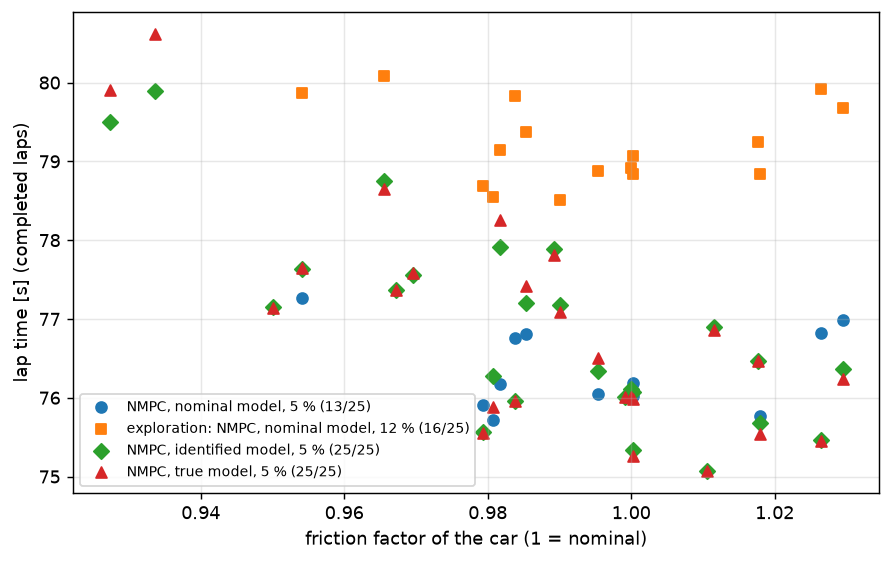

# L4 — learn the car, then drive it

**Question.** L2 showed that a controller built on the nominal model fails on
cars that differ from it, and that a larger friction reserve does not help; L3
showed that a reserve shaped by the uncertainty does. If the car can be
*identified* from its own driving data, how much of the gap to a controller
that knows the car exactly does that close?

## 1. Setting

The same perturbed cars as L2 (`experiments/l2.sample_plants`, seed 0: the
nominal car and perturbed friction, mass, downforce, drag, yaw inertia, tyre
stiffness and aero balance), no stochastic disturbances. Every car drives

1. an **exploration lap** with a cautious controller (the L2 NMPC with a 12 %
   reserve on the 12 % plan). It does not have to finish: the data up to a
   failure are used as well;
2. **identification** of the seven parameters from the logged states and
   applied inputs (`estimation/identify.py`): nonlinear least squares on the
   body accelerations, computed over each 10 ms simulator step and paired with
   the mid-step state and the held input; samples with a saturated axle
   (usage ≥ 0.98, where the simulator scales the forces onto the ellipse) and
   the last 0.2 s before a stop are excluded. The saturation filter uses the
   usage the simulator computes with the true friction, which a real car does
   not know; the reviewer checked that this does not matter here (saturated
   samples are 0–0.3 % of the data; without the filter the largest error is
   0.17 %, and a two-step filter with the usage of the first estimate gives the
   same estimates). The noise study below uses the same (clean) filter;
3. **re-planning**: the minimum-time OCP of L1 with the identified model
   (5 % margin), warm-started from the nominal plan;
4. a lap with the **NMPC using the identified model** on the new plan.

For comparison every car also drives the L2 NMPC with the nominal model
(baseline) and the same pipeline with the true parameters ("oracle", what
perfect knowledge buys).

## 2. Results

Reproduce with `python scripts/run_l4.py` (25 cars, about 3 h on 7 processes;
needs the L1 plans and the 12 % plan of L2).

| controller | laps completed | 95 % interval | mean lap (completed) |
|---|---|---|---|
| NMPC, nominal model, 5 % | 13/25 | 31–72 % | 76.35 s |
| exploration: NMPC, nominal model, 12 % | 16/25 | 43–82 % | 79.21 s |
| NMPC, identified model, 5 % | 25/25 | 86–100 % | 76.87 s |
| NMPC, true model, 5 % | 25/25 | 86–100 % | 76.89 s |

| comparison (same cars) | only the first completes | only the second | exact McNemar p |
|---|---|---|---|
| NMPC, identified model, 5 % vs NMPC, nominal model, 5 % | 12 | 0 | 0.000488 |
| NMPC, identified model, 5 % vs exploration: NMPC, nominal model, 12 % | 9 | 0 | 0.00391 |
| NMPC, true model, 5 % vs NMPC, identified model, 5 % | 0 | 0 | 1 |

Lap time identified minus true model, on the 25 cars both complete: mean -0.026 s, largest 0.724 s.

Per car (lap time, or how and where the run ended)

| friction | mass | C_lA | B | front aero | nominal model | exploration | identified | true model | identification error (max over parameters) |
|---|---|---|---|---|---|---|---|---|---|
| nominal |  |  |  |  | 76.07 | 78.91 | 76.11 | 76.02 | 0.0002 (Iz) |
| 0.927 | 1.017 | 0.986 | 0.928 | -0.015 | off track @ 471 m | off track @ 471 m | 79.50 | 79.90 | 0.0005 (ClA) |
| 0.934 | 1.034 | 1.029 | 1.149 | +0.029 | off track @ 2751 m | off track @ 3842 m | 79.89 | 80.62 | 0.0002 (Iz) |
| 0.950 | 1.035 | 1.089 | 0.868 | -0.007 | off track @ 470 m | off track @ 468 m | 77.15 | 77.14 | 0.0007 (ClA) |
| 0.954 | 1.024 | 1.078 | 1.021 | -0.011 | 77.27 | 79.86 | 77.64 | 77.65 | 0.0004 (Iz) |
| 0.966 | 1.037 | 1.042 | 1.069 | +0.026 | off track @ 3830 m | 80.08 | 78.76 | 78.65 | 0.0004 (Iz) |
| 0.967 | 1.024 | 1.095 | 0.931 | +0.022 | off track @ 2771 m | off track @ 3831 m | 77.37 | 77.37 | 0.0003 (m) |
| 0.970 | 1.040 | 0.946 | 0.910 | -0.025 | off track @ 470 m | off track @ 469 m | 77.56 | 77.58 | 0.0014 (ClA) |
| 0.979 | 1.022 | 1.086 | 1.034 | -0.028 | 75.91 | 78.69 | 75.57 | 75.55 | 0.0001 (ClA) |
| 0.981 | 1.030 | 1.070 | 1.123 | -0.027 | 75.72 | 78.54 | 76.28 | 75.88 | 0.0006 (Iz) |
| 0.982 | 1.014 | 0.983 | 1.138 | -0.008 | 76.17 | 79.15 | 77.91 | 78.26 | 0.0001 (m) |
| 0.984 | 1.015 | 1.034 | 0.960 | -0.024 | 76.75 | 79.83 | 75.95 | 75.96 | 0.0002 (m) |
| 0.985 | 1.017 | 0.978 | 1.037 | -0.025 | 76.81 | 79.38 | 77.21 | 77.42 | 0.0003 (Iz) |
| 0.989 | 1.046 | 0.988 | 0.978 | +0.007 | off track @ 2753 m | off track @ 3830 m | 77.89 | 77.81 | 0.0004 (Iz) |
| 0.990 | 1.013 | 0.908 | 1.124 | +0.006 | off track @ 3830 m | 78.52 | 77.18 | 77.09 | 0.0001 (Iz) |
| 0.995 | 1.033 | 1.038 | 1.066 | +0.002 | 76.05 | 78.87 | 76.34 | 76.50 | 0.0002 (ClA) |
| 0.999 | 1.001 | 1.052 | 0.870 | +0.020 | off track @ 2758 m | off track @ 2757 m | 76.00 | 76.00 | 0.0002 (m) |
| 1.000 | 1.027 | 1.087 | 1.107 | -0.028 | 76.18 | 79.07 | 76.07 | 75.98 | 0.0005 (Iz) |
| 1.000 | 1.009 | 1.073 | 0.977 | -0.028 | 76.02 | 78.84 | 75.33 | 75.26 | 0.0001 (ClA) |
| 1.010 | 1.021 | 1.066 | 0.874 | +0.009 | off track @ 3833 m | off track @ 3830 m | 75.07 | 75.07 | 0.0002 (m) |
| 1.012 | 1.039 | 0.948 | 0.951 | -0.021 | off track @ 3834 m | off track @ 3837 m | 76.89 | 76.86 | 0.0002 (ClA) |
| 1.018 | 1.011 | 0.925 | 1.016 | +0.019 | off track @ 3832 m | 79.24 | 76.46 | 76.46 | 0.0005 (Iz) |
| 1.018 | 1.041 | 0.996 | 1.127 | -0.014 | 75.76 | 78.85 | 75.68 | 75.54 | 0.0002 (Iz) |
| 1.026 | 1.001 | 1.073 | 0.895 | +0.028 | 76.82 | 79.92 | 75.46 | 75.46 | 0.0001 (ClA) |
| 1.029 | 1.047 | 0.992 | 1.009 | +0.017 | 76.99 | 79.68 | 76.36 | 76.24 | 0.0001 (ClA) |

* **Identification is essentially exact on noise-free data.** The largest
  parameter error over all 25 cars is 0.14 % (C_lA of one car); most are below
  0.05 %. A partial lap is enough: nine of the exploration laps end off track
  (at turn 1, the fast esses or 3830 m), and their data identify the car as well
  as a completed lap does.
* **With the identified model the NMPC completes every car**, including the 12
  that the NMPC with the nominal model cannot drive (12 to 0, p = 0.0005) and
  the 9 on which even the cautious exploration lap fails. It is as good as
  knowing the parameters exactly: the NMPC with the true model also completes all
  25, and the lap times differ by −0.03 s on average (largest 0.72 s, in either
  direction; the re-planned references differ slightly, and differences of a
  few tenths between single laps are not meaningful, as in L2).
* **The identified car is driven at its own limit.** Re-planning with the
  identified model makes cars with more grip or downforce faster than the
  nominal controller (e.g. 75.46 instead of 76.82 s), and cars with less grip
  slower but on the track (e.g. 79.50 s where the nominal controller leaves the
  track at turn 1).
**With measurement noise** (`python scripts/run_l4.py noise`, ~1 h): the same
pipeline with the L3 noise levels (5 cm, 0.1 m/s, 0.6°/s, …) added to the logged
exploration data, the same least squares without any filtering. The
controllers themselves still see the true state, so that only the
identification is affected.

| parameter | friction | mass | C_lA | C_dA | I_z | B | front aero |
|---|---|---|---|---|---|---|---|
| mean error | +0.066 | −0.031 | −0.149 | +0.005 | +0.495 | −0.052 | −0.000 |
| largest error | 0.292 | 0.051 | 0.489 | 0.009 | 0.649 | 0.264 | 0.039 |

The yaw inertia hits the upper bound of the search range (1.5) in 21 of the 25
estimates and C_lA the lower bound (0.6) in 3, so their "mean errors" are bound
effects rather than meaningful bias estimates, and the Jacobian-based standard
deviations of those estimates are not valid.
With noisy data the NMPC with the identified model completes 22 of 25 cars
(clean data: 25; nominal model: 13; noisy against nominal 10 to 1, p = 0.012;
clean against noisy 3 to 0, p = 0.25). The parameters are clearly biased:
noise on the regressors (the measured states enter the model nonlinearly)
inflates the friction and the yaw inertia and deflates the downforce. The
errors partly compensate: overestimated friction with underestimated downforce
predicts roughly the right grip at speed; the three cars that fail are two of
the three with the least friction (0.927 and 0.950, at turn 1) and one at
3843 m. Identification from real data needs filtering or an errors-in-variables
method (e.g. an extended Kalman filter estimating states and parameters
together); this layer only shows that the naive estimate degrades gracefully.

* The method an earlier version used to compute the accelerations (central
  differences of the velocities, paired with the state and input at the sample)
  biased the yaw inertia by about 5 % because the input changes at the sample;
  pairing each step's velocity difference with the mid-step state and the input
  held over the step removes the bias.

## 3. Lessons for L5

* In this setting what the controllers of L2 lacked was knowledge of the car,
  not robustness: one lap of data (even a crashed one) and the same
  optimisation tools turn a 13-of-25 controller into a 25-of-25 one, as fast as
  a controller that knows the car exactly. The setting is favourable: the cars
  differ from the model only in seven parameters of the *same* model structure,
  and the data are noise-free. With a structural model error (unmodelled
  dynamics, a different tyre law) identifying parameters would not be enough;
  that is where learned residual models or model-free learning come in.
* Identification from noisy data is biased but still useful; a proper state and
  parameter estimator is the obvious next step for a real car.
* L5 asks the opposite question: can a learning controller that never builds a
  model do as well?
