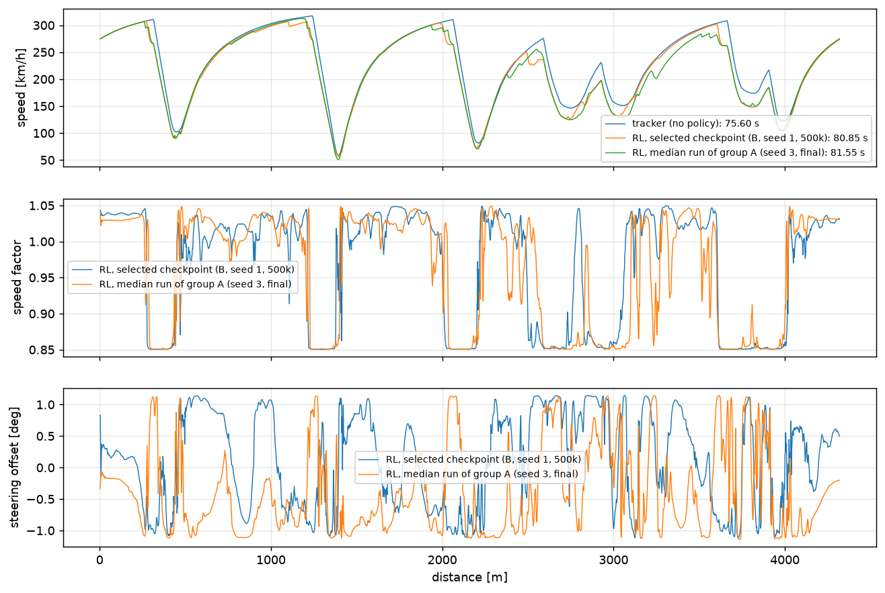

# L5 — reinforcement learning

**Question of the whole series.** In which settings does a learning-based
controller beat a model-based one, and why? L5 trains a policy by reinforcement
learning and puts it on the test sets of L2 (cars that differ from the model)
and L3 (random disturbances).

## 1. Method: residual RL on top of the tracker

Learning to drive a racing car at the limit from scratch takes far more
samples than this simulator in Python can deliver in a reasonable time. The
policy therefore learns a *correction* to the L1 feed-forward/feedback tracker
on the nominal 5 % plan (`rl/env.py`):

* **action** (every 50 ms, held in between): a steering offset of up to
  ±0.02 rad added to the tracker's command, and a factor on the reference speed
  between 0.85 and 1.05: the policy can learn where to keep a reserve and where
  it can go faster than the plan;
* **observation** (19 numbers): lateral and course-angle error, body velocities,
  yaw rate, steering angle, speed error, front and rear slip angle relative to
  the tyre peak, curvature of the plan 10–150 m ahead, plan speed 25–100 m ahead,
  distance of the car to the nearer track edge, the current speed factor;
* **reward**: progress along the track (metres / 5) per decision, minus 50 when
  the car leaves the track or spins (the episode ends), minus a small penalty on
  the action;
* **episodes**: 20 s from a random point of the plan; every episode a new car
  (parameters drawn from the L2 ranges) and, in half of the parallel
  environments, the L3 disturbances (friction field, gusts, measurement noise)
  with a new seed. Training seeds and test seeds are disjoint.
* **algorithm**: soft actor-critic (stable-baselines3), two hidden layers of 256,
  8 parallel environments.

The environment reproduces the L1 closed loop exactly when the policy outputs
zero (75.574 s on the nominal car). Its projection onto the track uses a scalar
version of `Track.project` (`rl/env.PointProjector`) with a warm-start index (identical results, about
15 times faster for a single point).

Two policies are trained, 600 000 decisions each (about 4.5 h with 8
environments on a shared machine): one that sees only the current observation,
and one that sees the last eight observations and its last action ("history"),
so that it can infer how the car in front of it responds – the implicit
counterpart of the identification of L4. Reproduce with
`python scripts/train_l5.py 600000 sac_residual`,
`L5_HISTORY=8 python scripts/train_l5.py 600000 sac_history8` and
`python scripts/run_l5.py <name>` (needs `pip install -e .[rl]`). The two trained
policies are in `models/L5/` (stable-baselines3 format), so the evaluation can be
reproduced without training.

**A correction.** A first version of the environment copied the tracker
without its drive cut (no drive force while the rear slip angle is near the
tyre peak). It reproduced the nominal lap exactly, so the omission went
unnoticed until the bare tracker in the environment was compared with the L2
and L3 runs on perturbed cars. Policies trained on that version are discarded;
with the cut, the bare tracker in the environment reproduces the L2 and L3
tracker runs (same outcome and failure position on all compared cars and seeds;
`tests/test_l5.py`).

## 2. Results

The test sets are those of L2 (51 cars: nominal and 50 with perturbed
parameters, no disturbances) and L3 (30 disturbance realisations on the
nominal car). Training used other random cars and seeds.

| controller | L2: laps completed (95 % interval) | mean lap | L3: laps completed (95 % interval) | mean lap |
|---|---|---|---|---|
| tracker alone (L1) | 3/51 (1–16 %) | 75.61 s | 0/30 (0–12 %) | – |
| **residual RL** | **50/51** (90–100 %) | 83.82 s | **30/30** (88–100 %) | 83.93 s |
| **residual RL with history** | **51/51** (93–100 %) | 82.04 s | **30/30** (88–100 %) | 81.99 s |
| for comparison: NMPC, nominal model (L2) | 22/51 (29–58 %) | 76.31 s | 5/30 (6–35 %) | 77.45 s |
| NMPC, 12 % reserve (L2, L3) | 27/51 (38–67 %) | 79.20 s | 9/30 (15–49 %) | 80.26 s |
| SMPC ε = 0.01 (L3) | – | – | 30/30 (88–100 %) | 79.20 s |
| NMPC with the identified model (L4, 25 of the L2 cars) | 25/25 | 76.87 s | – | – |

* **The learned policy is the most robust controller of the series.** With
  history it completes every car and every disturbed lap; on the L2 cars it
  completes 29 that the NMPC does not and none the other way round
  (p = 4·10⁻⁹). It needs no model of the car at run time and costs a forward
  pass of a small network every 50 ms instead of an NLP.
* **It pays for that with lap time.** On the 22 cars the NMPC completes it is
  5.6 s slower (4.9–6.1 s; without history 7.4 s); on the disturbed laps 2.8 s
  slower than the SMPC (2.3–3.2 s); 5 s slower than the NMPC with the
  identified model of L4.
* **It is cautious everywhere rather than adaptive.** Its lap times vary by
  only 1 s across the 51 cars (81.6–82.6 s with history), while the cars'
  capabilities differ by several seconds (75.1–79.9 s with their identified
  models in L4). On the nominal car it pins the speed factor at its lower
  bound (0.85) into every braking zone and corner and uses the steering offset
  mostly at its bounds (figure below). Trained across the whole range of cars
  with a large penalty for leaving the track, the policy has learned the
  equivalent of a uniform reserve placed at the corners – robust, like the
  12 % reserve of L2 but far more effective, because it is placed where it
  matters. The history helps a little (1.8 s faster, 51 instead of 50 cars),
  but does not turn the policy into one that drives each car at its own limit.

* **Caveats.** The policy was trained on the same distribution of cars and
  disturbances as the test sets (in distribution, different samples); the
  model-based controllers of L2 used no such prior, the SMPC of L3 used the
  disturbance statistics. The result depends on the reward (the crash penalty
  sets how much time the policy trades for safety), on the action bounds (the
  speed factor sits at its lower bound in the corners, so a wider range might
  slow it down further) and on the training budget (the mean episode reward
  rose until about 260 000 decisions and fluctuated between 140 and 170 after
  that, for both policies; longer training or other hyper-parameters were not
  tried).

## 3. Conclusion of the series

*In which settings does a learning-based controller beat a model-based one,
and why?*

* **When the model is wrong and nothing is learned about the car, the learned
  policy wins on robustness** (L2 setting: 51 of 51 against 22 of 51), because
  it was trained to survive the whole range of cars, which the nominal-model
  MPC never saw.
* **It loses on performance.** A model-based controller that either learns the
  car (L4: identify from one lap, re-plan, 25 of 25 at 76.9 s) or sizes its
  reserve from the measured uncertainty (L3: 30 of 30 at 79.2 s) is as robust
  and 3–5 s faster. The structure that makes them fast – a model that can be
  identified, a prediction whose error grows with the horizon – is exactly what
  the model-free policy has to replace by a blanket of caution.
* The obvious combination, not tried here, is to give the learning controller
  the model-based structure (learned residual dynamics inside an MPC, or a
  learned terminal cost) or to give the MPC the policy's robustness prior.
