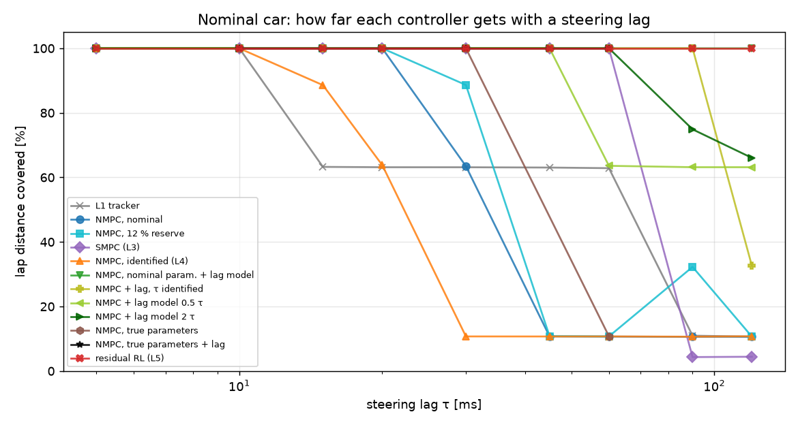

# L6 — when the model is wrong in its structure

> **Draft, results incomplete.** Sections 3–7 are filled in when the runs of
> [L6_protocol.md](L6_protocol.md) have finished.

**Question.** L4 showed that identifying the parameters closes the gap to a
controller that knows the car – when the model has the right structure. What
happens when it has not: which of the methods of L2–L5 still work, and how far
are they from a controller with the correct structure?

## 1. Setting

Everything as in L4 (the nominal car and the first 24 cars of L2, no
disturbances), plus one error that no parameter of the controllers' model can
reproduce: a **first-order steering actuator lag** (`sim/lagged.py`). The
controllers command a steering rate as before; it moves the commanded angle
δ_c; the road wheels follow with δ' = (δ_c − δ)/τ, and the tyre forces depend
on δ. In the main condition the controllers see their own commanded angle –
the road-wheel angle is not measured, so the lag is hidden in how the car
responds. That is the harder setting; many cars measure the rack angle (an
ablation, section 4).

| controller | model | lag in the model | plan |
|---|---|---|---|
| L1 tracker | nominal | no | 5 % |
| NMPC (L2) | nominal | no | 5 % |
| NMPC with a uniform 12 % reserve (the L4 exploration lap) | nominal | no | 12 % |
| SMPC ε = 0.01 (L3, calibration unchanged) | nominal | no | 12 % |
| NMPC, identified (L4) | identified from the exploration lap | no | re-planned |
| NMPC, true parameters | true | no | re-planned |
| NMPC + lag model | nominal | true τ | 5 % |
| NMPC + lag model, τ and parameters identified | identified with τ | identified τ | re-planned |
| NMPC + lag model, true parameters (correct-structure reference) | true | true τ | true-car plan |
| residual RL (L5, B_s1_500k, unchanged) | – | – | 5 % |

The lag-aware NMPCs integrate the lag exactly over each MPC step and
reconstruct the road-wheel angle from their own commands (an open-loop
observer, exact without noise). The identification with the lag
(`estimation/identify.identify_with_lag`) filters the logged commanded angle
through a lag with the candidate τ and fits τ together with the seven
parameter factors; like L4 it excludes saturated samples with the plant's true
friction usage (privileged information, disclosed in L4).

The protocol – controllers, τ levels, comparisons, the go / no-go criterion for
L7 – was written before the result-producing runs and amended after the
reviewer's design review, before the 25-car runs (amendments A1–A8). All
laps run from a worktree pinned to one commit (`results/L6/RUN_COMMIT`).

## 2. The lag alone: sweep on the nominal car

Lap time, or where the car left the track or spun (lap 4315 m):

| controller | 5 ms | 10 ms | 15 ms | 20 ms | 30 ms | 45 ms | 60 ms | 90 ms | 120 ms |
|---|---|---|---|---|---|---|---|---|---|
| L1 tracker | 75.58 | 75.58 | off @ 2730 m | off @ 2725 m | off @ 2725 m | spin @ 2721 m | spin @ 2712 m | spin @ 473 m | spin @ 460 m |
| NMPC, nominal | 76.05 | 76.11 | 76.27 | 76.93 | off @ 2739 m | off @ 463 m | off @ 461 m | off @ 458 m | off @ 458 m |
| NMPC, uniform 12 % reserve | 78.89 | 78.78 | 78.84 | 78.98 | off @ 3824 m | off @ 466 m | off @ 463 m | off @ 1392 m | off @ 459 m |
| SMPC (L3) | 78.88 | 78.92 | 78.84 | 78.92 | 78.86 | 78.82 | 78.96 | spin @ 186 m | spin @ 191 m |
| NMPC, identified (L4) | 76.06 | 76.21 | off @ 3823 m | off @ 2753 m | off @ 463 m | off @ 462 m | off @ 463 m | off @ 459 m | off @ 465 m |
| NMPC + lag model (true τ) | 76.01 | 76.03 | 76.03 | 76.01 | 76.08 | 76.06 | 76.02 | 76.07 | 76.05 |
| NMPC + lag model, τ identified | 76.08 | 76.00 | 76.18 | 76.03 | 76.03 | 76.05 | 76.02 | 76.00 | off @ 1406 m |
| NMPC + lag model with 0.5 τ | 76.03 | 76.05 | 76.08 | 76.35 | 76.40 | 76.49 | off @ 2744 m | off @ 2725 m | off @ 2725 m |
| NMPC + lag model with 2 τ | 76.08 | 76.02 | 76.06 | 76.10 | 76.42 | 77.05 | 77.04 | off @ 3232 m | off @ 2850 m |
| residual RL (L5) | (pending) | 80.88 | | | 81.03 | | 81.01 | | |

Without a lag the nominal NMPC laps in 76.07 s (L2).

* **Every controller without the lag in its model has a lag it cannot take.**
  The tracker fails from 15 ms, the NMPC from 30 ms – a lag of a few hundredths
  of a second; in the failing laps the road wheels trail the command by at most
  0.009 rad (tracker, 15 ms) and 0.020 rad (NMPC, 30 ms). A uniform friction reserve does not move that limit (12 %:
  also from 30 ms).
* **The L3 SMPC tolerates up to 60 ms**, at its usual pace (78.8–79.0 s). Its
  back-offs were calibrated on friction, gust and sensor-noise errors, not on a
  lag; it is their shape – track margins growing along the horizon, 0.2 m at
  the first step to 1.4 m at the end – that also absorbs the late response of
  the car. From 90 ms it spins in the first corner.
* **Identification without the lag makes things worse.** The L4 identification
  explains the late response of the car by a larger yaw inertia: 1.15 times
  the true one at 5 ms, 1.30 at 10 ms, and its upper bound (1.5) from 15 ms on,
  with the other factors following at larger τ (three factors on their bounds at
  60 ms, four at 120 ms). The NMPC with this model fails from 15 ms, where the nominal NMPC
  still completes. The fit is stable – the residual rms only grows with τ – but
  the parameters are wrong in a way that hurts.
* **The correct structure removes the problem**: with the true τ the lag-aware
  NMPC laps in 76.01–76.08 s at every τ up to 120 ms, as fast as without a lag.
  τ can be identified: one exploration lap – even the 460 m before it leaves
  the track at 60 ms – gives τ within 0.2 % and the parameters within 0.2 %;
  with these estimates the NMPC completes up to 90 ms. At 120 ms it left the
  track at 1406 m after 45 failed solves (of 509; mean solve time 1.0 s instead
  of 0.37 s) – with a practically exact model, so the cause is numerical, in a
  single run.
* **A wrong time constant costs robustness gradually**: a model with half the
  true τ completes up to 45 ms, one with twice the true τ up to 60 ms (with
  1 s more lap time) – still far beyond the 20 ms of the nominal NMPC.
* **The residual RL policy completes at every τ tried so far**, at its usual
  pace (≈ 81 s): it observes the last eight observations and its last action,
  and was trained on a range of cars – a lag looks to it like one more car.

## 3. Lag and parameter errors: the 25 cars

(pending: 1b at 10, 30 and 60 ms)

## 4. Ablation: the road-wheel angle measured

(pending)

## 5. Residual learning and its uncertainty (round 2)

(pending)

## 6. Sensor noise (round 3)

(pending)

## 7. Second environment

(pending: `.venv-311`, the sweep 1a and `nmpc`, `identified`, `oracle_struct` at
60 ms)

## 8. Discussion and consequences for L7

(pending)
